**ДИПЛОМНЫЙ ПРОЕКТ · ЭТАП 2**

# Рынок решений для оптимизации всасывания и лекарственных форм

Международный обзор: экспертные процессы, цифровая автоматизация, ИИ, механистические модели и экспериментальные платформы

**Дата проверки:** 18 октября 2026 года

**Основа:** техническое задание DESCR(1).md и одобренный отчёт первого этапа от 17 октября 2026 года.

**Содержание:** пять глав; 20 функциональных схем; два графика по опубликованным данным; отдельная проектная схема; аннотированный реестр ссылок.

Аналитический обзор открытых первоисточников. Не является регуляторным заключением, лабораторной валидацией или результатом испытания всех программных продуктов.

## Содержание

- [Метод и границы исследования](#method)
- [Глава 1. Какие способы решения проблемы существуют](#chapter-1)
- [Глава 2. Функции и эксплуатационные особенности решений](#chapter-2)
- [Глава 3. Эффективность: что действительно подтверждено](#chapter-3)
- [Глава 4. Архитектуры и схемы процессов](#chapter-4)
- [Глава 5. Что работает для данной проблемы и что следует делать в дипломе](#chapter-5)
- [Приложение. Аннотированный реестр источников](#sources)

## Метод и границы исследования

Объект сравнения — системы, которые помогают специалисту выбрать и обосновать изменение лекарственной формы, вспомогательных веществ или формы субстанции. Исходное ТЗ дополнительно включает пролекарства, синтез, мониторинг исследований и экспорт. Это требования проекта, а не доказанные возможности будущей платформы [P01](#source-P01). Выводы первого этапа используются как исходная постановка: анализировать нужно конкретное вещество, твёрдую форму, продукт, дозу и цель, а не только название молекулы [P02](#source-P02).

Поиск был организован по задачам: formulation strategy selection, drug–excipient compatibility, formulation machine learning, self-driving formulation laboratory, PBPK/PBBM, formulation optimization, solid-form screening, retrosynthesis и evidence/citation benchmarks. Рассматривались официальные страницы производителей и разработчиков, оригинальные статьи, код и руководства регуляторов. Обзор охватывает международные решения, но не претендует на исчерпывающий реестр компаний, оценку долей рынка или всех локальных игроков.

**Доказательные статусы в отчёте:** «поставщик заявляет» означает подтверждённое наличие заявления, а не независимую проверку результата; «исследование показало» относится только к описанной выборке и конечной точке; «проектный вывод» обозначает авторское решение на основании сравнения. Неустановленная функция помечается как не подтверждённая в рассмотренных материалах, а не как отсутствующая в продукте.

Программы не запускались на общем наборе препаратов; платные кабинеты и конфиденциальные корпоративные данные не исследовались. Для FormulationDT, SwissADME, ADMETlab и работы Lu использовались библиографические записи и доступные описания/аннотации; это отмечено в реестре. Для FormulationDE прочитаны полный текст и таблицы PDF; для FormulationAI — полный текст издателя. Схемы коммерческих продуктов восстанавливают публично описанный процесс, а не раскрывают их внутренний код.

Возраст источника оценивается относительно вопроса. Руководство 2009 года пригодно для описания QbD, но не для утверждения о текущем тарифе. Результат статьи 2024 года характеризует опубликованную модель, но не гарантирует идентичное устройство сервиса в 2026 году. На корпоративных страницах дата обращения не подменяется годом публикации.

# Глава 1. Какие способы решения проблемы существуют

## 1.1. Рынок состоит не из одного класса продуктов

Практически значимое сравнение требует отделить **выбор стратегии**, **прогноз свойства**, **моделирование экспозиции**, **получение экспериментальных данных** и **подготовку доказательного решения**. FormulationDT выбирает направления разработки; ADMETlab оценивает свойства молекул; GastroPlus моделирует PK; Quotient Sciences продаёт интегрированную программу разработки. Объявить один из них «самым точным ИИ» без общей задачи нельзя.  [S05](#source-S05) [S12](#source-S12) [S13](#source-S13) [S23](#source-S23)

Ниже — карта охвата обзора. Нумерация совпадает с двадцатью схемами главы 4. Последняя строка — метод оценки, а не участник рынка.

| № | Решение / способ работы | Категория и роль в задаче |
|---|---|---|
| 01 | Экспертная команда + QbD/DoE | Действующий базовый процесс постановки задачи, отбора и подтверждения вариантов.  [S01](#source-S01) |
| 02 | Quotient Sciences / RapidFACT | Аутсорсинг разработки, производства и клинической обратной связи.  [S23](#source-S23) [S24](#source-S24) |
| 03 | BASF ZoomLab | Цифровой выбор формы и ингредиентов, связанный с экспертными и лабораторными услугами.  [S04](#source-S04) |
| 04 | FormulationDT | ИИ-поддержка выбора формуляционной стратегии.  [S05](#source-S05) |
| 05 | FormulationAI | Прогноз характеристик нескольких систем доставки по составу и процессу.  [S07](#source-S07) |
| 06 | PharmDE → FormulationDE | Правила и ML для предварительной оценки совместимости API и эксципиента.  [S09](#source-S09) [S10](#source-S10) |
| 07 | SwissADME | Первичное молекулярное профилирование.  [S11](#source-S11) |
| 08 | ADMETlab 3.0 | Набор ADMET-предикторов и программный доступ.  [S12](#source-S12) |
| 09 | GastroPlus | Механистическое моделирование поведения вещества и продукта.  [S13](#source-S13) |
| 10 | Simcyp Biopharmaceutics | Биофармацевтическое моделирование и виртуальные популяции.  [S14](#source-S14) |
| 11 | PK-Sim / MoBi / OSP | Открытая инфраструктура физиологического моделирования.  [S15](#source-S15) |
| 12 | Intellegens Alchemite | Обучение на экспериментальных данных и адаптивное планирование опытов.  [S17](#source-S17) [S18](#source-S18) |
| 13 | Intrepid Labs VALIANT | Заявленная коммерческая связка ИИ и роботизированного скрининга форм.  [S19](#source-S19) |
| 14 | Persist AI Suite + Cloud Lab | Заявленная корпоративная платформа знаний, прогнозов и лабораторной проверки.  [S20](#source-S20) [S21](#source-S21) |
| 15 | Полуавтономный формулятор Ros et al. | Опубликованный исследовательский цикл «модель → опыт → данные».  [S22](#source-S22) |
| 16 | CCDC CSD-Materials | Анализ твёрдых форм и структурных предпосылок сокристаллообразования.  [S25](#source-S25) |
| 17 | Reaxys | Поиск химических прецедентов и планирование синтеза.  [S26](#source-S26) [S27](#source-S27) |
| 18 | AiZynthFinder | Открытое алгоритмическое планирование ретросинтеза.  [S28](#source-S28) [S29](#source-S29) |
| 19 | LLM без инструментов / ChemCrow | Базовый генеративный режим и исследовательская инструментальная архитектура.  [S30](#source-S30) |
| 20 | TDC / ALCE / предметные тесты | Воспроизводимая оценка компонентов и результата.  [S31](#source-S31) [S32](#source-S32) [S33](#source-S33) |

## 1.2. Человек — не обязательно «ручной перебор»

Сравнивать новую систему только с неопытным человеком, хаотично пробующим составы, методологически неправильно. ICH Q8 рассматривает систематическую разработку с целевым профилем, пониманием материалов и процесса, оценкой факторов и экспериментами. Поэтому честная базовая линия — квалифицированный специалист с доступными ему поиском, таблицами, литературой и планированием опытов.  [S01](#source-S01)

**Проектный вывод.** Ускорение нужно измерять до принятого решения, включая проверку отчёта и исправления. Сам по себе ответ за минуту не является выигрышем, если затем специалист часами разбирает неверные выводы. Производительность эксперта и стоимость часа в компании-партнёре пока не измерены; числовое обещание экономии было бы необоснованным.

## 1.3. Кто является прямым конкурентом, а кто — компонентом

**Ближе всего к пользовательскому сценарию ТЗ** находятся ZoomLab, FormulationDT, FormulationAI и Persist AI Suite: их описания затрагивают выбор направления или формы, анализ состава либо поддержку технолога. PharmDE/FormulationDE непосредственно конкурируют с модулем совместимости. Это более релевантные ориентиры, чем универсальные чат-боты.  [S04](#source-S04) [S05](#source-S05) [S07](#source-S07) [S10](#source-S10) [S20](#source-S20)

**GastroPlus, Simcyp и OSP** одновременно являются альтернативами количественному модулю и потенциальными компонентами собственной платформы. **Reaxys, AiZynthFinder и CSD-Materials** закрывают смежные химические задачи, но не весь путь от ограничения абсорбции до готового продукта.  [S13](#source-S13) [S14](#source-S14) [S15](#source-S15) [S25](#source-S25) [S26](#source-S26) [S28](#source-S28)

**Вывод для позиционирования:** утверждение «аналогов нет» не подтверждается. Проверяемая гипотеза диплома должна описывать конкретное преимущество: например, лучшее согласование источников и продуктовых ограничений на заданном классе пероральных препаратов, а не сам факт объединения ИИ и фармацевтики.

## 1.4. Международный охват и доступность — разные вещи

В обзор включены международные коммерческие поставщики, открытые проекты и научные разработки. Аффилиации FormulationDT связаны с University of Macau и Central South University; исследовательский роботизированный процесс Ros — с UCL. У ZoomLab лабораторные услуги на просмотренной странице явно ограничены регионами Europe, Middle East & Africa. Наличие сайта само по себе не доказывает возможность купить лицензию, заказать услугу или передать данные из любой страны.  [S05](#source-S05) [S22](#source-S22) [S04](#source-S04)

Для закупки в конкретной юрисдикции отдельно проверяются договор, экспортные ограничения, оплата, место хранения данных и поддержка. Эти вопросы в данном обзоре не решались и не заменяются предположением «сервис мировой, значит доступен всем».

## 1.5. Как трактуются базы и дополнительные модули ТЗ

PubChem и ChEMBL — источники молекулярных и экспериментальных данных, а не готовые конкуренты всей платформы. Orange Book предоставляет продуктовые, патентные и эксклюзивные сведения; openFDA — сообщения о нежелательных событиях с существенными ограничениями интерпретации.  [S44](#source-S44) [S45](#source-S45) [S46](#source-S46) [S47](#source-S47)

В этапе 2 основное сравнение сосредоточено на ядре: профиль, диагностика, варианты и подтверждение. Генерики и гипотезы снижения побочных эффектов остаются дополнительными задачами согласно ТЗ [P01](#source-P01). Не следует приписывать формуляционному продукту патентную экспертизу или доказанное уменьшение побочных эффектов, если соответствующая возможность и её валидация не показаны.

# Глава 2. Функции и эксплуатационные особенности решений

## 2.1. Экспертный и сервисный процессы

### 01. Экспертная команда: QbD и DoE

**Функции:** определить целевой профиль, собрать данные, выбрать факторы, спланировать опыты и интерпретировать качество продукта. Это не единый программный продукт; набор инструментов зависит от организации. ICH Q8 поддерживает именно осмысленную связь свойств материалов, процесса и результата.  [S01](#source-S01)

**Значение для проекта:** сохранять эксперта как принимающего решение и сравнивать систему с его обычным рабочим процессом. Нельзя объявить определённую трудоёмкость или процент ошибок «человека вообще» без наблюдений.

### 02. Quotient Sciences: Translational Pharmaceutics / RapidFACT

Поставщик объединяет разработку формы, производство клинического материала и исследования, используя полученные человеческие PK-данные для следующей итерации. RapidFACT адресует оптимизацию продукта, а не только расчёт его свойств.  [S23](#source-S23) [S24](#source-S24)

**Значение для проекта:** это альтернатива покупке набора разрозненных услуг, а не аналог веб-приложения. Сильная сторона архитектуры — обратная связь от целевой биологической системы. Экономический эффект компании-партнёра по одной странице услуги определить невозможно.

## 2.2. Цифровое проектирование формы и молекулярные предикторы

### 03. BASF ZoomLab

Подтверждены Formulation Wizard, база ингредиентов и форм, Learning Center, заказы образцов, лабораторные и экспертные услуги. Есть Core, Single User Premium и Corporate Premium; для Premium предлагается 30-дневная проба. Следовательно, описание «полностью бесплатная платформа» некорректно. Лабораторные приложения затрагивают растворение, таблетируемость, технологичность, однородность содержания и классификацию пригодности к разработке.  [S04](#source-S04)

**Проектный вывод:** сравнивать нужно конкретное приложение ZoomLab с соответствующим действием технолога. Доступ к базе поставщика полезен, но охват материалов и правила их ранжирования следует проверить перед выводом о нейтральности выбора.

### 04. FormulationDT

По структуре API система поддерживает 12 решений для перорального и инъекционного введения. Используется PU-Decide — обучение по положительным и неразмеченным примерам, совмещённое с предметными знаниями. База построена на одобренных препаратах. Это выбор направлений разработки, а не выдача готовой количественной рецептуры. На сайте указана CC BY-NC-SA 4.0.  [S05](#source-S05) [S06](#source-S06)

**Проектный вывод:** отсутствие некоторой стратегии в известном продукте нельзя автоматически размечать как её научную неудачу. Сам подход к неполной разметке важен для диплома. Коммерческое повторное использование требует отдельного анализа прав.

### 05. FormulationAI

В публикации описаны шесть систем: циклодекстриновые комплексы, твёрдые дисперсии, фосфолипидные комплексы, нанокристаллы, самоэмульгирующиеся системы и липосомы. Прогнозируются 16 характеристик с использованием признаков API, эксципиентов и технологических параметров; модели выбираются для отдельных задач.  [S07](#source-S07) [S08](#source-S08)

**Проектный вывод:** это важный пример зависимости результата от состава и процесса, а не одного SMILES. При сравнении следует выбрать конкретный предиктор и конечную точку; нельзя усреднить несовместимые задачи в абстрактную «точность формы».

### 06. PharmDE и FormulationDE: две разные версии подхода

PharmDE 2021 года — экспертная система с поиском по 532 записям и 60 правилами. FormulationDE 2026 года дополняет этот подход ML: структуры пары кодируются MACCS и дополнительными дескрипторами, затем применяются LightGBM, правила и SHAP. В статье описаны веб-ввод, результаты и CSV-экспорт.  [S09](#source-S09) [S10](#source-S10)

**Проектный вывод:** это предварительный фильтр риска, а не «разрешающий шлюз». Удобное объяснение вклада признаков не превращает корреляционный прогноз в доказательство химического механизма. Сведения о влажности, pH и процессе нужно собирать независимо.

### 07. SwissADME

Веб-инструмент рассчитывает ряд физико-химических и ADME-характеристик, а также показатели drug-likeness. Он относится к молекулярному профилированию, не к подбору состава конечного продукта. Базовая статья опубликована в 2017 году.  [S11](#source-S11)

**Проектный вывод:** полезен как доступная базовая линия профиля, но результат должен маркироваться как расчётный. В данном исследовании промышленный API и разрешение на автоматизированное массовое использование не подтверждены.

### 08. ADMETlab 3.0

Публикация 2024 года описывает 119 характеристик, графовые модели, API и оценки неопределённости. Это более широкий вычислительный компонент, но всё ещё не эксперимент по готовому продукту.  [S12](#source-S12)

**Проектный вывод:** для интеграции нужно выбрать необходимые конечные точки, проверить их на релевантных молекулах и не заполнять отчёт всеми доступными числами. Большое количество прогнозов не означает большую доказательность диагноза.

## 2.3. Механистические модели экспозиции

### 09. GastroPlus

Коммерческая платформа для PBPK/PBBM поддерживает моделирование абсорбции и системной фармакокинетики, сценарный анализ и автоматизацию. На текущей странице также заявлены AI-функции. Это существенно для новизны диплома: просто добавить «ИИ-помощника к PBPK» уже недостаточно для заявления об уникальности.  [S13](#source-S13)

**Проектный вывод:** оценивать надо не только движок, но и стоимость получения входных данных, настройки и проверки конкретной модели. Детальный клинически подтверждённый случай разобран в главе 3.

### 10. Simcyp Biopharmaceutics

Продукт Certara адресует биофармацевтические сценарии, абсорбцию, влияние пищи, вариабельность и виртуальную биоэквивалентность. Его логика основана на механистической модели и виртуальной популяции, а не на извлечении рецептуры из статей.  [S14](#source-S14)

**Проектный вывод:** сильная область применения — вопрос «что произойдёт с экспозицией при заданном изменении и предположениях». Нельзя сравнивать с FormulationDT как с классификатором одной и той же задачи.

### 11. PK-Sim / MoBi / Open Systems Pharmacology

Открытая экосистема предоставляет физиологическое моделирование и расширение моделей. Документирован контур квалификации: заданные планы, выполнение расчётов, сравнение с наблюдениями и отчёт.  [S15](#source-S15) [S16](#source-S16) [S41](#source-S41)

**Проектный вывод:** архитектурное преимущество для диплома — управляемость и повторяемость расчётов. Это не доказательство превосходства по точности над коммерческими продуктами и не отсутствие затрат: время квалифицированного моделиста остаётся частью процесса.

## 2.4. ИИ, который предлагает следующий эксперимент

### 12. Intellegens Alchemite

Поставщик описывает модели для составов, использование неполных экспериментальных данных, оценку неопределённости и адаптивное планирование опытов. Исходный материал — в том числе собственные измерения заказчика, а выход — рекомендации по следующим экспериментам.  [S17](#source-S17) [S18](#source-S18)

**Проектный вывод:** этот класс нужен после появления качественных лабораторных данных. Заявленную межотраслевую экономию нельзя считать заранее установленной экономией при разработке пероральных форм.

### 13. Intrepid Labs VALIANT

Коммерческое описание связывает проприетарный ИИ с роботизированными экспериментами и многокритериальным отбором. На странице платформы заявлена 20–60-кратная эффективность по числу образцов относительно DoE. Внутренние детали моделей и единый воспроизводимый протокол сравнения по рассмотренной странице не установлены.  [S19](#source-S19)

**Проектный вывод:** включать VALIANT в конкурентную карту нужно; использовать его маркетинговый коэффициент как целевую метрику диплома — нет. Для проверки потребуется одинаковый химический кейс, бюджет опытов, критерий остановки и независимое подтверждение результата.

### 14. Persist AI Suite + Cloud Lab

Suite заявляет объединение частных документов и экспериментальных таблиц, оценку рисков API и помощь в выборе формы. Описаны частное облако и on-premise. Cloud Lab предлагает лабораторные эксперименты с возвратом данных в цифровой процесс.  [S20](#source-S20) [S21](#source-S21)

**Проектный вывод:** это один из наиболее близких конкурентов по широте интерфейса и работе со знаниями. Однако заявленные приватность, размещение и механизм использования данных должны подтверждаться договором и технической проверкой; обзор сайта не является аудитом. Отобранные кейсы на главной странице не характеризуют среднюю успешность всех проектов.  [S38](#source-S38)

### 15. Полуавтономный формулятор Ros et al., 2025

Исследовательский workflow объединяет первоначальный дизайн выборки, Gaussian Process, байесовский выбор новых точек, роботизированное приготовление и измерение растворимости. Авторы отдельно проверяют лидеров вручную. Сохраняются ручные операции, поэтому это не полностью автономная лаборатория.  [S22](#source-S22) [S42](#source-S42)

**Проектный вывод:** полезный воспроизводимый ориентир для лабораторного модуля, но не продукт, который можно напрямую поставить вместо всей платформы ТЗ. Особая ценность — показанная необходимость повторного подтверждения автоматического измерения.

## 2.5. Твёрдая форма, синтез и текстовые агенты

### 16. CCDC CSD-Materials

Инструменты анализируют кристаллическую упаковку, взаимодействия, водородные связи, конформации и молекулярную комплементарность при выборе твёрдых форм и сокристаллов.  [S25](#source-S25)

**Проектный вывод:** это специализированный компонент для случаев, где неопределённость находится в твёрдой фазе. Он не заменяет модель абсорбции и не устанавливает срок годности новой таблетки без исследования продукта.

### 17. Reaxys

Документация различает опубликованный и предиктивный ретросинтез. Обновление марта 2026 года описывает сочетание опубликованных и AI-предложенных реакционных шагов. В исследовательском отчёте статус нужно показывать для каждого шага, а не для маршрута в целом.  [S26](#source-S26) [S27](#source-S27)

**Проектный вывод:** важное преимущество — работа с литературными прецедентами. Однако наличие одного опубликованного шага не делает все остальные шаги проверенными. Доступ к модулю и права экспорта являются вопросами лицензии.

### 18. AiZynthFinder

Открытый код под MIT предоставляет ретросинтетический поиск с обученными политиками, шаблонами реакций и списком доступных исходных веществ; есть программные интерфейсы запуска. Статья версии 4.0 описывает развитие на основании промышленного применения.  [S28](#source-S28) [S29](#source-S29)

**Проектный вывод:** подходит как исследуемый и воспроизводимый компонент, но не как «гарантия синтезируемости». Лицензия кода не автоматически распространяется на любые сторонние веса и наборы реакций.

### 19. LLM-only и инструментальный агент ChemCrow

LLM без инструментов следует оставить как базовую линию. ChemCrow демонстрирует другой подход: языковая модель выбирает химические инструменты, получает результаты и продолжает решение. Это доказательство возможности такой архитектуры на исследованных химических задачах, не готовая валидация формуляционного помощника.  [S30](#source-S30)

**Проектный вывод:** агентный слой целесообразно проверять отдельно от качества инструментов. Уверенное объяснение правильного расчёта и правильный расчёт — две разные части результата.

### 20. TDC, ALCE и предметные тесты

TDC предоставляет ADMET-задачи с фиксированными условиями оценки; ALCE разделяет качество ответа и цитирования. Работа Lu даёт пример отдельной формуляционной задачи — образования аморфной дисперсии. Ни один из этих материалов не является эталоном полного сценария ТЗ.  [S31](#source-S31) [S32](#source-S32) [S33](#source-S33)

**Проектный вывод:** оценочный контур следует собирать из нескольких уровней: свойства, извлечение доказательств, применимость стратегий, соблюдение ограничений и помощь эксперту.

## 2.6. Эксплуатационные различия, влияющие на выбор

| Вопрос | Что установлено | Что необходимо проверить в пилоте |
|---|---|---|
| Бесплатность и права | ZoomLab имеет Premium; FormulationDT указывает NC-лицензию; AiZynthFinder — MIT для кода.  [S04](#source-S04) [S06](#source-S06) [S29](#source-S29) | Право коммерческой интеграции, модель лицензирования данных и поддержки. |
| API и автоматизация | API описан у ADMETlab; автоматизация — у GastroPlus; OSP и AiZynthFinder имеют программные workflows.  [S12](#source-S12) [S13](#source-S13) [S16](#source-S16) [S29](#source-S29) | Реальная схема авторизации, лимиты, версии и воспроизводимость ответа. |
| Частные данные | Persist заявляет частное размещение; ZoomLab предлагает корпоративный режим.  [S20](#source-S20) [S04](#source-S04) | Договор, удаление данных, журналы, контроль доступа, обучение на данных заказчика. |
| Готовность модулей | На сайте компании FormulationAI часть модулей помечена In Development.  [S37](#source-S37) | Не путать roadmap, научную статью, публичную демонстрацию и поставляемый продукт. |
| Полная стоимость | Разные строки обзора — лицензии, услуги, исследования и открытый код.  [S23](#source-S23) [S29](#source-S29) | Считать также подготовку данных, труд эксперта, интеграцию и лабораторные опыты. |

Отсутствие опубликованной цены не означает, что продукт дорогой; наличие бесплатного кода не означает дешёвое внедрение. В отчёте не приводится искусственная ценовая таблица из несопоставимых тарифов или неподтверждённых коммерческих предложений.

# Глава 3. Эффективность: что действительно подтверждено

## 3.1. Почему нельзя построить общий рейтинг по «точности»

У разных решений разные выходы. ROC-AUC классификатора отражает различение меток; фармакокинетическая AUC — экспозицию во времени. Сокращение числа экспериментов, время подготовки отчёта и вероятность достижения целевой формы также не взаимозаменяемы. Формуляционные классификаторы, PBPK и роботизированные циклы проверяются на разных уровнях.  [S05](#source-S05) [S10](#source-S10) [S22](#source-S22) [S34](#source-S34)

В этой главе разделены: заявление поставщика; проверка на отложенных данных; временная внешняя проверка; новый лабораторный эксперимент; сопоставление с человеческими PK-данными. Это аналитическая классификация данного обзора, не официальная шкала FDA. Она не означает, что клинический эксперимент нужен для проверки каждой функции интерфейса: уровень проверки должен соответствовать конкретному заявлению.

## 3.2. Сводная оценка каждой позиции

| № / решение | Какое основание эффективности доступно | Корректный вывод |
|---|---|---|
| 01. Эксперт + QbD | Официально описанный процесс разработки, но без единой метрики производительности.  [S01](#source-S01) | Обязательная содержательная базовая линия; измерить на задачах партнёра. |
| 02. Quotient | Поставщик заявляет ускорение до proof of concept на 8–12 месяцев.  [S23](#source-S23) | Возможный организационный выигрыш, а не универсальная оценка для нового проекта. |
| 03. ZoomLab | Заявления о прогнозировании и ускорении, без общего открытого head-to-head в рассмотренной странице.  [S04](#source-S04) | Функции подтверждены как предложения поставщика; величину выигрыша проверять отдельно. |
| 04. FormulationDT | ROC-AUC 0,78–0,98, среднее выше 0,90 по 12 задачам.  [S05](#source-S05) | Перспективный baseline стратегии; не 90% успешных лекарственных форм. |
| 05. FormulationAI | Опубликованы результаты отдельных моделей; у четырёх классификаторов test accuracy >0,8 и AUC >0,9, но прогноз размера нанокристаллов слабее.  [S07](#source-S07) | Выбирать и проверять конкретную конечную точку, не весь бренд одним числом. |
| 06. FormulationDE | Nested CV и внешний тест существенно различаются; подробности ниже.  [S10](#source-S10) [S39](#source-S39) | Предварительная оценка риска с обязательной проверкой. |
| 07. SwissADME | Публикация методов молекулярного профилирования.  [S11](#source-S11) | Пригодность определяется выбранным свойством и химической областью. |
| 08. ADMETlab | Разные модели и задачи, оценки неопределённости.  [S12](#source-S12) | Не существует одного корректного процента качества для всех 119 характеристик. |
| 09. GastroPlus | Есть конкретный случай PBBM с последующим клиническим подтверждением формы алпелисиба.  [S34](#source-S34) | Сильное основание для данного сценария; не универсальная точность движка. |
| 10. Simcyp | Работа 2026 года по олапарибу исследует правильность моделирования вариабельности.  [S35](#source-S35) | Полезно для механистического решения, если проверена не только средняя PK. |
| 11. OSP | Открытый контур квалификации моделей.  [S16](#source-S16) | Проверяемость — преимущество; общая победа по точности не установлена. |
| 12. Alchemite | Поставщик описывает адаптивный DoE и межотраслевые применения.  [S17](#source-S17) [S18](#source-S18) | Нужен собственный сопоставимый эксперимент; рекламную экономию нельзя переносить автоматически. |
| 13. VALIANT | Заявлено 20–60-кратное преимущество по sample efficiency.  [S19](#source-S19) | Пока заявление поставщика в данном обзоре, а не независимо воспроизведённый коэффициент. |
| 14. Persist | Описаны функции и отобранные кейсы, без полного знаменателя всех попыток.  [S20](#source-S20) [S38](#source-S38) | Сильное функциональное пересечение с ТЗ; количественное превосходство не установлено. |
| 15. Ros et al. | Новые лабораторные данные и повторная ручная проверка лидеров.  [S22](#source-S22) | Работоспособность цикла показана в ограниченной задаче; важна воспроизводимость измерения. |
| 16. CSD-Materials | Документированы специализированные структурные методы.  [S25](#source-S25) | Полезность зависит от твёрдофазной задачи; не замена всей разработки формы. |
| 17. Reaxys | Подтверждены опубликованные и предиктивные маршруты.  [S26](#source-S26) [S27](#source-S27) | Качество поиска прецедента отделять от практического выхода синтеза. |
| 18. AiZynthFinder | Публикация промышленного опыта и открытый код.  [S28](#source-S28) [S29](#source-S29) | Воспроизводимая базовая линия ретросинтеза, но не автоматический синтез. |
| 19. ChemCrow | Исследование инструментально дополненного агента.  [S30](#source-S30) | Доказан подход на задачах статьи; перенос на ТЗ требует отдельного benchmark. |
| 20. TDC / ALCE | Стандартизованные задачи и метрики компонентов.  [S31](#source-S31) [S32](#source-S32) | Основа честного сравнения; полный фармацевтический кейс надо размечать дополнительно. |

## 3.3. FormulationDE: внешний тест меняет интерпретацию аннотации

В работе 15 апреля 2026 года собраны 1105 пар. Для моделирования использованы 1030 записей до 2023 года, для внешней проверки — 75 более поздних. В таблице nested cross-validation accuracy составляет 0,75, F1 — 0,74, ROC-AUC — 0,82. На внешней выборке значения ниже. Таблицы 2–3 и матрица ошибок проверены по изображению страницы 5 PDF.  [S10](#source-S10) [S39](#source-S39)

| Метрика внешнего теста | FormulationDE | DECW |
|---|---:|---:|
| Accuracy | 0,64 | 0,63 |
| Precision | 0,33 | 0,27 |
| Recall | 0,69 | 0,44 |
| F1 | 0,45 | 0,33 |

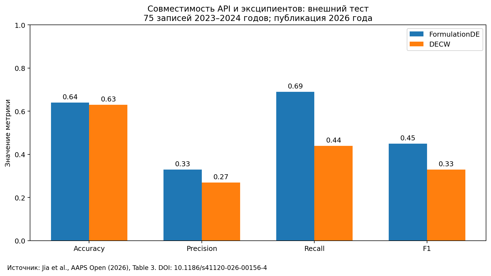

**Аналитический вывод.** Переход от F1 0,74 к 0,45 нельзя скрыть за заголовочным ROC-AUC. Это аргумент в пользу проверки переносимости и отказа от автономного «одобрения» комбинации. При этом нельзя объявлять модель бесполезной: более высокий recall относительно DECW может быть ценным в конкретном процессе. Чтобы понять пользу, нужно определить, как дорого обходятся разные ошибки и сколько последующих опытов требуется.

Разница accuracy 0,01 также не доказывает статистически устойчивого превосходства. Внешняя выборка небольшая; доверительные интервалы для этой сравнительной таблицы здесь не выдумываются. Главное научное наблюдение — контекст теста, а не единственный выигрышный показатель.

## 3.4. GastroPlus: пример не только модельной, но и клинической проверки

В исследовании алпелисиба, опубликованном 30 апреля 2025 года, PBBM реализовано в GastroPlus 9.8.1. Сравнение гранул и таблеток 50 мг выполнено в рандомизированном перекрёстном исследовании 60 здоровых взрослых. Для приёма после еды получены следующие клинические отношения геометрических средних и 90%-ные доверительные интервалы.  [S34](#source-S34)

| Показатель | Гранулы / таблетка | 90%-ный ДИ |
|---|---:|---|
| AUC∞ | 0,984 | 0,952–1,020 |
| AUC до последней точки | 0,980 | 0,946–1,020 |
| Cmax | 0,947 | 0,891–1,010 |

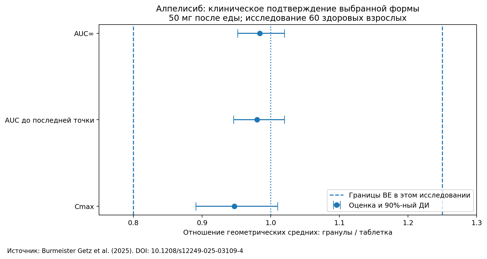

Авторы связывают клинический результат с предварительным модельным выбором формы, но также обсуждают ограничения физиологических параметров и необходимость in vivo подтверждения.  [S34](#source-S34)

**Аналитический вывод.** Это более сильное основание для доверия к конкретному процессу, чем высокий score на случайно разделённой базе рецептур. Однако результат относится к выбранным формам, дозе и условиям. Нельзя превратить его в тезис «GastroPlus прогнозирует любые формы с точностью 98%»: число 0,984 выше — отношение экспозиций двух продуктов, а не accuracy программы.

## 3.5. Simcyp и олапариб: средняя кривая — не весь результат

Статья 14 апреля 2026 года показывает, что модели могут сходно описывать средний PK-профиль, но различаться в способности воспроизвести внутрииндивидуальную вариабельность и вывод о виртуальной биоэквивалентности.  [S35](#source-S35)

**Аналитический вывод.** Для дипломного интерфейса мало вывести красивую кривую концентрации. В карточке расчёта нужны предположения о вариабельности, параметры проверки и чувствительность решения к их изменению. Признание такого ограничения повышает полезность отчёта: пользователь видит, какие измерения могут изменить выбор стратегии.

Этот кейс также не является сравнением Simcyp и GastroPlus на одинаковых данных. Две разные публикации с положительными результатами не позволяют расставить эти продукты по местам.

## 3.6. Замкнутый экспериментальный цикл: эффект есть, но важны подтверждения

Ros и соавторы исследовали куркумин в пространстве 7776 комбинаций. Были изучены 256 уникальных составов: 96 начальных и пять серий по 32. Это число композиций, не число всех физических измерений с повторами. Автоматизированный скрининг выделил семь лидеров выше выбранного порога около 10 мг/мл; при ручной перепроверке около этого уровня сохранились три.  [S22](#source-S22)

**Аналитический вывод.** Доля рассмотренного пространства примерно 3,3% — расчёт 256/7776 — не означает, что найден глобальный оптимум или доказана экономия 96,7% относительно честной альтернативы. Но работа демонстрирует полезный цикл отбора. Расхождения повторной проверки показывают, почему оптимизация модели не отделима от качества дозирования и измерения.

Для будущей платформы следует учитывать не только «число рекомендованных удачных составов», но и долю результатов, подтвердившихся повторно. Одна конечная точка — растворимость — не устанавливает стабильность, технологичность и человеческую биодоступность.

## 3.7. Что означает высокий результат в задаче аморфных дисперсий

В работе Lu 2025 года использовались 1272 состава, из которых 188 образовали аморфные дисперсии и 1084 — кристаллические продукты. Авторы сообщили accuracy 96,7% и F1 83,6%.  [S33](#source-S33)

**Аналитический вывод.** Классификатор, всегда выбирающий большинство, получил бы около 85,2% accuracy: 1084/1272. Это не делает исследованную модель плохой, но показывает, зачем нужны метрики редкого класса и корректная базовая линия. Главное ограничение переноса — прогнозируется образование аморфного состояния, а не терапевтический эффект.

## 3.8. Какие выводы об эффективности пока не установлены

По рассмотренным материалам нельзя обоснованно указать универсальную стоимость получения оптимальной рецептуры, средний клинический выигрыш перечисленных ИИ-систем, их единый рейтинг или точную экономию времени технолога в компании-партнёре. У части продуктов доступны только заявления поставщика, у других — ограниченные научные задачи.

Это не утверждение, что решения неэффективны. Это граница доступных доказательств. Для закупки или выбора архитектуры нужно дополнить обзор контролируемым пилотом, а не заменить отсутствующие измерения оценками «высокая / средняя / низкая» без определений.

# Глава 4. Архитектуры и схемы процессов

## 4.1. Правила чтения схем

Все двадцать схем ниже построены специально для этого отчёта. Они показывают поток данных, решений и измерений, а не выдуманную внутреннюю архитектуру закрытого ПО. Сплошные блоки передают опубликованные функции или стадии процесса. Пунктирная внешняя проверка — обозначенная автором необходимая граница применения; она не приписывается продукту как встроенная функция. Пунктирная обратная стрелка обозначает итерацию, а не доказательство автоматического переобучения.

API в молекулярных блоках означает active pharmaceutical ingredient — действующее вещество; «веб / API» у программного доступа означает application programming interface. В рабочем интерфейсе диплома эти значения следует разводить явно.

### Схема 01. Экспертная команда: QbD + планирование экспериментов

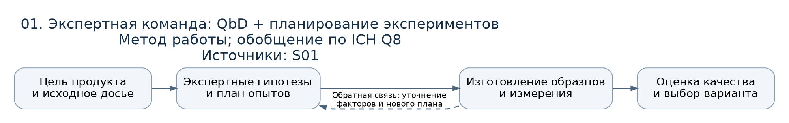

Эталонный рабочий цикл эксперта. Здесь измерение и пересмотр плана являются частью процесса, а не признаком неэффективности человека.  [S01](#source-S01)

### Схема 02. Quotient Sciences: Translational Pharmaceutics / RapidFACT

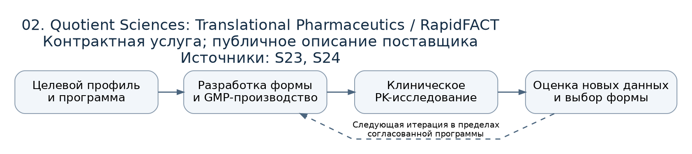

Результат клинического этапа возвращается в разработку формы. В отличие от чистого SaaS, исследование включает материальные и клинические операции.  [S23](#source-S23) [S24](#source-S24)

### Схема 03. BASF ZoomLab

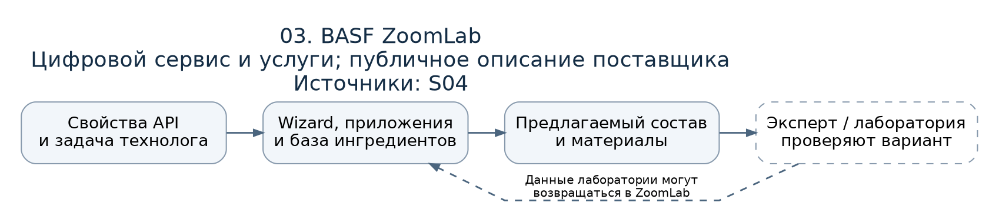

Сервис цифрового выбора связан с ингредиентами и лабораторными услугами. Сам предлагаемый состав не получает статус экспериментально подтверждённого.  [S04](#source-S04)

### Схема 04. FormulationDT

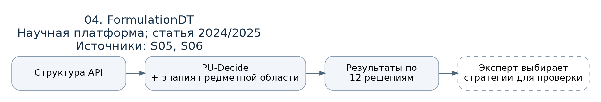

Результат — решения о стратегии. Узел справа обозначает внешнее превращение этих решений в программу разработки.  [S05](#source-S05) [S06](#source-S06)

### Схема 05. FormulationAI

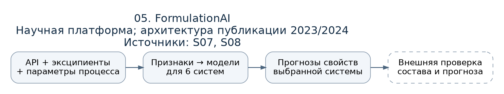

Модель использует не только молекулу, но и состав с параметрами процесса. Прогноз относится к выбранной системе и конечной точке.  [S07](#source-S07) [S08](#source-S08)

### Схема 06. PharmDE → FormulationDE

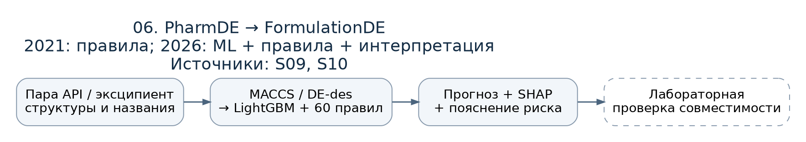

На схеме показана ML-версия 2026 года; предшественник PharmDE — источник правил, а не та же самая обученная модель.  [S09](#source-S09) [S10](#source-S10)

### Схема 07. SwissADME

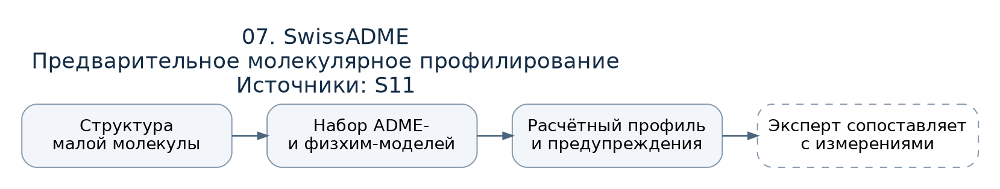

Молекулярный профиль служит входом последующего анализа. Состав продукта в эту краткую схему расчёта не включён.  [S11](#source-S11)

### Схема 08. ADMETlab 3.0

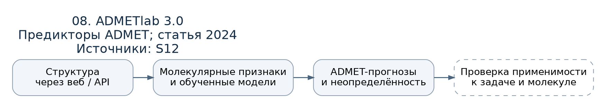

Программный доступ позволяет использовать предикторы как сервис. Проверка области применимости показана отдельно от самого расчёта.  [S12](#source-S12)

### Схема 09. GastroPlus

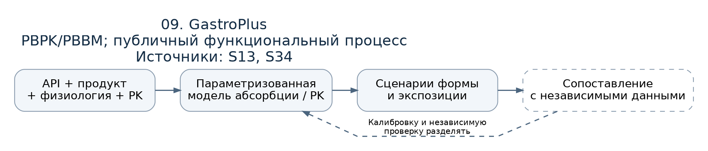

Проверка на независимых наблюдениях отделяется от настройки. Клинический пример в главе 3 относится к конкретной модели и версии.  [S13](#source-S13) [S34](#source-S34)

### Схема 10. Simcyp Biopharmaceutics

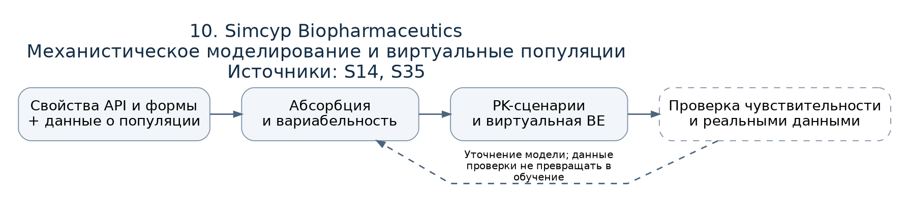

Популяционная вариабельность влияет на вывод о виртуальной BE. Проверка одной средней кривой не охватывает эту часть задачи.  [S14](#source-S14) [S35](#source-S35)

### Схема 11. PK-Sim / MoBi / OSP

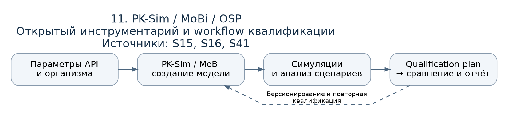

Открытый контур квалификации связывает версию модели, план расчёта и наблюдения. Он не является универсальным разрешением любого применения.  [S15](#source-S15) [S16](#source-S16) [S41](#source-S41)

### Схема 12. Intellegens Alchemite

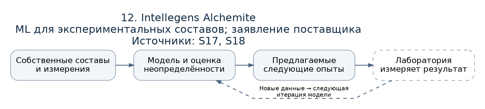

Рекомендуемые опыты не становятся данными до выполнения лабораторией. Автоматизация планирования не тождественна роботизации эксперимента.  [S17](#source-S17) [S18](#source-S18)

### Схема 13. Intrepid Labs VALIANT

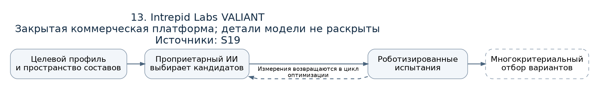

Подробности закрытого ИИ не домысливаются. Петля отражает публично заявленную связку оптимизации и роботизированных измерений.  [S19](#source-S19)

### Схема 14. Persist AI Suite + Cloud Lab

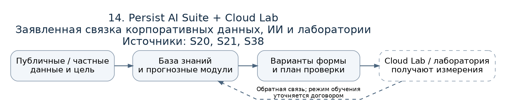

Частная база знаний и лаборатория показаны как заявленные поставщиком компоненты. Права и режим использования данных проверяются договорно.  [S20](#source-S20) [S21](#source-S21) [S38](#source-S38)

### Схема 15. Ros et al.: полуавтономный формулятор

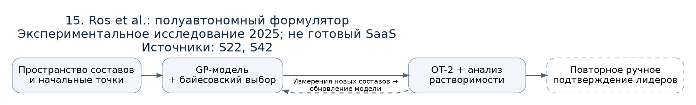

Схема включает ручное подтверждение лидеров. Это существенная часть опубликованного эксперимента, а не необязательная дополнительная проверка.  [S22](#source-S22) [S42](#source-S42)

### Схема 16. CCDC CSD-Materials

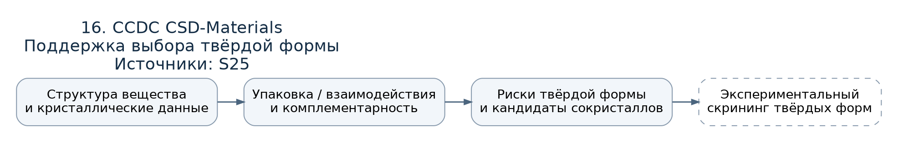

Выбор твёрдой формы является самостоятельным химическим вопросом. Справа — внешний эксперимент, не объявленный результатом программы.  [S25](#source-S25)

### Схема 17. Reaxys: опубликованный и предиктивный ретросинтез

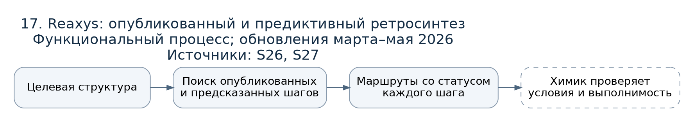

Происхождение должно сохраняться для каждого шага: опубликованный прецедент либо предсказание. Смешанный маршрут не целиком проверен.  [S26](#source-S26) [S27](#source-S27)

### Схема 18. AiZynthFinder

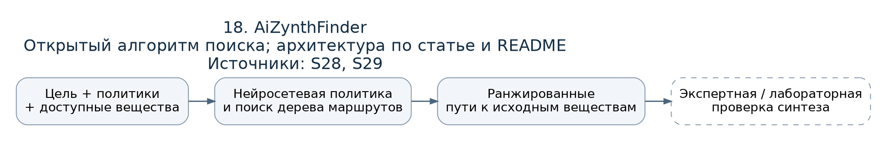

Списки исходных веществ и обученные политики влияют на результат поиска. Найденный путь не доказывает фактического выхода синтеза.  [S28](#source-S28) [S29](#source-S29)

### Схема 19. LLM с химическими инструментами: ChemCrow

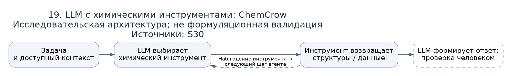

В LLM-only отсутствует инструментальная петля. ChemCrow показан как исследовательский вариант её добавления, не конкурент с доказанной формуляционной точностью.  [S30](#source-S30)

### Схема 20. TDC + ALCE + предметные тесты

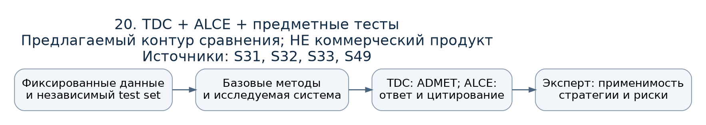

Это авторская композиция существующих методов оценки. TDC и ALCE не образуют совместный коммерческий продукт; предметная экспертиза добавлена для ТЗ.  [S31](#source-S31) [S32](#source-S32) [S33](#source-S33) [S49](#source-S49)

## 4.2. Что известно о внутреннем устройстве, а что нет

У FormulationAI опубликован конкретный технический стек: веб-интерфейс, Django, MySQL, uWSGI/Nginx и развёртывание на облачной инфраструктуре. Это описание из статьи 2023/2024 годов, не проверка актуального production-окружения. У FormulationDE в статье указан Streamlit и связка молекулярных признаков, LightGBM, правил и SHAP.  [S07](#source-S07) [S10](#source-S10) [S40](#source-S40)

Для VALIANT и Persist открытые страницы описывают пользовательский процесс, но не дают достаточного основания нарисовать точную топологию сервисов, назвать LLM-провайдера или алгоритм оптимизации каждого модуля. Поэтому соответствующие узлы оставлены как проприетарный ИИ или прогнозный модуль.  [S19](#source-S19) [S20](#source-S20)

Для OSP и AiZynthFinder можно опираться на официальные технические workflows и открытый код. Это другой уровень технической проверяемости, но не самостоятельное доказательство лучшей научной точности.  [S16](#source-S16) [S29](#source-S29)

## 4.3. Общий архитектурный результат сравнения

**Авторский вывод из схем:** решения различаются не количеством «ИИ-блоков», а местом, где в процесс приходит новая проверяемая информация. Молекулярный предиктор преобразует известную структуру в оценку. PBPK связывает наблюдения с физиологическими предположениями. Лабораторный цикл получает новые измерения. Инструментальный LLM организует выполнение и объяснение, но сам по себе не создаёт экспериментального подтверждения.

Следовательно, самая существенная архитектурная граница диплома — переход от гипотезы к проверке. Её нельзя закрыть только ещё одним агентом, который оценивает текст первого агента. Предлагаемая интеграция в главе 5 сохраняет эту границу явной.

# Глава 5. Что работает для данной проблемы и что следует делать в дипломе

## 5.1. Выводы по типу задачи

| Задача из ТЗ | На что разумно опираться | Что не подтверждено как достаточное решение |
|---|---|---|
| Выбрать направления изменения формы | FormulationDT, ZoomLab, FormulationAI и экспертное сопоставление.  [S04](#source-S04) [S05](#source-S05) [S07](#source-S07) | Один общий список стратегий без связи с продуктом и ограничением. |
| Получить первичный профиль API | Измерения плюс выбранные SwissADME/ADMETlab-предикторы.  [S11](#source-S11) [S12](#source-S12) | Присвоить регуляторный BCS по одному расчёту.  [S03](#source-S03) |
| Выявить риски API–эксципиент | Правила, литературные наблюдения и ML как предварительный фильтр.  [S09](#source-S09) [S10](#source-S10) | Считать отрицательный сигнал модели доказательством отсутствия несовместимости. |
| Оценить влияние формы на экспозицию | Параметризованная и проверенная PBPK/PBBM-модель.  [S34](#source-S34) [S35](#source-S35) | Считать любой красивый PK-график точным прогнозом. |
| Сократить экспериментальный поиск | Адаптивный DoE и цикл с новыми измерениями.  [S18](#source-S18) [S22](#source-S22) | Перенести рекламный коэффициент экономии без общего бюджета и критериев остановки. |
| Проверить твёрдофазные риски | Специализированный структурный анализ плюс скрининг.  [S25](#source-S25) | Игнорировать полиморф/сокристалл, сохранив только молекулярный SMILES. |
| Подготовить синтез модификации | Опубликованные прецеденты и отдельно помеченные предсказанные шаги.  [S26](#source-S26) [S27](#source-S27) [S28](#source-S28) | Называть найденный маршрут проверенной технологией без эксперимента. |
| Получить проверяемое объяснение | Источники, инструменты и оценка цитат отдельно от стиля текста.  [S30](#source-S30) [S32](#source-S32) | Оценивать доказательность по убедительности формулировок. |

Таблица выражает проектное заключение, а не сертификат пригодности перечисленных продуктов. Для каждой строки требуется соответствующий тест: рекомендация по стратегии, лабораторный исход и клинический исход — разные уровни.

## 5.2. Какие исходные гипотезы проекта следует пересмотреть

**Первая: «не существует системы, которая рекомендует форму».** FormulationDT и ZoomLab уже адресуют эту часть задачи. Их нужно включить в содержательное сравнение, а не использовать исключительно LLM-only как слабую базовую линию.  [S04](#source-S04) [S05](#source-S05)

**Вторая: «частная база знаний плюс ИИ — уникальная функция».** Persist AI Suite заявляет близкий сценарий. Поэтому новизну следует формулировать через качество конкретного исследовательского workflow, прозрачность происхождения выводов и подтверждённое улучшение решения, а не через название технологии.  [S20](#source-S20)

**Третья: «успешный расчёт совместимости может завершать проверку».** Внешние результаты FormulationDE не дают такого основания. Прогноз должен влиять на приоритет опытов, а не автоматически заменять их.  [S10](#source-S10)

**Четвёртая: «лучший PBPK-движок можно выбрать по отдельному красивому кейсу».** Алпелисиб и олапариб показывают ценность механистического подхода, но исследуют разные вещества и цели. Их нельзя превратить в head-to-head рейтинг двух программ.  [S34](#source-S34) [S35](#source-S35)

## 5.3. Предлагаемая граница минимального полезного продукта

Следующий блок — **проектное предложение**, требующее согласования с руководителем и отраслевым экспертом. Оно сохраняет состав большого проекта, но ограничивает первую проверяемую реализацию.

Предлагается начать с конкретного класса пероральных продуктов малых молекул. Входом сделать не только название, но и выбранный продукт, дозу, цель изменения, доступный состав и ограничения. Выход — несколько альтернатив с объяснением механизма, источниками, известными рисками и следующим экспериментом. При отсутствии достаточных данных количественный прогноз выигрыша не выдаётся.

Такой результат может быть полезен даже без собственного нового ADMET-предиктора. Напротив, попытка одновременно реализовать пероральные и сложные парентеральные системы, новый синтез, полную PBPK и фармаконадзор сделает причину успеха или провала прототипа трудноинтерпретируемой. Это вывод об организации исследования, не утверждение о невозможности широкого проекта.

## 5.4. Что создавать самим, а что интегрировать

| Слой | Предлагаемое решение | Основание выбора |
|---|---|---|
| Идентичность продукта и схема наблюдений | Создать собственную предметную модель данных | Эта связка определяет корректность всего пользовательского кейса [P01](#source-P01), [P02](#source-P02). |
| Извлечение и происхождение доказательств | Создать проверяемый workflow с версиями и местом в источнике | Качество цитат требует отдельной оценки.  [S32](#source-S32) |
| Базовые молекулярные предикторы | Сначала интегрировать и сравнить существующие | Есть доступные исследовательские компоненты.  [S11](#source-S11) [S12](#source-S12) |
| Каталог стратегий | Разработать под ограниченный набор задач; сравнить с FormulationDT | Уже существует сильная предметная базовая линия.  [S05](#source-S05) |
| Ограничения эксципиентов | Собственные контекстные правила поверх справочников | IID не универсальная таблица разрешённых максимальных доз.  [S02](#source-S02) |
| PBPK/PBBM | Использовать существующий движок при достаточном досье | Создание собственного решателя не требуется для проверки основного workflow.  [S13](#source-S13) [S15](#source-S15) |
| Ретросинтез | Отдельный подключаемый модуль | Доступны опубликованные и открытые инструменты.  [S26](#source-S26) [S29](#source-S29) |
| Лабораторный цикл | Подключать после получения воспроизводимых измерений | Реальное подтверждение лидеров может расходиться с автоматическим скринингом.  [S22](#source-S22) |

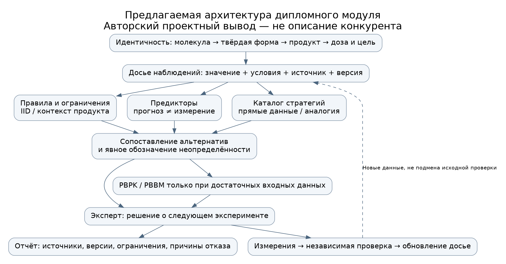

В этой схеме намеренно отсутствует узел «LLM решает, что препарат безопасен». Он заменён сбором оснований, проверкой ограничений, обозначением неопределённости и экспертным решением о следующем действии.

## 5.5. Как проверить рыночное преимущество, а не только функциональность

**Предлагаемый протокол** продолжает метрики этапа 1. Сравнить нужно одинаковые кейсы и одинаковые исходные сведения в нескольких режимах: обычный процесс специалиста; та же LLM без инструментов; LLM с источниками; правила и расчёты; полная платформа. Для узких задач дополнительно использовать релевантные FormulationDT/FormulationDE/ADMET-предикторы, если доступ и права позволяют.

Кейс должен включать вещество, форму, дозу, цель, ограничения и заранее зафиксированное досье. Экспертная разметка выполняется до просмотра названия системы. В число задач включаются успешные известные стратегии, неподходящие стратегии, неполные данные и случаи обоснованного отказа.

| Критерий | Что измерять | Почему он важен |
|---|---|---|
| Достоверность | Ошибки идентичности, единиц, условий и происхождения утверждений | Ошибка в исходном объекте обесценивает последующие расчёты. |
| Полезность первых вариантов | Пригодность и полнота при фиксированном числе предложений | Нельзя выиграть, выдав все известные технологии. |
| Проверяемость | Корректность и полнота поддержки источниками | Ссылка рядом с текстом не гарантирует, что источник его подтверждает.  [S32](#source-S32) |
| Ограничения и отказы | Критические нарушения и уверенные ответы при нехватке данных | Качественная система должна уметь не принимать решение. |
| Эффективность работы | Время до принятого отчёта, включая исправления | Скорость черновика не равна экономии труда. |
| Лабораторное подтверждение | Доля повторно подтверждённых лидеров при заданном бюджете опытов | Отделяет модельное ранжирование от физического результата. |
| Воспроизводимость | Версии данных, модели, параметров и сохранность экспорта | Решение должно быть возможно восстановить и проверить. |

Для ADMET использовать фиксированные разбиения TDC; для продуктовых кейсов группировать данные по веществам и семействам форм. Документация TDC различает random, scaffold и cold-start подходы, но готовое разбиение одной молекулярной задачи не переносится автоматически на составы.  [S31](#source-S31) [S49](#source-S49)

Временной holdout полезен, но для LLM не доказывает отсутствия знания опубликованного ответа из обучения. Поэтому ретроспективное воспроизведение известных случаев следует отделить от закрытых кейсов партнёра и проспективного экспериментального этапа. Это методологическое ограничение предлагаемого дизайна, а не результат выполненного теста.

Численные пороги приёмки необходимо установить после пилота и оценки стоимости ошибок. В отчёте не задаются вымышленные отраслевые нормы вида «F1 не ниже 0,95» или «ускорение минимум в пять раз».

## 5.6. Что ещё требуется узнать перед выбором продукта или архитектуры

Остаются открытыми фактические исходные данные партнёра, доступные специалисты, лабораторные методы, бюджет опытов, условия передачи конфиденциальной информации и приоритет рынка регистрации. Без этих сведений нельзя обоснованно выбрать между подпиской, сервисной программой и собственным развёртыванием.

Для поставщиков нужно запросить пример отчёта с исходными данными, перечень фактически поставляемых модулей, ограничения химической области, описание тестирования, договорные условия данных и процедуру воспроизводимого пилота. Для отраслевого эксперта — недавний реальный кейс выбора формы и признаки, по которым внешне правдоподобную стратегию пришлось отвергнуть. Эти запросы являются планом дальнейшей проверки; интервью и коммерческие переговоры не проводились.

## 5.7. Итог второго этапа

**Рыночная картина:** задача уже решается сочетанием экспертной разработки, специализированных цифровых сервисов, ML-предикторов, PBPK/PBBM и лабораторных циклов. Некоторые продукты непосредственно пересекаются с замыслом диплома; тезис об отсутствии аналогов не подтверждается.  [S04](#source-S04) [S05](#source-S05) [S07](#source-S07) [S20](#source-S20)

**Наиболее убедительная доказательная линия:** конкретный прогноз, независимая проверка и связь с решением о продукте. Случай алпелисиба показывает такую цепочку; внешний тест FormulationDE и повторные измерения Ros показывают, где уверенность необходимо уменьшать.  [S10](#source-S10) [S22](#source-S22) [S34](#source-S34)

**Защищаемая гипотеза диплома:** система с явной идентичностью продукта, происхождением наблюдений, контекстными ограничениями и подходящими инструментами может улучшить качество и трудоёмкость предэкспериментального выбора стратегий на ограниченном классе задач. Преимущество должно быть измерено относительно сильных базовых линий. Оно не следует автоматически из наличия LLM, числа подключённых баз или красоты итогового отчёта.

# Приложение. Аннотированный реестр источников

Реестр содержит 49 веб-позиций и два исходных материала проекта. S39 повторяет S10 в PDF, S40 повторяет S07 в другом издательском представлении; это не независимые исследования. Даты публикаций и обращения разделены. Отсутствие доступа к отдельному URL отмечено, а не скрыто.

### P01. Техническое задание DESCR(1).md

Материал предоставлен пользователем. Источник требований, не доказательство научных утверждений. Копия в архиве: `source_materials/DESCR(1).md`.

### P02. Отчёт первого этапа и реестр источников

Одобренный отчёт в текущем диалоге; реестр от 17.10.2026. Копия реестра в архиве: `source_materials/sources_stage1.md`. Используется для преемственности постановки и явно отмеченных справочных положений.

### S01. FDA. ICH Q8(R2): Pharmaceutical Development

**Дата / версия:** Final; ноябрь 2009. **Тип:** Официальное руководство.

**Прямая ссылка:** [https://www.fda.gov/regulatory-information/search-fda-guidance-documents/q8r2-pharmaceutical-development](https://www.fda.gov/regulatory-information/search-fda-guidance-documents/q8r2-pharmaceutical-development)

**Подтверждает:** Целевой профиль продукта, фармацевтическая разработка, параметры качества и процесса. **Граница вывода:** Не сравнительное исследование производительности человека и ИИ.

**Проверка доступа:** URL и содержание проверены в веб-исследовании; автоматический запуск сервиса не выполнялся.

### S02. FDA. Inactive Ingredients: Frequently Asked Questions

**Дата / версия:** Динамическая документация. **Тип:** Официальная документация.

**Прямая ссылка:** [https://www.fda.gov/drugs/drug-approvals-and-databases/inactive-ingredients-approved-drug-products-search-frequently-asked-questions](https://www.fda.gov/drugs/drug-approvals-and-databases/inactive-ingredients-approved-drug-products-search-frequently-asked-questions)

**Подтверждает:** Смысл IID, maximum potency и экспозиции. **Граница вывода:** Прецедент применения не является универсальным безопасным пределом.

**Проверка доступа:** URL и содержание проверены в веб-исследовании; автоматический запуск сервиса не выполнялся.

### S03. FDA. ICH M9: BCS-Based Biowaivers

**Дата / версия:** Final; май 2021. **Тип:** Официальное руководство.

**Прямая ссылка:** [https://www.fda.gov/regulatory-information/search-fda-guidance-documents/m9-biopharmaceutics-classification-system-based-biowaivers](https://www.fda.gov/regulatory-information/search-fda-guidance-documents/m9-biopharmaceutics-classification-system-based-biowaivers)

**Подтверждает:** Область применения и доказательные требования BCS-биовейвера. **Граница вывода:** Расчётный прогноз BCS не равен подтверждённому регуляторному классу.

**Проверка доступа:** URL и содержание проверены в веб-исследовании; автоматический запуск сервиса не выполнялся.

### S04. BASF. ZoomLab: Digital Platform for Drug Product Development

**Дата / версия:** Динамическая страница; просмотр 18.10.2026. **Тип:** Документация поставщика.

**Прямая ссылка:** [https://pharmaceutical.basf.com/global/en/pharma-solutions/about-basf-pharma/digitalization/zoomlab](https://pharmaceutical.basf.com/global/en/pharma-solutions/about-basf-pharma/digitalization/zoomlab)

**Подтверждает:** Wizard, база ингредиентов и форм, Core/Premium, 30-дневная пробная версия, лабораторные услуги. **Граница вывода:** Заявления об ускорении и validated algorithms не заменяют опубликованный сравнительный протокол.

**Проверка доступа:** URL и содержание проверены в веб-исследовании; автоматический запуск сервиса не выполнялся.

### S05. Wang N., Dong J., Ouyang D. AI-directed formulation strategy design initiates rational drug development

**Дата / версия:** Online 26.12.2024; J Control Release 378:619–636, 10.02.2025; DOI 10.1016/j.jconrel.2024.12.043. **Тип:** Первичная статья; проверены библиография и аннотация.

**Прямая ссылка:** [https://pubmed.ncbi.nlm.nih.gov/39719215/](https://pubmed.ncbi.nlm.nih.gov/39719215/)

**Подтверждает:** FormulationDT, 12 решений, PU-Decide, ROC-AUC 0,78–0,98. **Граница вывода:** Не показатель клинического успеха; полный протокол разделения данных по аннотации не установлен.

**Проверка доступа:** URL и содержание проверены в веб-исследовании; автоматический запуск сервиса не выполнялся.

### S06. FormulationDT. Официальная веб-платформа

**Дата / версия:** Динамическая страница; просмотр 18.10.2026. **Тип:** Документация разработчиков.

**Прямая ссылка:** [https://formulationdt.computpharm.org/](https://formulationdt.computpharm.org/)

**Подтверждает:** Ввод структуры и формуляционные решения; указание CC BY-NC-SA 4.0. **Граница вывода:** Доступность сайта не доказывает разрешение коммерческой интеграции.

**Проверка доступа:** URL и содержание проверены в веб-исследовании; автоматический запуск сервиса не выполнялся.

### S07. Dong et al. FormulationAI: a novel web-based platform for drug formulation design driven by artificial intelligence

**Дата / версия:** Online 2023; Brief Bioinform 25(1), 2024; DOI 10.1093/bib/bbad419. **Тип:** Первичная статья; прочитан полный текст.

**Прямая ссылка:** [https://academic.oup.com/bib/article/25/1/bbad419/7441064](https://academic.oup.com/bib/article/25/1/bbad419/7441064)

**Подтверждает:** Шесть систем, 16 свойств, признаки API/эксципиентов/процесса; архитектура и модельные ограничения. **Граница вывода:** Различные конечные точки имеют разные результаты; нет единого процента эффективности готовых препаратов.

**Проверка доступа:** URL и содержание проверены в веб-исследовании; автоматический запуск сервиса не выполнялся.

### S08. FormulationAI. Официальная научная веб-платформа

**Дата / версия:** Динамическая страница; просмотр 18.10.2026. **Тип:** Документация разработчиков.

**Прямая ссылка:** [https://formulationai.computpharm.org/](https://formulationai.computpharm.org/)

**Подтверждает:** Вход в опубликованные предиктивные сервисы. **Граница вывода:** Не проверялись нагрузка, договорные SLA и промышленная интеграция.

**Проверка доступа:** URL и содержание проверены в веб-исследовании; автоматический запуск сервиса не выполнялся.

### S09. Wang et al. PharmDE: A new expert system for drug-excipient compatibility evaluation

**Дата / версия:** 2021; DOI 10.1016/j.ijpharm.2021.120962. **Тип:** Первичная статья; библиография и аннотация.

**Прямая ссылка:** [https://pubmed.ncbi.nlm.nih.gov/34339812/](https://pubmed.ncbi.nlm.nih.gov/34339812/)

**Подтверждает:** 532 записи, 60 правил; поиск и оценка несовместимости. **Граница вывода:** Не следует переносить показатели модели 2026 года на экспертную систему 2021 года.

**Проверка доступа:** URL и содержание проверены в веб-исследовании; автоматический запуск сервиса не выполнялся.

### S10. Jia et al. FormulationDE: an updated artificial intelligence system for drug-excipient compatibility prediction

**Дата / версия:** 15.04.2026; AAPS Open 12:20; DOI 10.1186/s41120-026-00156-4. **Тип:** Первичная статья; полный текст и таблицы PDF.

**Прямая ссылка:** [https://link.springer.com/article/10.1186/s41120-026-00156-4](https://link.springer.com/article/10.1186/s41120-026-00156-4)

**Подтверждает:** LightGBM плюс правила и SHAP; 1105 пар; nested CV отдельно от внешних 75 записей. **Граница вывода:** Внешние accuracy 0,64 и F1 0,45; не автоматическое доказательство совместимости.

**Проверка доступа:** URL и содержание проверены в веб-исследовании; автоматический запуск сервиса не выполнялся.

### S11. Daina, Michielin, Zoete. SwissADME

**Дата / версия:** 03.03.2017; Sci Rep 7:42717; DOI 10.1038/srep42717. **Тип:** Первичная статья о методе.

**Прямая ссылка:** [https://pubmed.ncbi.nlm.nih.gov/28256516/](https://pubmed.ncbi.nlm.nih.gov/28256516/)

**Подтверждает:** Молекулярные ADME/физико-химические оценки и drug-likeness. **Граница вывода:** Описание метода 2017 года, не аудит всех последующих изменений сервиса; не предсказание состава таблетки.

**Проверка доступа:** URL и содержание проверены в веб-исследовании; автоматический запуск сервиса не выполнялся.

### S12. Fu et al. ADMETlab 3.0

**Дата / версия:** 2024; NAR 52(W1):W422–W431; DOI 10.1093/nar/gkae236. **Тип:** Первичная статья о системе.

**Прямая ссылка:** [https://pubmed.ncbi.nlm.nih.gov/38572755/](https://pubmed.ncbi.nlm.nih.gov/38572755/)

**Подтверждает:** 119 характеристик, графовые модели, API и неопределённость. **Граница вывода:** Число характеристик не равно числу клинически валидированных исходов.

**Проверка доступа:** URL и содержание проверены в веб-исследовании; автоматический запуск сервиса не выполнялся.

### S13. Simulations Plus. GastroPlus

**Дата / версия:** Динамическая страница; просмотр 18.10.2026. **Тип:** Документация поставщика.

**Прямая ссылка:** [https://www.simulations-plus.com/software/gastroplus/](https://www.simulations-plus.com/software/gastroplus/)

**Подтверждает:** PBPK/PBBM, абсорбция, сценарии, автоматизация и заявленные AI-функции. **Граница вывода:** Нельзя объявлять подтверждённой эффективность произвольной пользовательской модели.

**Проверка доступа:** URL и содержание проверены в веб-исследовании; автоматический запуск сервиса не выполнялся.

### S14. Certara. Simcyp Biopharmaceutics

**Дата / версия:** Динамическая страница; просмотр 18.10.2026. **Тип:** Документация поставщика.

**Прямая ссылка:** [https://www.certara.com/software/simcyp-biopharmaceutics/](https://www.certara.com/software/simcyp-biopharmaceutics/)

**Подтверждает:** Биофармацевтическое моделирование, вариабельность, пищевой эффект, VBE и анализ форм. **Граница вывода:** Не независимый head-to-head тест против GastroPlus или OSP.

**Проверка доступа:** URL и содержание проверены в веб-исследовании; автоматический запуск сервиса не выполнялся.

### S15. Open Systems Pharmacology

**Дата / версия:** Динамический открытый проект; просмотр 18.10.2026. **Тип:** Официальная документация.

**Прямая ссылка:** [https://www.open-systems-pharmacology.org/](https://www.open-systems-pharmacology.org/)

**Подтверждает:** PK-Sim/MoBi и открытое физиологическое моделирование. **Граница вывода:** Свободное ПО не устраняет потребность в калибровке и проверке конкретной модели.

**Проверка доступа:** URL и содержание проверены в веб-исследовании; автоматический запуск сервиса не выполнялся.

### S16. OSP. Qualification workflow

**Дата / версия:** Динамическая документация; просмотр 18.10.2026. **Тип:** Официальная техническая документация.

**Прямая ссылка:** [https://docs.open-systems-pharmacology.org/shared-tools-and-example-workflows/qualification](https://docs.open-systems-pharmacology.org/shared-tools-and-example-workflows/qualification)

**Подтверждает:** Планы квалификации, выполнение моделей, отчёты и повторная проверка. **Граница вывода:** Квалификация выбранного DDI-сценария не равна проверке всей фармацевтической разработки.

**Проверка доступа:** URL и содержание проверены в веб-исследовании; автоматический запуск сервиса не выполнялся.

### S17. Intellegens. Alchemite for Formulations

**Дата / версия:** Динамическая страница; просмотр 18.10.2026. **Тип:** Документация поставщика.

**Прямая ссылка:** [https://intellegens.com/solutions/alchemite-for-formulations/](https://intellegens.com/solutions/alchemite-for-formulations/)

**Подтверждает:** Моделирование составов, неполные экспериментальные данные и выбор следующих опытов. **Граница вывода:** Общие заявления об экономии нельзя переносить на улучшение биодоступности.

**Проверка доступа:** URL и содержание проверены в веб-исследовании; автоматический запуск сервиса не выполнялся.

### S18. Intellegens. Alchemite for Design of Experiments

**Дата / версия:** Динамическая страница; просмотр 18.10.2026. **Тип:** Документация поставщика.

**Прямая ссылка:** [https://intellegens.com/solutions/alchemite-for-doe/](https://intellegens.com/solutions/alchemite-for-doe/)

**Подтверждает:** Адаптивное планирование экспериментов и модельное ранжирование. **Граница вывода:** Экономические показатели зависят от отрасли и конкретного процесса.

**Проверка доступа:** URL и содержание проверены в веб-исследовании; автоматический запуск сервиса не выполнялся.

### S19. Intrepid Labs. VALIANT platform

**Дата / версия:** Динамическая страница; просмотр 18.10.2026. **Тип:** Документация поставщика.

**Прямая ссылка:** [https://www.intrepidlabs.tech/platform](https://www.intrepidlabs.tech/platform)

**Подтверждает:** Связка ИИ, роботизированных экспериментов и многокритериального подбора формы. **Граница вывода:** 20–60-кратная sample efficiency — заявление поставщика; единый открытый протокол проверки не установлен.

**Проверка доступа:** URL и содержание проверены в веб-исследовании; автоматический запуск сервиса не выполнялся.

### S20. Persist AI Suite

**Дата / версия:** Динамическая страница; просмотр 18.10.2026. **Тип:** Документация поставщика.

**Прямая ссылка:** [https://www.persist.ai/persist-ai-suite](https://www.persist.ai/persist-ai-suite)

**Подтверждает:** Частная база знаний, оценка форм, корпоративные данные и варианты размещения. **Граница вывода:** Указания на on-premise и конфиденциальность — заявленные условия, не проведённый аудит безопасности.

**Проверка доступа:** URL и содержание проверены в веб-исследовании; автоматический запуск сервиса не выполнялся.

### S21. Persist AI. Cloud Lab

**Дата / версия:** Динамическая страница; просмотр 18.10.2026. **Тип:** Документация поставщика.

**Прямая ссылка:** [https://www.persist.ai/cloud-lab](https://www.persist.ai/cloud-lab)

**Подтверждает:** Заказ роботизированных экспериментов и возврат данных по формам. **Граница вывода:** Не доказан одинаковый выигрыш для всех веществ и путей введения.

**Проверка доступа:** URL и содержание проверены в веб-исследовании; автоматический запуск сервиса не выполнялся.

### S22. Ros et al. Semi-self-driving robotic formulation workflow

**Дата / версия:** 17.07.2025; Digital Discovery 4:2263–2272; DOI 10.1039/D5DD00171D. **Тип:** Первичное экспериментальное исследование; текст из индексированного представления издателя.

**Прямая ссылка:** [https://pubs.rsc.org/en/content/articlehtml/2025/dd/d5dd00171d](https://pubs.rsc.org/en/content/articlehtml/2025/dd/d5dd00171d)

**Подтверждает:** Куркумин, 7776 составов, 256 исследованных композиций, байесовский цикл и ручное подтверждение лидеров. **Граница вывода:** Не полностью автономная работа; одна молекула и конечная точка. Прямое повторное открытие URL давало ошибку.

**Проверка доступа:** Использовано содержательное индексированное представление первичной статьи издателя; повторное прямое открытие дало ошибку.

### S23. Quotient Sciences. Translational Pharmaceutics

**Дата / версия:** Динамическая страница; просмотр 18.10.2026. **Тип:** Документация поставщика услуги.

**Прямая ссылка:** [https://www.quotientsciences.com/translational-pharmaceutics-integrated-drug-development](https://www.quotientsciences.com/translational-pharmaceutics-integrated-drug-development)

**Подтверждает:** Интегрированные формуляционная разработка, производство и клиническая работа. **Граница вывода:** Сокращение 8–12 месяцев — заявление поставщика, не рандомизированное сравнение программ.

**Проверка доступа:** URL и содержание проверены в веб-исследовании; автоматический запуск сервиса не выполнялся.

### S24. Quotient Sciences. Drug Product Optimization / RapidFACT

**Дата / версия:** Динамическая страница; просмотр 18.10.2026. **Тип:** Документация поставщика услуги.

**Прямая ссылка:** [https://www.quotientsciences.com/translational-pharmaceutics/drug-product-optimization](https://www.quotientsciences.com/translational-pharmaceutics/drug-product-optimization)

**Подтверждает:** Использование клинических данных для итеративного выбора формы. **Граница вывода:** Это контрактная программа разработки, а не программная подписка.

**Проверка доступа:** URL и содержание проверены в веб-исследовании; автоматический запуск сервиса не выполнялся.

### S25. CCDC. What is CSD-Materials?

**Дата / версия:** Обновлено 17.01.2025. **Тип:** Официальная техническая документация.

**Прямая ссылка:** [https://support.ccdc.cam.ac.uk/support/solutions/articles/103000306383-what-is-csd-materials-](https://support.ccdc.cam.ac.uk/support/solutions/articles/103000306383-what-is-csd-materials-)

**Подтверждает:** Анализ кристаллической упаковки, взаимодействий, твёрдых форм и сокристаллов. **Граница вывода:** Не оптимизатор полной рецептуры и не прогноз человеческой экспозиции.

**Проверка доступа:** URL и содержание проверены в веб-исследовании; автоматический запуск сервиса не выполнялся.

### S26. Elsevier. How can I do retrosynthesis in Reaxys?

**Дата / версия:** Обновлено 01.05.2026. **Тип:** Официальная техническая документация.

**Прямая ссылка:** [https://www.elsevier.support/reaxys/answer/how-can-i-do-retrosynthesis](https://www.elsevier.support/reaxys/answer/how-can-i-do-retrosynthesis)

**Подтверждает:** Published Retrosynthesis и отдельный Predictive Retrosynthesis. **Граница вывода:** Литературный прецедент и модельно предложенная реакция имеют разный статус.

**Проверка доступа:** URL и содержание проверены в веб-исследовании; автоматический запуск сервиса не выполнялся.

### S27. Reaxys. Release notes — March 2026

**Дата / версия:** Релиз 26.03.2026; заметка 27.03.2026. **Тип:** Официальная документация версии.

**Прямая ссылка:** [https://www.elsevier.support/reaxys/answer/release-notes-march-2026](https://www.elsevier.support/reaxys/answer/release-notes-march-2026)

**Подтверждает:** Сочетание предсказанных и опубликованных реакционных шагов в маршруте. **Граница вывода:** Не доказательство промышленной воспроизводимости каждого маршрута.

**Проверка доступа:** URL и содержание проверены в веб-исследовании; автоматический запуск сервиса не выполнялся.

### S28. Saigiridharan et al. AiZynthFinder 4.0: developments based on learnings from 3 years of industrial application

**Дата / версия:** 23.05.2024; J Cheminform 16:57; DOI 10.1186/s13321-024-00860-x. **Тип:** Первичная статья; полный текст.

**Прямая ссылка:** [https://link.springer.com/article/10.1186/s13321-024-00860-x](https://link.springer.com/article/10.1186/s13321-024-00860-x)

**Подтверждает:** Алгоритмы поиска маршрутов, фильтрация, оценка и промышленный опыт. **Граница вывода:** Метрики поиска маршрута не равны выходам реально выполненного синтеза.

**Проверка доступа:** URL и содержание проверены в веб-исследовании; автоматический запуск сервиса не выполнялся.

### S29. MolecularAI. AiZynthFinder repository

**Дата / версия:** Динамический репозиторий; просмотр 18.10.2026. **Тип:** Официальный код и README.

**Прямая ссылка:** [https://github.com/MolecularAI/aizynthfinder](https://github.com/MolecularAI/aizynthfinder)

**Подтверждает:** CLI/GUI, MCTS, политики, списки доступных веществ, лицензия MIT для кода. **Граница вывода:** Права и пригодность внешних данных и весов проверяются отдельно.

**Проверка доступа:** URL и содержание проверены в веб-исследовании; автоматический запуск сервиса не выполнялся.

### S30. Bran et al. Augmenting large language models with chemistry tools

**Дата / версия:** 08.05.2024; Nat Mach Intell 6:525–535; DOI 10.1038/s42256-024-00832-8. **Тип:** Первичная статья; полный текст.

**Прямая ссылка:** [https://www.nature.com/articles/s42256-024-00832-8](https://www.nature.com/articles/s42256-024-00832-8)

**Подтверждает:** ChemCrow: LLM-координация химических инструментов. **Граница вывода:** Не benchmark готовой платформы оптимизации лекарственных форм.

**Проверка доступа:** URL и содержание проверены в веб-исследовании; автоматический запуск сервиса не выполнялся.

### S31. Therapeutics Data Commons. ADMET benchmark group

**Дата / версия:** Динамическая документация; просмотр 18.10.2026. **Тип:** Официальный научный benchmark.

**Прямая ссылка:** [https://tdcommons.ai/benchmark/admet_group/overview/](https://tdcommons.ai/benchmark/admet_group/overview/)

**Подтверждает:** Фиксированные задачи ADMET, данные и метрики. **Граница вывода:** Не универсальный эталон лучших рецептур, не коммерческий конкурент.

**Проверка доступа:** URL и содержание проверены в веб-исследовании; автоматический запуск сервиса не выполнялся.

### S32. Gao et al. Enabling Large Language Models to Generate Text with Citations

**Дата / версия:** EMNLP 2023; DOI 10.18653/v1/2023.emnlp-main.398. **Тип:** Первичная статья и benchmark ALCE.

**Прямая ссылка:** [https://aclanthology.org/2023.emnlp-main.398/](https://aclanthology.org/2023.emnlp-main.398/)

**Подтверждает:** Оценка правильности и полноты ссылочной поддержки. **Граница вывода:** Результаты 2023 года не устанавливают частоту ошибок любой LLM 2026 года.

**Проверка доступа:** URL и содержание проверены в веб-исследовании; автоматический запуск сервиса не выполнялся.

### S33. Lu et al. High-throughput screening and machine learning for amorphous solid dispersions

**Дата / версия:** 2025; DOI 10.1007/s11095-025-03853-z. **Тип:** Первичная статья; библиография и аннотация.

**Прямая ссылка:** [https://pubmed.ncbi.nlm.nih.gov/40180767/](https://pubmed.ncbi.nlm.nih.gov/40180767/)

**Подтверждает:** 1272 состава; 188 аморфных и 1084 кристаллических; accuracy 96,7%, F1 83,6%. **Граница вывода:** Классификация образования аморфной дисперсии, не клинический успех.

**Проверка доступа:** URL и содержание проверены в веб-исследовании; автоматический запуск сервиса не выполнялся.

### S34. Burmeister Getz et al. Predicting and Confirming Bioequivalence of Alpelisib Oral Granules and Tablets

**Дата / версия:** 30.04.2025; AAPS PharmSciTech 26:121; DOI 10.1208/s12249-025-03109-4. **Тип:** Первичная статья; полный текст.

**Прямая ссылка:** [https://link.springer.com/article/10.1208/s12249-025-03109-4](https://link.springer.com/article/10.1208/s12249-025-03109-4)

**Подтверждает:** GastroPlus 9.8.1, перспективное PBBM и клиническое сравнение 60 здоровых взрослых. **Граница вывода:** Успех конкретной модели, дозы и формы; не универсальное освобождение от клиники.

**Проверка доступа:** URL и содержание проверены в веб-исследовании; автоматический запуск сервиса не выполнялся.

### S35. Dong et al. The Critical Role of Intrasubject Variability in Olaparib Formulation Bridging by PBPK

**Дата / версия:** 14.04.2026; DOI 10.1002/cpt.70284. **Тип:** Первичная статья; полный текст.

**Прямая ссылка:** [https://ascpt.onlinelibrary.wiley.com/doi/10.1002/cpt.70284](https://ascpt.onlinelibrary.wiley.com/doi/10.1002/cpt.70284)

**Подтверждает:** Оценка PBPK/VBE и важности внутрииндивидуальной вариабельности. **Граница вывода:** Совпадение средних PK само по себе не обеспечивает правильное решение о BE.

**Проверка доступа:** URL и содержание проверены в веб-исследовании; автоматический запуск сервиса не выполнялся.

### S36. FDA. Use of PBPK Analyses — Biopharmaceutics Applications for Oral Drug Product Development

**Дата / версия:** Draft; сентябрь 2020; текущий статус просмотрен 18.10.2026. **Тип:** Официальный проект руководства.

**Прямая ссылка:** [https://www.fda.gov/regulatory-information/search-fda-guidance-documents/use-physiologically-based-pharmacokinetic-analyses-biopharmaceutics-applications-oral-drug-product](https://www.fda.gov/regulatory-information/search-fda-guidance-documents/use-physiologically-based-pharmacokinetic-analyses-biopharmaceutics-applications-oral-drug-product)

**Подтверждает:** Контекст применения PBBM и необходимость обоснования моделей. **Граница вывода:** Не выдаётся за окончательную обязательную норму.

**Проверка доступа:** URL и содержание проверены в веб-исследовании; автоматический запуск сервиса не выполнялся.

### S37. FormulationAI company. Platform portfolio

**Дата / версия:** Динамическая страница; просмотр 18.10.2026. **Тип:** Страница компании.

**Прямая ссылка:** [https://formulation-ai.com/en/platform/](https://formulation-ai.com/en/platform/)

**Подтверждает:** Перечень продуктов и модулей, включая пометки In Development. **Граница вывода:** Публикация академической модели, рабочий веб-инструмент и готовая корпоративная функция не тождественны.

**Проверка доступа:** URL и содержание проверены в веб-исследовании; автоматический запуск сервиса не выполнялся.

### S38. Persist AI. Product overview and case examples

**Дата / версия:** Динамическая страница; просмотр 18.10.2026. **Тип:** Страница поставщика.

**Прямая ссылка:** [https://www.persist.ai/](https://www.persist.ai/)

**Подтверждает:** Заявленные сценарии платформы и демонстрационные случаи. **Граница вывода:** Отобранные примеры без полного знаменателя не являются средней эффективностью.

**Проверка доступа:** URL и содержание проверены в веб-исследовании; автоматический запуск сервиса не выполнялся.

### S39. FormulationDE — PDF статьи, таблицы 2 и 3, рисунок 1

**Дата / версия:** 15.04.2026; особенно с. 5. **Тип:** Тот же первоисточник, что S10; НЕ независимое подтверждение.

**Прямая ссылка:** [https://link.springer.com/content/pdf/10.1186/s41120-026-00156-4.pdf](https://link.springer.com/content/pdf/10.1186/s41120-026-00156-4.pdf)

**Подтверждает:** Визуально проверены метрики nested CV и внешних данных 2023–2024. **Граница вывода:** Нельзя считать HTML и PDF двумя независимыми исследованиями.

**Проверка доступа:** PDF получен; таблицы 2–3 и рисунок 1 визуально проверены на странице 5.

### S40. FormulationAI — полный текст через издательское представление

**Дата / версия:** Online 2023 / выпуск 2024. **Тип:** Тот же первоисточник, что S07.

**Прямая ссылка:** [https://oup.silverchair-cdn.com/article-minimal/7441064](https://oup.silverchair-cdn.com/article-minimal/7441064)

**Подтверждает:** Технический стек Django/MySQL/uWSGI/Nginx и описанные предикторы. **Граница вывода:** Архитектура на дату публикации, не аудит живого сервиса 2026 года.

**Проверка доступа:** URL и содержание проверены в веб-исследовании; автоматический запуск сервиса не выполнялся.

### S41. Open Systems Pharmacology. FAQ

**Дата / версия:** Динамическая документация; просмотр 18.10.2026. **Тип:** Официальная документация.

**Прямая ссылка:** [https://www.open-systems-pharmacology.org/faq/](https://www.open-systems-pharmacology.org/faq/)

**Подтверждает:** Назначение PK-Sim/MoBi и способы использования экосистемы. **Граница вывода:** Не оценка стоимости труда моделиста.

**Проверка доступа:** URL и содержание проверены в веб-исследовании; автоматический запуск сервиса не выполнялся.

### S42. Ros et al. Код исследовательского формуляционного цикла

**Дата / версия:** 2025; ссылка из статьи S22. **Тип:** Авторский репозиторий.

**Прямая ссылка:** [https://github.com/shorthouse-lab/Ros_SDformulation](https://github.com/shorthouse-lab/Ros_SDformulation)

**Подтверждает:** Проверяемый программный компонент экспериментальной работы. **Граница вывода:** Не готовый клинически валидированный продукт; код и роботы не запускались в рамках обзора.

**Проверка доступа:** Ссылка на авторский репозиторий из первичной статьи; код не запускался.

### S43. Europe PMC. RESTful Web Service

**Дата / версия:** Динамическая документация; используется с оговоркой этапа 1. **Тип:** Официальная документация / преемственность этапа 1.

**Прямая ссылка:** [https://europepmc.org/RestfulWebService](https://europepmc.org/RestfulWebService)

**Подтверждает:** Поиск научных источников и метаданных. **Граница вывода:** Программный коннектор не тестировался; на этапе 1 прямое открытие давало 403.

**Проверка доступа:** Повторная проверка 18.10.2026: HTTP 403. Назначение API известно из официальной индексированной документации и этапа 1.

### S44. FDA. Orange Book

**Дата / версия:** Динамическая база. **Тип:** Официальная база / преемственность этапа 1.

**Прямая ссылка:** [https://www.fda.gov/drugs/drug-approvals-and-databases/approved-drug-products-therapeutic-equivalence-evaluations-orange-book](https://www.fda.gov/drugs/drug-approvals-and-databases/approved-drug-products-therapeutic-equivalence-evaluations-orange-book)

**Подтверждает:** Продукты, одобрения, перечисленные патенты и эксклюзивность. **Граница вывода:** Не полный анализ свободы использования во всех странах.

**Проверка доступа:** URL и содержание проверены в веб-исследовании; автоматический запуск сервиса не выполнялся.

### S45. openFDA. Drug Adverse Events

**Дата / версия:** Динамическая документация. **Тип:** Официальная документация / преемственность этапа 1.

**Прямая ссылка:** [https://open.fda.gov/apis/drug/event/](https://open.fda.gov/apis/drug/event/)

**Подтверждает:** Сообщения о нежелательных событиях и ограничения анализа. **Граница вывода:** Числа сообщений не доказывают причинность и частоту побочных эффектов.

**Проверка доступа:** URL и содержание проверены в веб-исследовании; автоматический запуск сервиса не выполнялся.

### S46. Kim et al. PubChem 2025 update

**Дата / версия:** 2024 online / выпуск 2025. **Тип:** Первичная статья базы данных / преемственность этапа 1.

**Прямая ссылка:** [https://pubmed.ncbi.nlm.nih.gov/39558165/](https://pubmed.ncbi.nlm.nih.gov/39558165/)

**Подтверждает:** Химические идентификаторы и агрегирование данных с происхождением. **Граница вывода:** Не единое экспертно установленное значение для любых условий.

**Проверка доступа:** Повторное открытие 18.10.2026 вернуло неполный текст; содержательные сведения взяты из проверенного источника этапа 1.

### S47. ChEMBL Database in 2023: a drug discovery platform spanning multiple bioactivity data types

**Дата / версия:** Online 2023 / NAR выпуск 2024. **Тип:** Первичная статья базы / преемственность этапа 1.

**Прямая ссылка:** [https://academic.oup.com/nar/article/52/D1/D1180/7337608](https://academic.oup.com/nar/article/52/D1/D1180/7337608)

**Подтверждает:** Экспериментальная биоактивность в контексте анализа. **Граница вывода:** Не библиотека оптимальных готовых лекарственных форм.

**Проверка доступа:** Повторное открытие 18.10.2026 завершилось ошибкой перехода издателя; источник сохранён из этапа 1.

### S48. FDA. ICH M13A

**Дата / версия:** Final; октябрь 2024. **Тип:** Официальное руководство / преемственность этапа 1.

**Прямая ссылка:** [https://www.fda.gov/regulatory-information/search-fda-guidance-documents/m13a-bioequivalence-immediate-release-solid-oral-dosage-forms](https://www.fda.gov/regulatory-information/search-fda-guidance-documents/m13a-bioequivalence-immediate-release-solid-oral-dosage-forms)

**Подтверждает:** Биоэквивалентность пероральных форм в области применения. **Граница вывода:** Не универсальное требование максимизировать экспозицию.

**Проверка доступа:** URL и содержание проверены в веб-исследовании; автоматический запуск сервиса не выполнялся.

### S49. TDC. Data split functions

**Дата / версия:** Динамическая документация. **Тип:** Официальная техническая документация.

**Прямая ссылка:** [https://tdcommons.ai/functions/data_split/](https://tdcommons.ai/functions/data_split/)

**Подтверждает:** Random/scaffold и другие варианты разделения данных. **Граница вывода:** Scaffold split не устраняет все виды утечки в составных фармацевтических кейсах.

**Проверка доступа:** URL и содержание проверены в веб-исследовании; автоматический запуск сервиса не выполнялся.
