# Этап 3. Проектирование ИИ-платформы оптимизации всасывания и лекарственных форм

**Полный проектный отчёт: видение процесса, архитектура, декомпозиция и результаты модулей.**

**Дата исследования и проверки документации:** 18 октября 2026 года.  
**Версия документа:** 1.0.  
**Основание:** техническое задание `DESCR(1).md`, принятый отчёт этапа 1 и полный Markdown-отчёт этапа 2. [P01](#P01) [P02](#P02) [P03](#P03)

**Статус:** проектное описание системы, а не отчёт о её внедрении. Предложены процесс, границы ответственности, контракты данных, условия запуска расчётов, правила пересмотра результатов и приёмочные проверки. Работа не является регуляторным заключением, регистрационным досье или подтверждением пригодности конкретной лекарственной формы.

## Как разграничены основания и проектные решения

Сведения о действующих интерфейсах, версиях спецификаций и содержании руководств снабжены ссылками. Разработанная здесь архитектура — **авторское проектное предложение** на основании требований и исследованных ограничений. Идентификаторы модулей, внутренние API, названия статусов, структура таблиц и критерии приёмки не приписываются FDA, ICH, ISO или разработчикам сторонних инструментов.

У каждого внешнего источника в конце отчёта указаны дата или версия, тип, просмотренный материал и предел применимости. Для ISO прочитаны публичные карточки и аннотации; полный платный текст стандартов не исследован. Для ограниченно доступных страниц явно отмечен характер доступа. Чтение документации не выдаётся за успешную интеграцию сервиса. Новые фармакологические численные результаты в этом этапе не рассчитывались.

Процесс описан для **поддержки профессионального предэкспериментального решения**. Возможное последующее применение результатов в регулируемой разработке потребует отдельного определения контекста, применимых требований и программы валидации. Наличие журнала действий или кнопки «согласовать» само по себе не устанавливает соответствие 21 CFR Part 11. [S10](#S10)

## Навигация по полному отчёту

1. [Глава 1. Видение целого решения и схема процесса](#chapter1).
2. [Глава 2. Архитектура решения](#chapter2).
3. [Глава 3. Модули и обоснование декомпозиции](#chapter3).
4. [Глава 4. Ожидаемые результаты модулей и их приёмка](#chapter4).

В завершение включены [реестр источников](#references) и пояснение к комплекту схем и контрактов. Десять схем даны как изображения и как редактируемый Mermaid-код. В архиве дополнительно сохранены SVG и исходные DOT-файлы. Схемы показывают проектируемую систему; они не изображают внутреннее устройство закрытых продуктов конкурентов.

<a id="chapter1"></a>
# Глава 1. Видение целого решения и схема процесса

## 1.1. Какую задачу система должна решать целиком

В техническом задании пользователь вводит вещество или продукт и получает профиль, диагностику ограничивающих факторов, варианты изменения лекарственной формы, вспомогательных веществ либо субстанции, а также обоснование, ограничения и экспортируемый результат. Предусмотрены диалоговые уточнения, синтез для химических модификаций и дополнительные исследовательские модули. Эти возможности остаются в общей архитектуре. [P01](#P01)

**Предлагаемое целостное назначение:** помочь специалисту выбрать и обосновать следующий шаг разработки конкретного продукта. Система должна ответить не только «что можно изменить», но и «почему этот вариант относится к нашей задаче», «какие данные это поддерживают», «что пока неизвестно» и «какая проверка может изменить решение».

Единица работы — **исследовательский кейс**, а не запрос к чат-боту. В него входят идентичность вещества и продукта, цель, доза, путь введения, популяция, доступность состава, ограничения, разрешённые данные и зафиксированная версия исходного досье. Такая постановка продолжает выводы первых двух этапов и позволяет оценивать результат по пригодности для определённого контекста, а не по правдоподобию общего текста. [P02](#P02) [P03](#P03)

Целевой выход называется **пакетом поддержки решения**. Он включает профиль с происхождением данных; одну или несколько гипотез об ограничивающем факторе; ограниченный набор альтернатив; результаты проверок применимости; явные пробелы; план дальнейшей проверки; решение специалиста и воспроизводимую версию отчёта. В системе допускается содержательный результат «данных недостаточно для выбора». Он отличается от технической ошибки и не должен скрываться за общими рекомендациями.

## 1.2. Что переносится из предыдущих этапов в требования к архитектуре

| Основание из этапов 1–2 | Архитектурное следствие | Где реализуется |
|---|---|---|
| Один INN не определяет готовый продукт и его рецептуру | Молекула, форма субстанции и продукт представлены разными сущностями | M01, M02, M05 |
| Растворимость, всасывание и системная экспозиция не взаимозаменяемы | У результата указан endpoint; диагностика не сводится к одному показателю | M06, M07, M11 |
| Прогноз не равен измерению | Происхождение данных и научный статус обязательны во всех выходах | M04–M06, M11, M14 |
| Источник может быть найден, но не подтверждать утверждение | Хранится конкретный фрагмент и связь «утверждение — основание» | M03–M05, M19 |
| Существуют близкие предметные конкуренты | Использовать существующие инструменты и сильные базовые линии, а не разрабатывать всё заново | M06, M08, M11, M12, M19 |
| Внешняя проверка моделей может быть хуже внутренней | Реестр моделей включает область применимости и независимые результаты | M06, M19 |
| Автоматический скрининг не заменяет повторный опыт | Лабораторные результаты приходят отдельным проверяемым потоком | M16 |
| Полная рецептура может отсутствовать | Неизвестное количество не заменяется нулём или догадкой | M01, M04, M09 |
| Ограничения данных и лицензий влияют на интеграцию | Право использования проверяется до загрузки, передачи и экспорта | M03, M18 |

Это трассировка **предыдущих проектных выводов**, а не повторная независимая валидация рассмотренных на этапе 2 программ. Результаты FormulationDE, FormulationDT, PBPK-кейсов и лабораторного цикла используются как основания для границ доверия, но не как заявленные показатели будущего дипломного решения. [P03](#P03)

## 1.3. Заинтересованные стороны и ответственность

Предлагается не объединять все полномочия в абстрактного «эксперта». Один человек может выполнять несколько ролей, однако система сохраняет, в какой роли принято решение.

| Роль | Решение, за которое отвечает | Что получает от системы | Чего система не решает за эту роль |
|---|---|---|---|
| Фармаколог / технолог | Цель кейса, пригодность альтернатив и следующий шаг | Досье, сравнение и план проверки | Не выбирает автоматически окончательную рецептуру |
| Специалист по химии / твёрдым формам | Применимость соли, сокристалла, модификации или маршрута | Структуры, прецеденты, проверки и пробелы | Не объявляет схему практически выполненной |
| PK-моделист | Контекст и пригодность количественного моделирования | Входы, параметры, диагностику и сравнение с наблюдениями | Не подменяет независимую проверку подгонкой |
| Регуляторный специалист | Применимость требований и регистрационного подхода | Версии документов и список открытых вопросов | Не выдаёт автоматическое юридическое заключение |
| Куратор данных | Правильность извлечения, идентичности и контекста измерений | Очередь спорных наблюдений и фрагменты источников | Не принимает клиническое решение из-за доступа к базе |
| Владелец проекта | Полномочия, бюджеты и допуск корпоративных данных | Политики использования и журнал согласований | Не получает автоматически доступ ко всем чужим проектам |
| Администратор / качество | Эксплуатация и выпуск проверенной версии | Метрики, тесты, восстановление и инциденты | Не меняет научный статус результата техническим действием |
| Внутренняя команда большой платформы | Интеграционный контракт и среда размещения | Версионированный API и пакет артефактов | Не зависит от текста чата как единственного интерфейса |

Это предлагаемая модель ответственности. Наличие контакта отраслевого эксперта предусмотрено исходным ТЗ; конкретные сотрудники, соглашения о доступе и порядок формального утверждения пока не установлены. [P01](#P01)

## 1.4. Контекст использования и цели, которые нельзя смешивать

В начале кейса выбирается **цель разработки**: повышение или изменение экспозиции, достижение требуемого профиля высвобождения, обеспечение сопоставимости с референтным продуктом, улучшение стабильности, удобства применения либо производственной реализуемости. Перечень целей — проектный словарь, который должен быть согласован с предметным экспертом.

Для каждой цели задаются желательный результат, допустимые изменения и ограничения. Например, задача генерика не переводится системой в задачу максимального увеличения AUC: область биоэквивалентности должна обрабатываться отдельно и с учётом применимого руководства. ICH M13A посвящено определённым пероральным формам, а не любому способу введения. [S04](#S04)

Внутривенная форма не проходит через модуль «улучшить кишечное всасывание». Для неё выбирается другой предметный профиль: пригодность состава и процесса для соответствующего пути, характеристики экспозиции и специфические требования продукта. Для внутримышечной или подкожной формы, напротив, могут быть значимы процессы поступления из места введения. На уровне архитектуры это выражается маршрутизацией по `route` и `analysis_intent`, а не общей кнопкой «повысить биодоступность» для всех продуктов. Это проектное уточнение пероральной и парентеральной ветвей исходного задания. [P01](#P01) [P02](#P02)

**Запрещённое применение в первоначальном профиле системы:** назначение лечения пациенту, утверждение безопасности нового состава, выдача дозировок для самостоятельного применения, автоматическая регистрационная оценка и непосредственное управление химическим синтезом или лабораторным оборудованием. При расширении назначения меняются требования к данным, рискам и проверкам; такое изменение не является простой сменой системного промпта.

## 1.5. Схема целого процесса

<a id="diagram-01"></a>

**Схема 01. Целостный процесс: от вопроса к проверяемому решению**

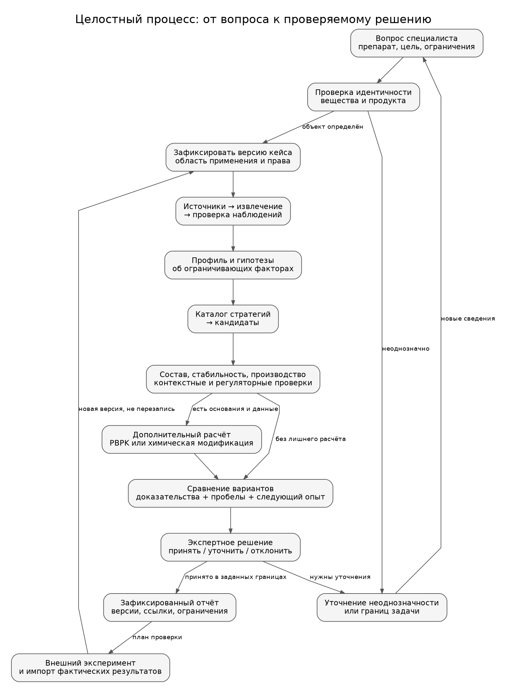

*Авторская проектная схема. Блоки и связи описывают предлагаемую систему, а не подтверждённую реализацию.* [SVG](diagrams/01_process.svg) · [Mermaid](diagrams/01_process.mmd) · [DOT](diagrams/01_process.dot).

<details>
<summary>Редактируемая схема Mermaid — также сохранена внутри этого Markdown-файла</summary>

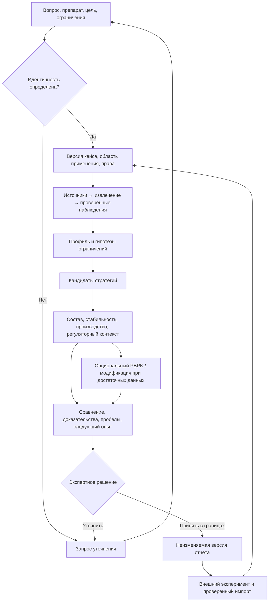

</details>


В схеме принятие отчёта означает, что специалист согласен использовать его **как основание для следующего исследовательского действия в указанных границах**. Оно не превращает гипотезу в подтверждённую эффективность препарата. Экспериментальная ветвь расположена снаружи цифрового ядра и возвращает новые наблюдения только после проверки их происхождения.

Процесс начинается с выбора объекта. Если торговое название соответствует нескольким дозировкам, рынкам или производителям, система показывает кандидатов и различия. Она не должна незаметно выбирать первый результат поиска. При вводе одной структуры система может сформировать молекулярный профиль, но должна явно сообщить, что конкретный продукт, количественный состав и технологический процесс не определены.

После фиксации кейса создаётся план источников и расчётов. План ограничен задачей: поиск растворимости не обязан вызывать все доступные ADMET-модели, а задача стабильности не обязана запускать PBPK. Результаты отдельных действий добавляются в досье с метаданными, а не складываются в неструктурированный чат. Полезный частичный результат доступен пользователю вместе с перечнем невыполненных и неприменимых проверок.

На этапе диагностики разрешены несколько объяснений одновременно. Система не обязана выбрать один ограничивающий фактор, если данные не позволяют этого сделать. Для альтернатив фиксируются поддерживающие и противоречащие наблюдения, различие условий и сведения, способные разграничить гипотезы. Такой результат полезнее точного по форме, но необоснованного единственного диагноза.

Генерация стратегий и проверка конкретного состава разделены. Сначала выбираются направления воздействия, затем для каждого кандидата проверяются доступные данные, ограничения и необходимые уточнения. Подробный количественный состав допустимо формировать только в рамках объявленных входов и имеющейся модели; при качественном составе вывод остаётся стратегическим или требует дополнительных сведений.

## 1.6. Контрольные точки процесса

Следующие контрольные точки — проектные правила управления, а не официальные стадии FDA.

| Контрольная точка | Условие продолжения | Результат при невыполнении |
|---|---|---|
| **G0. Объект и назначение** | Объект однозначен либо явно выбран режим молекулярного анализа | Уточнение; запрет на продуктовые выводы |
| **G1. Право на данные** | Разрешены получение, обработка и соответствующая передача | Источник не используется; сохраняется причина недоступности |
| **G2. Основания профиля** | Данные имеют идентичность, единицы и происхождение | Наблюдения помещаются в спорные; профиль остаётся неполным |
| **G3. Применимость стратегии** | Есть объяснимая связь с задачей и проверены необходимые ограничения | Кандидат отклонён, условен либо оставлен как исследовательский вопрос |
| **G4. Количественная модель** | Заданы вопрос, входы, область применимости и план оценки | Количественный выигрыш не выдаётся; составляется список нужных измерений |
| **G5. Экспертный выпуск** | Обязательные разделы рассмотрены, условия и ограничения сохранены | Черновой отчёт / возврат на доработку |
| **G6. Экспериментальная обратная связь** | Известны образец, метод, условия и фактический результат | Импорт остаётся неподтверждённым и не становится обучающим эталоном |

Для риск-значимых модельных выводов G4 предлагается связывать с карточкой доверия к модели. В июне 2026 года FDA опубликовало окончательное ICH M15, описывающее планирование, оценку и документирование модельных доказательств. Это важное уточнение к нормативной базе предыдущих этапов. [S05](#S05)

## 1.7. Пользовательские сценарии, включая неблагоприятные

### Сценарий A. Анализ конкретного бренда

Пользователь выбирает продукт, дозировку и рынок. Система показывает версию инструкции и статус знания состава: полный количественный, только качественный, частичный или неизвестный. Далее специалист задаёт цель и ограничения. Если в опубликованной инструкции отсутствуют количества компонентов, система не восстанавливает их догадками. Она может сравнить стратегии изменения продукта и запросить частные данные партнёра. Работа с собственным брендом сохраняется; переход к другому продукту не навязывается. Основание этого сценария — прямое требование ТЗ. [P01](#P01)

### Сценарий B. Есть только молекула

Система проверяет структуру и сохраняет её исходное представление, затем получает выбранные свойства и возможные стратегии для молекулярного контекста. Выход не содержит утверждения об оптимизации несуществующей рецептуры. Дозозависимые, продуктовые и производственные проверки имеют статус «не выполнено: отсутствует контекст». После добавления продукта создаётся новая версия кейса и пересматриваются зависимые результаты.

### Сценарий C. Источники противоречат друг другу

Система сначала сравнивает вещество, форму субстанции, метод, единицы и условия, затем определяет, действительно ли наблюдения конфликтуют. Несопоставимые значения не усредняются. Если противоречие не разрешено, обе записи сохраняются, а стратегия получает соответствующее ограничение. Пользователь видит, какую часть решения изменит уточнение конкретного параметра.

### Сценарий D. Источник или предиктор недоступен

Сбой внешнего API, отсутствие лицензии и отсутствие научных данных — разные причины. Система может использовать разрешённый локальный снимок с указанием даты или выполнить ограниченный анализ без инструмента. Она не подписывает результат как актуальный, если использовала старую версию, и не трактует HTTP-ошибку как отсутствие исследований.

### Сценарий E. Пользователь уточняет условия в чате

Фраза «без поверхностно-активных веществ» преобразуется в предлагаемый патч ограничений. Пользователь видит структурированное изменение, перечень затронутых кандидатов и основание их пересмотра. Неизменённые первичные данные не извлекаются заново. Неоднозначная фраза порождает уточнение, а не скрытый запрет на неопределённый класс компонентов.

### Сценарий F. Требуется химическая модификация

Создаётся отдельная ветвь кандидата с новой структурной идентичностью и типом изменения. Свойства исходного вещества не переносятся автоматически на производное. Ретросинтез вызывается только после разрешённого перехода к этой ветви; статус литературного прецедента фиксируется на уровне каждого шага. Соли, полиморфы и ковалентные модификации не объединяются в одну категорию «новая молекула». [P01](#P01) [P03](#P03)

### Сценарий G. Получен отрицательный результат эксперимента

Неудача связывается с конкретным образцом, составом, методом и проверяемой гипотезой. Она не размечается как «эта стратегия не работает для всего класса веществ». Предыдущий отчёт остаётся доступен; новая версия показывает, какое основание изменилось. Негативные результаты не исключаются из будущего набора оценки ради улучшения показателей.

## 1.8. Целый продукт и ограниченная первая реализация

ТЗ предполагает широкий продукт; ограничения первого прототипа здесь являются предложением, а не согласованным изменением темы диплома. [P01](#P01) [P03](#P03)

**Первый проверяемый срез:** пероральные продукты малых молекул; профиль, доказательства, гипотезы ограничений, ограниченный каталог стратегий, контекстные проверки, экспертный отчёт и Markdown-экспорт. Идентичность, права, версионирование и оценка качества входят в первый срез, а не откладываются как необязательная инфраструктура.

**Развитие ядра:** более детальные количественные составы, PBPK при достаточных данных, отдельные классы парентеральных форм, соли и твёрдая фаза, химические модификации и ретросинтез. Добавление происходит по объявленным областям применимости, а не общей кнопкой «поддерживаются все препараты».

**Последующие модули:** мониторинг публикаций и патентов, экспериментальная обратная связь, адаптивное планирование опытов, скрининг генериков и гипотезы побочных эффектов. Они используют те же сущности и происхождение, но имеют отдельные правила оценки и права доступа.

В интерфейсе и отчёте всегда показывается активный профиль возможностей. Если модуль выключен, отсутствует лицензия или задача выходит за его область, это отражается как ограничение покрытия. Нельзя показывать пустую строку так, будто проверка выполнена и риска не найдено.


<a id="chapter2"></a>
# Глава 2. Архитектура решения

## 2.1. Нормативная и техническая основа: что применяется, а что только учитывается

Архитектура описывается несколькими согласованными представлениями: контекст, исполняемые части, предметные данные, последовательность выполнения и границы доверия. Такой способ описания выбран с учётом публичной области ISO/IEC/IEEE 42010:2022 и метода C4. Эти источники не требуют ни микросервисов, ни конкретной базы, ни определённого LLM-фреймворка. [S11](#S11) [S13](#S13)

| Документ / спецификация | Проверенный статус | Использование в проекте | Что не заявляется |
|---|---|---|---|
| ICH Q8(R2), Q9(R1) [S01](#S01) [S02](#S02) | Final: 2009 и 2023 | Цель продукта, характеристики качества и управление рисками | Что предложенная схема БД предписана ICH |
| ICH M9, M13A [S03](#S03) [S04](#S04) | Final: 2021 и 2024 | Разделение задач BCS/биовейвера и биоэквивалентности | Автоматическое регуляторное решение по прогнозу |
| **ICH M15** [S05](#S05) | **Final, июнь 2026** | Карточка контекста, влияния и оценки модельного результата | Универсальная квалификация всех подключённых моделей |
| FDA AI guidance [S06](#S06) | **Draft, январь 2025** | Дополнительный ориентир для риск-ориентированной оценки AI | Что проект документа уже стал обязательным окончательным требованием |
| EMA AI reflection paper [S07](#S07) | Принят в 2024 | Независимая проверка, данные и применимость | Юридическая сертификация на основании reflection paper |
| ICH Q1A(R2) и новый Q1 [S08](#S08) [S09](#S09) | Q1A(R2): Final; новый Q1 на проверенной странице Draft/Step 2b | Стабильность и реестр версий требований | Что проект нового Q1 уже заменил действующую базу |
| ISO 42010:2022 и ISO 25010:2023 [S11](#S11) [S12](#S12) | Опубликованные редакции; прочитаны публичные аннотации | Организация архитектурного описания и требований качества | Полный аудит соответствия платным текстам |
| W3C PROV-DM [S14](#S14) | Recommendation, 2013 | Понятия происхождения: сущность, действие, агент | Полная PROV-сериализация в первой версии |
| UCUM 2.2 [S15](#S15) | 2024 | Машиночитаемые единицы при нормализации | Что единица автоматически задаёт метод и химический контекст |
| JSON Schema 2020-12 [S16](#S16) | Опубликованная спецификация | Проверка структуры сообщений и примеров | Научная истинность корректного JSON |
| OpenAPI [S17](#S17) | Проверена опубликованная 3.2.1 от 10.09.2026; рабочий контракт ниже — 3.1.2 | Версионированный HTTP-интерфейс | Что 3.1.2 является последней версией |
| RFC 9110 и RFC 9457 [S19](#S19) [S18](#S18) | HTTP semantics и Problem Details | Условные обновления, асинхронный ответ, ошибки | Автоматическая надёжность очереди только за счёт HTTP |
| OWASP ASVS [S26](#S26) | Стабильная 5.0.0, 2025 | План технических проверок безопасности | Уже достигнутое соответствие ASVS |

Источники указаны в соответствующих строках таблицы. Конкретные контракты, профили доступа и правила переходов далее являются проектными. «Требуется» в таких разделах означает **критерий предлагаемого продукта**, а не безусловную норму для любой фармацевтической программы.

Применимость регулируемых режимов определяется отдельно для среды эксплуатации. Исследовательский прототип, внутренний инструмент подготовки решения и система, на чьи электронные записи опираются при регулируемой деятельности, не должны автоматически получать один статус. В дальнейшем владелец внедрения должен документировать назначение, границы записей и применимые требования; данный этап их не подменяет. [S10](#S10)

## 2.2. Представление контекста

<a id="diagram-02"></a>

**Схема 02. Контекст системы и ответственность**

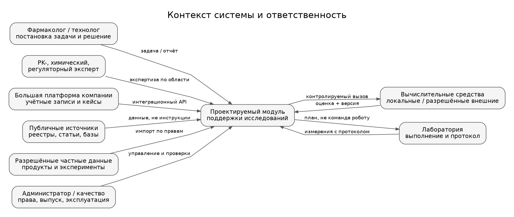

*Авторская проектная схема. Блоки и связи описывают предлагаемую систему, а не подтверждённую реализацию.* [SVG](diagrams/02_context.svg) · [Mermaid](diagrams/02_context.mmd) · [DOT](diagrams/02_context.dot).

<details>
<summary>Редактируемая схема Mermaid — также сохранена внутри этого Markdown-файла</summary>

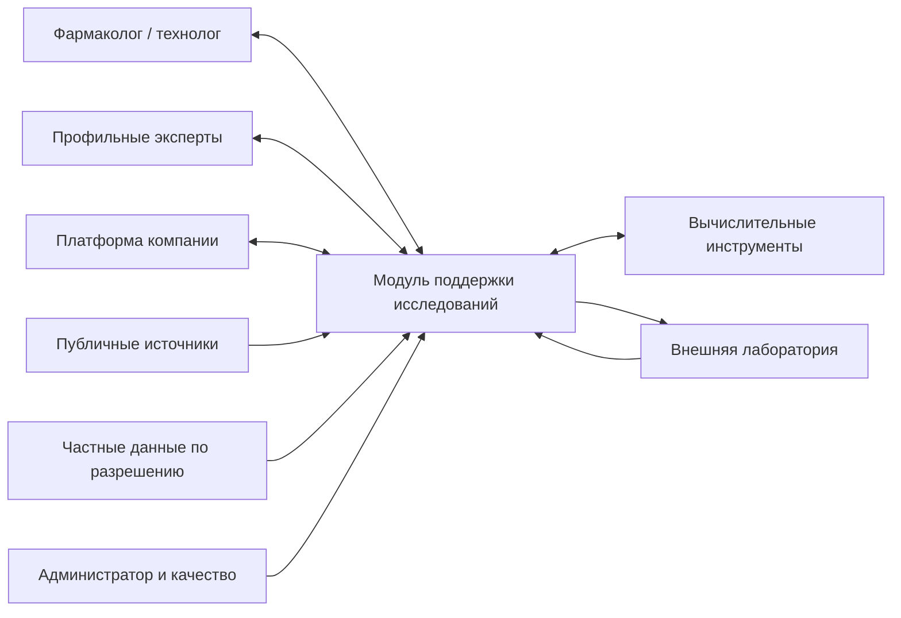

</details>


Граница проектируемого модуля включает управление кейсом, данными, расчётными заданиями, доказательствами и отчётом. Внешние источники, лаборатория и коммерческие движки остаются внешними системами, даже когда пользователь видит их результаты в одном интерфейсе. Недоступность одного внешнего компонента не должна стирать историю кейса или ломать просмотр уже выпущенного отчёта.

Предлагается интегрировать модуль в большую платформу через HTTP API и общие правила авторизации. На первом этапе не требуется переносить в модуль всю корпоративную систему пользователей, документооборота и лабораторного управления. Контракт определяет, какие идентификаторы, роли и артефакты передаются; способ выпуска учётных данных согласуется с командой компании и не выдумывается из её неназванного технологического стека.

## 2.3. Основное архитектурное решение: модульный монолит и выделенные исполнители

**Выбранное проектное решение:** один backend с изолированными логическими модулями, PostgreSQL как основная система записи, отдельное хранилище файлов и отдельные процессы исполнения долгих или изолируемых задач. Это не девятнадцать обязательных микросервисов по числу предметных модулей.

Основания выбора — требования данного проекта: единая история происхождения, согласованность версий кейса, небольшое число разработчиков на дипломном этапе и возможность выделять вычислительные среды независимо. Это оценка сложности проектирования, а не опубликованный benchmark производительности архитектур.

Длительное извлечение документов, модельные запросы, расчёты и экспорт не выполняются в жизненном цикле HTTP-запроса. Документация FastAPI различает простые `BackgroundTasks` и тяжёлые задачи, для которых уместны отдельные средства исполнения. Здесь `BackgroundTasks` не используется как долговременная очередь: задания и их состояния сохраняются в БД до отправки ответа. [S23](#S23)

Выделение самостоятельного сервиса впоследствии допускается при измеримой причине: независимое масштабирование, отдельная юрисдикция данных, иной профиль безопасности, особые зависимости или независимый цикл релизов. Не предлагается начинать с Kubernetes, распределённой шины и нескольких СУБД только для внешней «серьёзности» архитектуры.

### Исполняемые части

<a id="diagram-03"></a>

**Схема 03. Исполняемые части и хранилища**

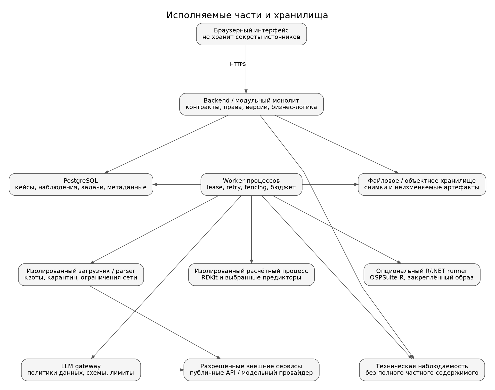

*Авторская проектная схема. Блоки и связи описывают предлагаемую систему, а не подтверждённую реализацию.* [SVG](diagrams/03_containers.svg) · [Mermaid](diagrams/03_containers.mmd) · [DOT](diagrams/03_containers.dot).

<details>
<summary>Редактируемая схема Mermaid — также сохранена внутри этого Markdown-файла</summary>

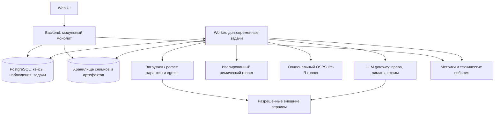

</details>


Термин *container* в C4 означает исполняемое приложение или хранилище на этом уровне представления, а не обязательную упаковку Docker. На схеме показаны функциональные границы; несколько частей могут находиться на одной машине, но не должны получать одинаковые привилегии. [S13](#S13)

| Часть | Предлагаемая реализация | Причина выделения | Условие готовности |
|---|---|---|---|
| Web UI | Браузерное приложение; конкретный UI-фреймворк согласуется с компанией | Отделить рабочее место от вычислений и секретов | Все операции доступны через стабильный backend-контракт |
| Backend | Python, FastAPI, модели валидации | Предметные команды, контроль доступа и версий | Контрактные и предметные тесты |
| Worker | Отдельный процесс той же кодовой базы с очередью в PostgreSQL | Продолжение работы после завершения HTTP-запроса и сбоя процесса | Lease, безопасный повтор, отмена и восстановление проверены |
| Химический runner | Закреплённая среда RDKit и выбранных инструментов | Ограничить последствия невалидного входа и конфликтов зависимостей | Известны версии и воспроизводимые тестовые входы |
| PBPK runner | Опциональный R-процесс с OSPSuite-R и его зависимостями | Иной стек и длительность вычислений | Образ проверен на конкретных моделях и среде |
| Загрузчик и parser | Изолированный процесс с ограниченной сетью и ресурсами | Недоверенные файлы и внешние URL | Тесты вредоносных файлов, URL и лимитов |
| PostgreSQL | Основные сущности, задания, версии и метаданные | Транзакционная связность; один источник истины | Проверены миграции, резервное восстановление и права |
| Файловое хранилище | Для пилота локальный защищённый том; далее согласованное объектное хранилище | Снимки источников и крупные результаты не смешивать с индексами | Контроль целостности, прав и сроков хранения |
| LLM gateway | Адаптер разрешённых локальных или внешних моделей | Единые политики содержимого, лимитов и вызовов | Запрет утечки частных данных и нормализация результатов |

Указанные продукты и библиотеки — проектный выбор. Возможности RDKit и OSPSuite-R подтверждены документацией; их фактическая интеграция в новое приложение пока не выполнена. [S35](#S35) [S42](#S42)

## 2.4. Минимальный профиль размещения и развитие нагрузки

Для первоначального внутреннего пилота предлагаются отдельные процессы backend, worker и PostgreSQL, защищённый каталог артефактов и доступ через корпоративную сеть либо согласованный защищённый шлюз. Даже при одной организации сохраняется `workspace_id`, чтобы право на документы не зависело от предположения «все пользователи одинаковые».

Масштабирование сначала проводится по измеренному узкому месту. Если задержка определяется API источника, добавление workers не увеличивает разрешённую частоту запросов. Если очередь занята PBPK, увеличивается пул соответствующих исполнителей, а не число UI-процессов. Если задерживается извлечение текста, выделяется parser-пул с отдельными лимитами. Эти решения являются предлагаемой политикой эксплуатации.

На первом пилоте для поиска достаточно PostgreSQL full-text search и, при необходимости, точного векторного поиска. Векторный индекс — производный объект, а не основное хранилище знаний. При подключении приближённого поиска следует учитывать, что фильтрация совместно с approximate index может уменьшать полноту результатов; это прямо обсуждается в документации pgvector. Поэтому качество поиска измеряется на разрешённом пользователю корпусе, а не на глобальном наборе документов. [S22](#S22)

Графовая СУБД на старте не требуется: связи происхождения можно хранить как типизированные отношения между версиями в PostgreSQL. W3C PROV-DM задаёт концептуальные понятия, но не требует конкретного типа базы. Переход к отдельному графовому хранилищу допустим после выявления запросов, которые оправдывают дополнительную операционную сложность. [S14](#S14)

## 2.5. Предметная модель данных

<a id="diagram-04"></a>

**Схема 04. Основные предметные сущности и ссылки**

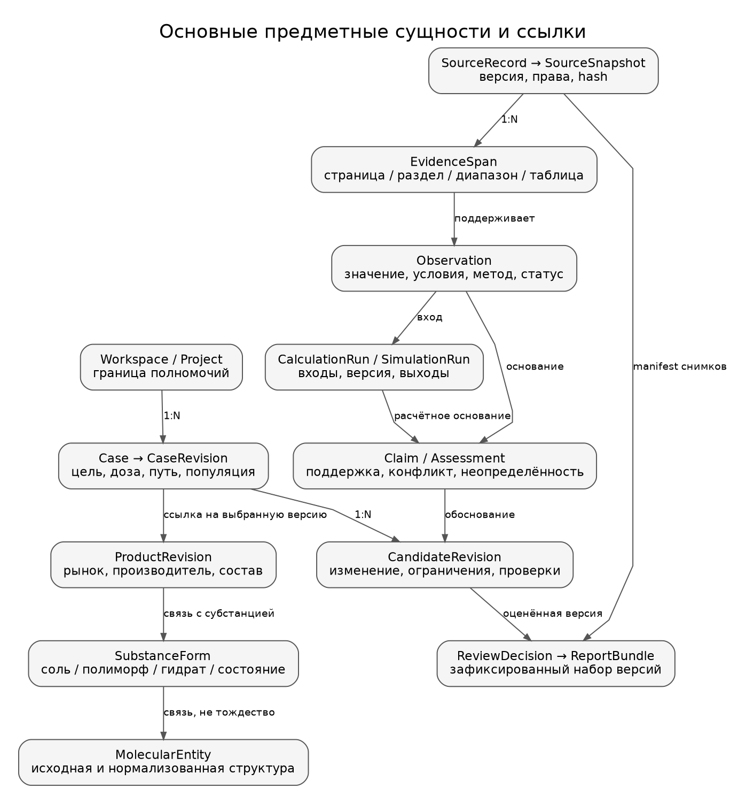

*Авторская проектная схема. Блоки и связи описывают предлагаемую систему, а не подтверждённую реализацию.* [SVG](diagrams/04_data.svg) · [Mermaid](diagrams/04_data.mmd) · [DOT](diagrams/04_data.dot).

<details>
<summary>Редактируемая схема Mermaid — также сохранена внутри этого Markdown-файла</summary>

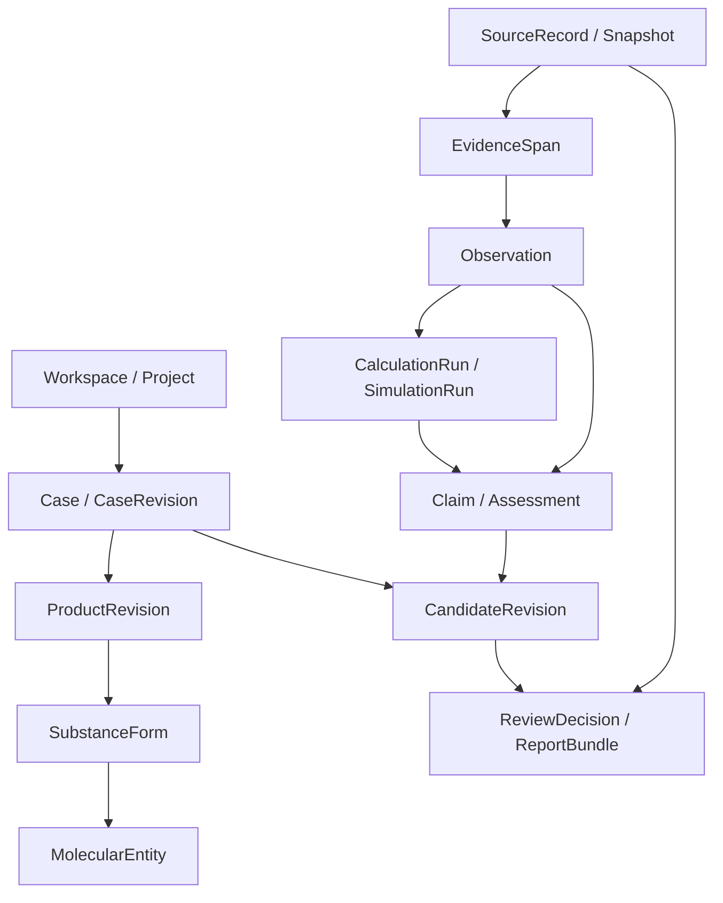

</details>


### 2.5.1. Разделение идентичностей

**`MolecularEntity`** хранит исходное представление, нормализованное представление, внешние идентификаторы и сведения о преобразовании. Неизвестная стереохимия не «исправляется» выбором одного изомера. Исходная строка или структурный файл сохраняются, чтобы специалист мог проверить, что именно было обработано.

**`SubstanceForm`** описывает соль, противоион, стехиометрию, полиморф, гидрат, сольват или иной значимый вариант субстанции, если такие данные известны. Неизвестные свойства остаются неизвестными. Одинаковая родительская структура не означает одинаковую твёрдую форму.

**`ProductRevision`** описывает конкретный продукт: рынок, производителя, дозировку, путь введения, лекарственную форму, известный состав, документ-основание и его версию. Внешние идентификаторы сохраняются строками; ведущие нули и формат источника не теряются. Связь с молекулой не заменяет продуктовый идентификатор.

**`CaseRevision`** добавляет цель, целевую популяцию, требования, конфиденциальность, разрешённые инструменты и выбранный набор версий данных. Каждая вычислительная задача указывает точную версию, а не абстрактный «текущий кейс».

RDKit и ChEMBL Structure Pipeline предоставляют операции проверки и стандартизации, но они могут изменять представление. Например, получение родительского фрагмента не является нейтральным сохранением соли или многокомпонентной системы. В предлагаемом адаптере такие операции имеют явное имя, версию, результат и журнал; исходник никогда не исчезает. [S35](#S35) [S47](#S47)

### 2.5.2. Наблюдение вместо безусловного свойства

Вместо поля `drug.solubility = number` вводится сущность `Observation`. Минимальный смысловой набор:

| Группа полей | Что сохраняется | Ошибка, которую предотвращает |
|---|---|---|
| Объект | Молекула, форма субстанции, продукт или образец | Перенос измерения на другой объект |
| Endpoint | Какое свойство и какой тип значения измеряли | Смешение растворимости, скорости растворения и экспозиции |
| Значение | Число, интервал, знак неравенства, категориальный исход или отсутствие | Превращение «менее X» в точное X |
| Единицы | Исходная и нормализованная единица, правило преобразования | Ошибки масштаба и размерности |
| Условия | pH, температура, среда, время и другие релевантные параметры | Усреднение несопоставимых экспериментов |
| Метод | Тип анализа, протокол, assay или указание на отсутствие сведений | Неверная интерпретация близких названий конечных точек |
| Происхождение | Snapshot, EvidenceSpan, автор извлечения или CalculationRun | Потеря проверяемого основания |
| Качество | Неопределённость, ограничения, конфликт, статус проверки | Выдача слабого основания за установленный факт |

Конкретные поля обязательны **по типу endpoint**, а не все для каждого измерения. Нельзя требовать pH у любого значения лишь ради универсальности схемы; нельзя и считать растворимость сопоставимой, когда условия, нужные для интерпретации, отсутствуют. Обязательность задаётся отдельным профилем наблюдения.

UCUM используется для машинного обозначения единиц. Но «мг действующего основания», «мг соли» и количество в единице готового продукта — не одна семантика только потому, что везде написано `mg`. Для этого предусмотрены `quantity_basis`, `substance_form_ref`, `per_unit` и контекст дозы. Аннотация единицы не заменяет эти сведения. [S15](#S15)

Для количественного состава сохраняются тип доли, основание, количество на единицу или объём, а также неопределённость. Массовые проценты, массово-объёмные проценты и доля компонента в сухом остатке не нормализуются одним безусловным правилом. Сумма долей проверяется лишь тогда, когда известны общий базис и полнота перечисления компонентов.

### 2.5.3. Измеренное, рассчитанное и утверждаемое — разные сущности

Предлагаются три независимых уровня:

- **Наблюдение:** что было сообщено источником или получено в проверенном эксперименте.
- **Расчётный запуск:** что инструмент вычислил для конкретных входов и версии.
- **Утверждение / оценка:** какой вывод предлагается на основании наблюдений и расчётов.

Наблюдение из статьи не становится собственным экспериментом платформы. Извлечение LLM не превращает содержание статьи в проверенный факт автоматически. Расчёт физико-химического дескриптора, статистическое предсказание и механистическая симуляция получают разные `origin_kind` и разные требования к оценке.

Рекомендуемые значения `origin_kind`: `reported_measurement`, `partner_measurement`, `deterministic_calculation`, `ml_prediction`, `mechanistic_simulation`, `expert_judgment`, `synthetic_fixture`. Последнее предназначено только для тестов; такие записи не допускаются в исследовательский корпус без явной демонстрационной маркировки.

## 2.6. Происхождение, версии и жизненный цикл доказательств

В PROV-DM различаются сущности, действия и агенты. В проекте источник или артефакт соответствует сущности; извлечение, нормализация и расчёт — действиям; человек, сервисная учётная запись или версия инструмента — участникам процесса. Это концептуальное отображение, не заявление о полной реализации всех конструкций PROV. [S14](#S14)

Предлагаемые сущности происхождения:

**`SourceRecord`** — библиографическая или регистрационная идентичность документа.  
**`SourceSnapshot`** — конкретно полученное содержимое или разрешённые метаданные с датой, версией, контрольной суммой и правами.  
**`EvidenceSpan`** — точный локатор: страница, раздел, строки, диапазон символов или ячейка таблицы; обязательно указывается система координат.  
**`TransformationRecord`** — операция извлечения или преобразования с входами и версией.  
**`EvidenceLink`** — отношение поддержки, противоречия или ограниченной применимости между утверждением и основанием.

Если полный текст нельзя сохранить по правам, snapshot может содержать только разрешённые метаданные и допустимый фрагмент. Тогда отчёт явно сообщает, что полное автономное воспроизведение первоисточника недоступно. Обычная ссылка и дата доступа не должны изображаться как сохранённая копия документа.

<a id="diagram-05"></a>

**Схема 05. Происхождение и пересмотр без потери истории**

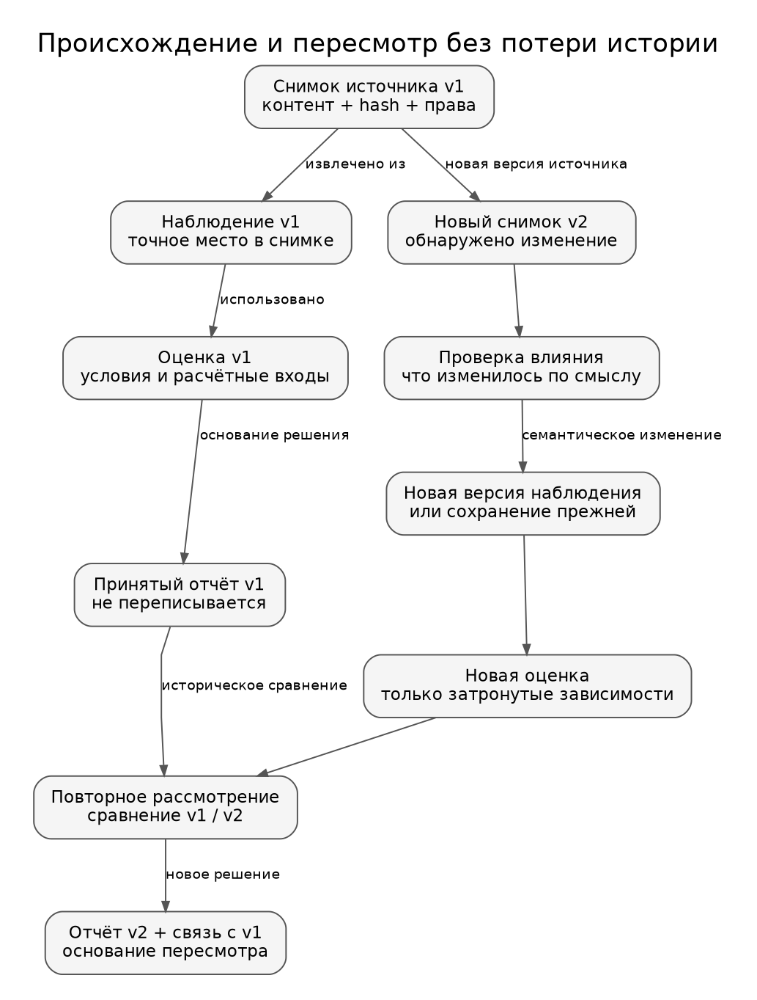

*Авторская проектная схема. Блоки и связи описывают предлагаемую систему, а не подтверждённую реализацию.* [SVG](diagrams/05_provenance.svg) · [Mermaid](diagrams/05_provenance.mmd) · [DOT](diagrams/05_provenance.dot).

<details>
<summary>Редактируемая схема Mermaid — также сохранена внутри этого Markdown-файла</summary>

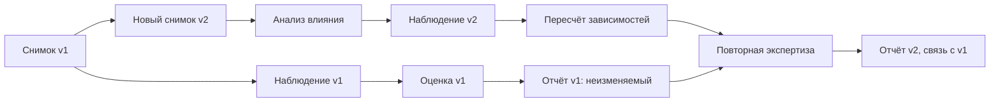

</details>


Обнаружение нового документа или версии запускает **проверку влияния**, а не автоматическое переиздание всех отчётов. Сначала определяется, изменилось ли существенное содержание. Затем пересматриваются зависимые наблюдения, расчёты и кандидаты. Исторический отчёт остаётся неизменяемой записью решения на тот момент; рядом может появиться отметка о новых данных и ссылка на последующую оценку.

Исправление извлечения также создаёт новую версию. Старое неверное значение сохраняется в истории с причиной отзыва и не остаётся активным основанием. Результаты, построенные на нём, помечаются как требующие пересмотра. Это позволяет установить не только факт ошибки, но и её распространение.

Контрольная сумма показывает соответствие байтов сохранённому артефакту. Она **не доказывает научную достоверность**, происхождение от заявленного автора или защиту от администратора, способного изменить и файл, и БД. Для более сильной защиты потребуется отдельный доверенный контур журналирования и хранения; сам по себе столбец `sha256` не называется неизменяемым аудитом.

## 2.7. Источники и внешние адаптеры

Все внешние сервисы подключаются через адаптеры с собственными профилями: версия контракта, поддерживаемые операции, квоты, форматы, права, тайм-аут, политика кэша, обработка ошибок и разрешённые категории данных. Наличие адреса сайта не достаточно для включения инструмента в обязательный workflow.

| Адаптер | Проверенная документацией основа | Предлагаемая реализация | Особая граница |
|---|---|---|---|
| PubChem PUG REST [S30](#S30) | Структуры, идентификаторы, свойства, ограничения запросов | Общий limiter, сохранение запроса/ответа и версии адаптера | Конфиденциальная структура не отправляется автоматически |
| PubChem PUG View [S31](#S31) | Аннотации и происхождение | Отдельная операция получения аннотаций | Не подменять источник аннотации названием агрегатора |
| DailyMed [S32](#S32) [S33](#S33) | REST v2, SPL, история SETID | Привязка к SETID и версии, хранение снимка | Качественный состав не дополняется выдуманными количествами |
| ChEMBL [S34](#S34) | Документированные сущности и пагинация | Переход по `page_meta.next`, сохранение assay-контекста | Первая страница не считается полной выгрузкой |
| FDA IID [S36](#S36) | Официальные прецеденты и FAQ | Версионированный импорт разрешённого формата | Не универсальный whitelist безопасности |
| Orange Book [S38](#S38) | Продуктовые и перечисленные патентные сведения | Отдельный реестр по рынку и дате | Не заключение о патентной свободе |
| ГРЛС [S39](#S39) | Официальный реестр | Контролируемый импорт до подтверждения API | Непроверенный массовый API не предполагается |
| Europe PMC [S40](#S40) | Поиск метаданных и доступного текста | Адаптер после проверки production-контракта и прав | Прямой доступ к документации был ограничен |
| ADMETlab [S41](#S41) | В публикации описаны предикторы, API и неопределённость | Кандидат на адаптер выбранных endpoints | Статья не заменяет проверку текущей авторизации и лицензии |
| OSP / OSPSuite-R [S42](#S42) [S43](#S43) | Документированное выполнение моделей | Изолированный runner с файлами моделей и фиксированными зависимостями | Квалификация конкретного применения выполняется отдельно |
| AiZynthFinder [S44](#S44) | Код, конфигурации поиска, модели и исходные вещества | Опциональный локальный runner | Лицензии весов и данных рассматриваются отдельно от кода |

Документация приведена в каждой строке. Публичная веб-форма SwissADME и коммерческие сервисы из этапа 2 не вызываются скрейпингом «по умолчанию». До подтверждения прав и технического контракта они остаются базовой линией ручной проверки либо опциональной интеграцией. [P03](#P03)

Документация PubChem просит не превышать пять запросов в секунду и описывает динамическое ограничение. Поэтому квота применяется на уровне приложения, а не независимо в каждом worker. Обработчик проверяет статус и тип содержимого: ошибка сервиса может быть HTML, даже если ожидался JSON. [S30](#S30)

Даты `published_at`, `source_updated_at`, `retrieved_at` и `effective_from` не смешиваются. Дата получения говорит о времени доступа, но не о свежести самих данных и не о вступлении регуляторного документа в силу. Если поле не установлено источником, оно остаётся неизвестным.

Каждый ответ адаптера содержит признак полноты: `complete_for_request`, `partial`, `rate_limited`, `access_denied`, `not_found`, `schema_changed` либо `failed`. Статус относится к выполнению запроса, а не к существованию всех возможных научных данных по теме.

## 2.8. Контракты модулей и внутренний HTTP API

Обмен выполняется типизированными объектами, а не произвольными текстовыми сообщениями между агентами. Используется JSON Schema 2020-12; backend проверяет типы и отдельно предметные инварианты. Pydantic strict mode может помогать ограничивать приведение типов, но особенности JSON и научная семантика проверяются дополнительным кодом. [S16](#S16) [S24](#S24)

### Общая оболочка результата

Каждый модуль возвращает как минимум:

| Поле | Значение для процесса |
|---|---|
| `schema_version`, `module_id` | Контракт и производитель результата |
| `workspace_id`, `case_revision_id`, `run_id` | Полномочия и точный контекст |
| `execution_status` | Успешен ли технический этап, частичен ли он, заблокирован ли |
| `scientific_status` | Рассчитано, поддерживается данными, неопределённо, вне области или неприменимо |
| `input_refs`, `output_refs` | Версии входов и артефактов, а не только имена |
| `evidence_refs` | Основания, если результат содержит внешние утверждения |
| `warnings`, `missing_inputs` | Ограничения и то, что нужно дополнить |
| `tool_versions`, `policy_version` | Версии исполнителей и ограничений |
| `created_at`, `content_hash` | Время и идентификатор содержимого |

Научный статус не выводится из `execution_status == succeeded`. Успешный запуск модели может вернуть результат вне области применимости. Технически корректный обзор может содержать нерешённый научный конфликт. Экспертное согласование хранится отдельно и не изменяет происхождение прогнозов на «эксперимент».

### Предлагаемые операции приложения

| Операция | Назначение | Существенная семантика |
|---|---|---|
| `POST /v1/cases` | Создать кейс | Сервер определяет workspace из полномочий, а не доверяет произвольному полю |
| `POST /v1/cases/{id}/revisions` | Предложить новую версию | Фиксируется основание изменения и исходная версия |
| `POST /v1/case-revisions/{id}/runs` | Запустить разрешённый workflow | Возвращает `202` и `run_id`, не готовый научный результат |
| `GET /v1/runs/{id}` | Состояние и ссылки на результаты | Частичные этапы и ограничения доступны отдельно |
| `POST /v1/runs/{id}/cancel` | Запрос отмены | Отмена может быть запрошена до фактической остановки |
| `POST /v1/reviews` | Решение специалиста по фиксированным версиям | Повторная проверка полномочий и актуальности snapshot |
| `POST /v1/report-bundles` | Выпустить пакет | Проверяются допустимые источники, статус и версия решения |
| `GET /v1/artifacts/{id}` | Получить артефакт | Права проверяются заново, а не только при создании ссылки |

Это **внутренние проектные маршруты**, не действующие API PubChem, DailyMed или других систем. В комплект включён ограниченный фрагмент OpenAPI для запуска и получения результата; он не выдаётся за полную спецификацию всего продукта.

Опубликована OpenAPI 3.2.1. Для приложенного первичного контракта выбран формат 3.1.2, поскольку обязательность перехода на новейшую редакцию до проверки генераторов и валидаторов не обоснована. Версия самого приложения `0.1.0` независима от версии спецификации. [S17](#S17)

Ошибки HTTP используют структуру Problem Details: понятное описание, стабильный тип ошибки и идентификатор события без раскрытия секретов. Предметные коды вроде `identity_ambiguous` и `model_not_applicable` дополняют, но не заменяют HTTP-статус. [S18](#S18)

Изменение текущего указателя версии защищается условным запросом по ETag/`If-Match`. При устаревшей версии сервер возвращает ошибку предусловия, а не молча перетирает изменения второго специалиста. Длительная задача, принятая с `202`, запрашивается через отдельный ресурс состояния; семантика HTTP не обещает её успешного завершения. [S19](#S19)

## 2.9. Надёжное выполнение: очередь, повтор, отмена и частичный результат

<a id="diagram-06"></a>

**Схема 06. Асинхронное выполнение и безопасное повторение**

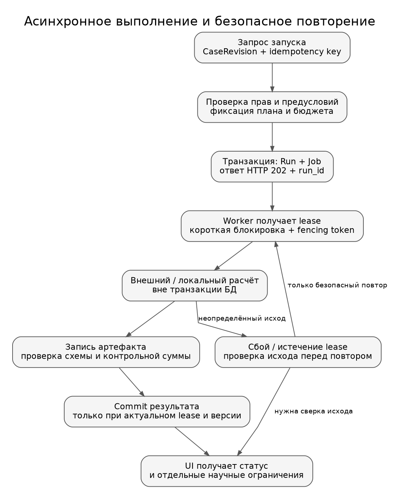

*Авторская проектная схема. Блоки и связи описывают предлагаемую систему, а не подтверждённую реализацию.* [SVG](diagrams/06_job.svg) · [Mermaid](diagrams/06_job.mmd) · [DOT](diagrams/06_job.dot).

<details>
<summary>Редактируемая схема Mermaid — также сохранена внутри этого Markdown-файла</summary>

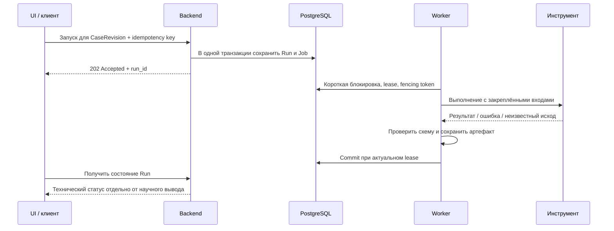

</details>


Предлагается очередь заданий в PostgreSQL для первого развёртывания. Документация `SKIP LOCKED` допускает применение к queue-like таблицам при нескольких потребителях. Это только примитив; lease, повтор, восстановление и учёт внешних действий должны быть реализованы и испытаны отдельно. [S21](#S21)

**Последовательность получения задания:** worker в короткой транзакции выбирает доступную запись, присваивает lease и увеличивает fencing token; затем освобождает блокировку. Расчёт выполняется вне транзакции. Продление lease не должно бесконечно скрывать зависший процесс: действует предельное время и контроль прогресса. Записать итоговый результат может только текущий владелец актуального token.

**Гарантия процесса:** допустим повтор выполнения попытки; бизнес-результат публикуется идемпотентно. Гарантия `exactly-once` для произвольного внешнего вызова не заявляется. Если API успел принять запрос, но соединение оборвалось, результат может быть неизвестен. Перед повтором система проверяет доступный внешний идентификатор; при невозможности сверки переводит действие в `needs_reconciliation`, а не бесконтрольно повторяет платный или изменяющий состояние запрос.

**Идемпотентность:** ключ области `(workspace, operation, client_key)` связывается с hash нормализованного тела запроса. Повтор с тем же содержимым возвращает существующий запуск; повтор с другим содержимым отклоняется как конфликт. Кэш расчётов использует другой ключ: входы, контекст, версия модели, параметры и область полномочий. Общий ключ только по SMILES недопустим для продуктового анализа.

**Публикация файлов:** worker записывает артефакт во временное размещение, проверяет формат и контрольную сумму, затем фиксирует метаданные и ссылку. Файл, не связанный с завершённой записью, не показывается пользователю и может быть убран процедурой очистки. Транзакция PostgreSQL не объявляется общей атомарной транзакцией с произвольным объектным хранилищем.

**Повторные попытки:** разрешены для явно временных и безопасно повторяемых ошибок. Ошибка схемы ответа, изменённый контракт, отсутствие права или неверная идентичность не исправляются бесконечным повтором. Квота и общий бюджет учитывают все попытки, включая неудачные.

**Отмена:** сначала фиксируется `cancel_requested`, затем runner прекращает работу в поддерживаемой точке или принудительно останавливается в пределах инфраструктурных правил. До подтверждения остановки запуск не обозначается как полностью отменённый. Поздний результат отменённой или потерявшей lease попытки не становится активным основанием отчёта.

<a id="diagram-07"></a>

**Схема 07. Состояния запуска: частичный результат не маскируется**

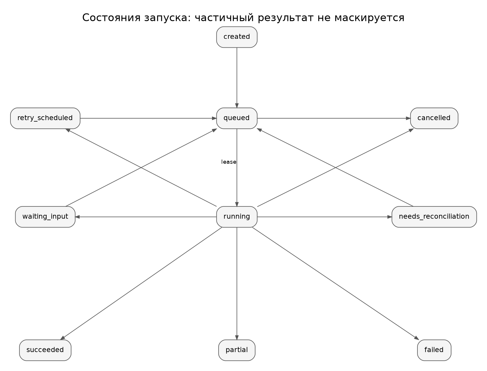

*Авторская проектная схема. Блоки и связи описывают предлагаемую систему, а не подтверждённую реализацию.* [SVG](diagrams/07_states.svg) · [Mermaid](diagrams/07_states.mmd) · [DOT](diagrams/07_states.dot).

<details>
<summary>Редактируемая схема Mermaid — также сохранена внутри этого Markdown-файла</summary>

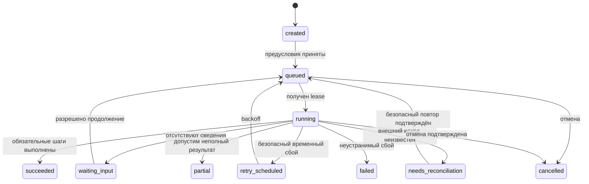

</details>


Статусы схемы относятся к запуску. `waiting_input` — ожидание дополнительных сведений, а не работа в фоновом процессе без участия человека. `succeeded` означает выполнение обязательных технических стадий; необходимость экспертного рассмотрения хранится отдельным признаком. `partial` всегда сопровождается перечнем неуспешных или пропущенных шагов и оценкой влияния на вывод.

## 2.10. Управление LLM: роль ограниченного координатора

LLM применяется в извлечении, формулировании поисковых запросов, сопоставлении объяснений и подготовке понятного текста. Она не получает полномочий изменять нормативные правила, выбирать произвольный адрес для передачи документа, переписывать первичные данные, утверждать научную пригодность собственной модели или запускать неразрешённый исполняемый код.

Предлагается **детерминированный каркас процесса с ограниченными LLM-действиями**. Каркас задаёт разрешённые стадии, предусловия, бюджет и тип выхода. Модель внутри стадии может предложить запрос, извлечённую запись или объяснение; программный код проверяет объект и решает, можно ли его принять. Ошибка структуры допускает ограниченное исправление; после исчерпания попыток стадия завершается с явным статусом.

Каждая операция использует минимально достаточный контекст. Для извлечения свойства нужен конкретный документ и схема, а не вся история проекта. Для объяснения кандидата нужны зафиксированные результаты проверок и ссылки, а не доступ ко всей БД. Научные основания передаются как данные с идентификаторами; текст источника не может расширить список инструментов.

Проверка источников должна включать: существование указанного snapshot; право текущего проекта на него; наличие фрагмента; соответствие объекта; поддержку конкретного утверждения. Существующий DOI без связи с утверждением недостаточен. Автоматическая языковая оценка поддержки может помогать куратору, но не считается независимой научной экспертизой.

«Второй агент согласился с первым» не является новой экспериментальной линией доказательств. Согласие моделей можно записать как результат дополнительной проверки текста, но нельзя добавлять его в количество независимых исследований.

## 2.11. Оценка пригодности расчётной модели

Для каждого существенного прогноза создаётся **`ModelUseAssessment`**, привязанный к версии инструмента и конкретному контексту. Поля предлагаются на основании различения вопроса, применения, влияния и риска в ICH M15; это адаптация для приложения. [S05](#S05)

Карточка содержит исследовательский вопрос; роль прогноза в решении; последствия ошибки; входную область; источник обучения или параметризации; независимые данные оценки, если они доступны; критерии, принятые до проверки; результаты технических и научных тестов; ограничения и экспертный вывод о пригодности. Неизвестные сведения отмечаются отдельно. Отсутствие опубликованной обучающей выборки у внешнего сервиса не компенсируется придуманным описанием.

Для ML-предиктора различаются неопределённость самого прогноза, химическая область, смещение выборки и пригодность endpoint. Для PBPK различаются параметры, использованные при настройке, наблюдения для независимой проверки и сценарии, в которых делается новый прогноз. Использование тех же данных для калибровки и «проверки» не выдаётся за независимый результат.

OECD QAF рассматривает оценку модели и отдельных прогнозов раздельно; эта граница полезна для реестра инструментов. Хорошо опубликованная модель не получает автоматический допуск к любой новой молекуле и любому продукту. Полное прохождение формальной процедуры QAF здесь не утверждается. [S45](#S45)

Количественный блок возвращает не только график, но и набор входов, версию модели, статус оценки, ограничения и чувствительность к выбранным предположениям. Когда допустимый для решения диапазон не установлен, система не заменяет его произвольным «доверительным интервалом» из LLM.

## 2.12. Безопасность, конфиденциальность и границы доверия

<a id="diagram-09"></a>

**Схема 09. Граница доверия к внешним документам и LLM**

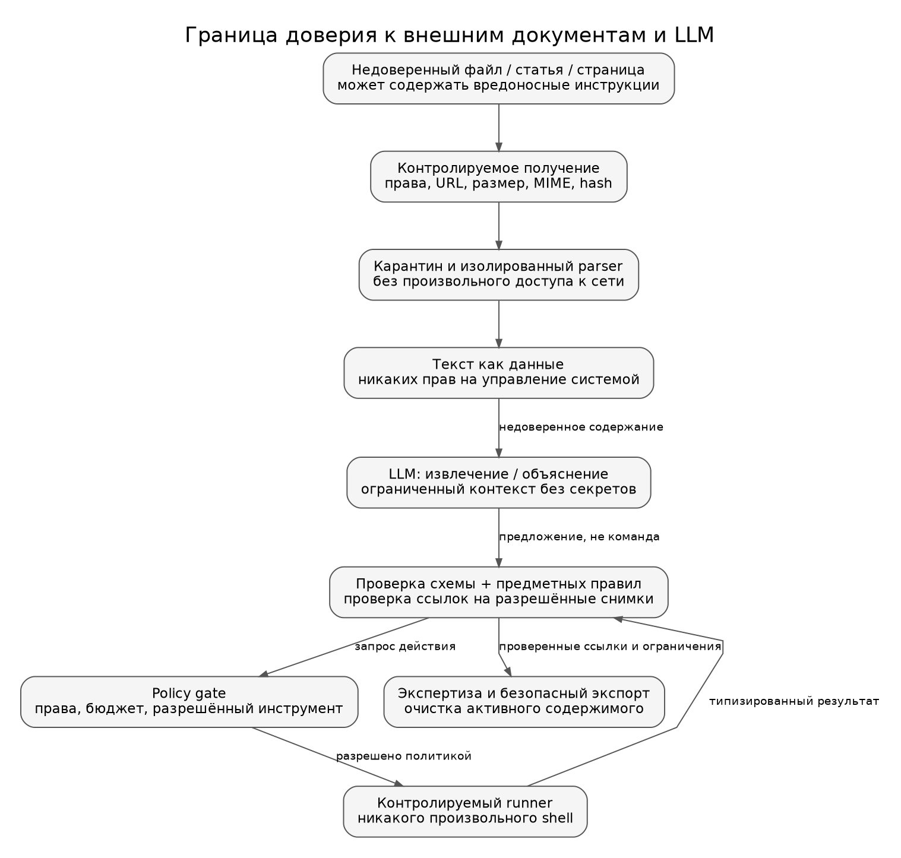

*Авторская проектная схема. Блоки и связи описывают предлагаемую систему, а не подтверждённую реализацию.* [SVG](diagrams/09_trust.svg) · [Mermaid](diagrams/09_trust.mmd) · [DOT](diagrams/09_trust.dot).

<details>
<summary>Редактируемая схема Mermaid — также сохранена внутри этого Markdown-файла</summary>

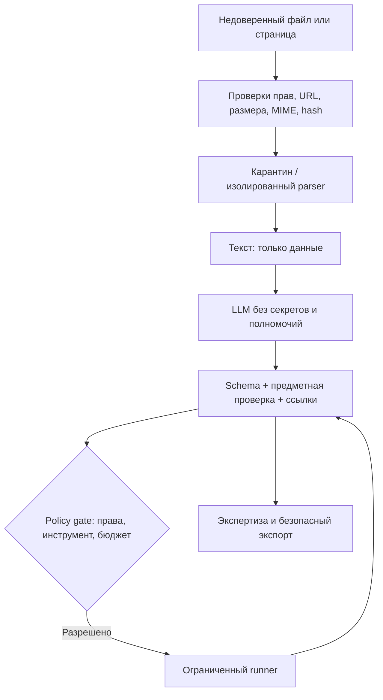

</details>


Документ, содержащий научный текст, остаётся недоверенным входом. Prompt injection может попадать в агент через извлекаемые материалы; добавление RAG не устраняет проблему само по себе. Поэтому полномочия задаются вне модели и проверяются при каждом действии. [S27](#S27)

### Доступ к частным данным

Каждый документ, кейс, артефакт и расчёт имеет область доступа. Предлагается начать с явной проектной изоляции; при мультиорганизационном внедрении добавить разделение организаций. В SQL используются политики доступа, однако приложение работает не под владельцем таблиц, не под superuser и не с `BYPASSRLS`: такие роли могут обходить обычные ограничения PostgreSQL. При необходимости применяются `FORCE ROW LEVEL SECURITY` и отдельные роли эксплуатации. [S20](#S20)

Проверка прав выполняется до передачи фрагментов LLM, до ранжирования результатов в пользовательском контексте и при выдаче файла. Нельзя сначала искать по всему частному корпусу, передавать найденное модели, а затем скрывать чужие ссылки в UI. Производные индексы, кэши, очереди и журналы также учитывают область доступа. Тесты проверяют отсутствие утечки не только в API-ответе, но и в подсказках, статистике и артефактах.

### Выход за пределы организации

Конфиденциальный SMILES сам по себе является содержимым проекта. Удаление названия компании не делает его разрешённым для внешнего API. До вызова проверяются категория данных, провайдер, назначение и соглашение. При отсутствии разрешения используется локальный путь либо результат «внешняя обработка запрещена». Hash структуры не объявляется достаточной анонимизацией для любого сценария.

### Файлы, сеть и отчёт

Загрузчик ограничивает назначения URL, разрешённые схемы, адреса внутренних сетей, перенаправления, размер ответа и время выполнения. Произвольный URL из текста статьи не становится разрешённой командой сетевого инструмента. Меры проектируются с учётом OWASP SSRF Prevention. [S28](#S28)

Файлы проходят проверку типа и размера, карантин и изолированную обработку. Parser не получает общие секреты, доступ к локальным конфиденциальным каталогам и неограниченную сеть. Отдельно проверяются архивы, вложенности, внешние сущности в XML и ресурсоёмкие документы. Эти меры соответствуют предмету рекомендаций OWASP File Upload, но полнота реализации должна быть испытана. [S29](#S29)

При экспорте убираются активное HTML-содержимое, исполняемые ссылки и нежелательные удалённые ресурсы. Mermaid-код и внешние названия также проходят безопасную обработку; исходные данные не становятся непроверенной HTML-разметкой. Офлайн-отчёт не содержит токенов, подписанных краткоживущих URL или чужих частных фрагментов.

### Аудит и технические журналы

Научное происхождение, аудит действий и диагностические логи — три разных слоя. Аудит отвечает «кто изменил или утвердил версию», provenance — «на основании чего получен вывод», технические сигналы — «как выполнялась система». OpenTelemetry предоставляет подход к метрикам, трассировкам и журналам, но не заменяет первые два слоя. [S25](#S25)

В техническую телеметрию по умолчанию не записываются полные промпты, документы, структуры и персональные сведения. Для диагностического захвата требуется отдельная политика с правами, сроком хранения и маскированием. Срок хранения научных артефактов, правила удаления и необходимость особого режима записей определяются владельцем внедрения, а не произвольным числом в дипломе.

## 2.13. Требования качества и проверяемые нефункциональные свойства

ISO/IEC 25010:2023 используется как ориентир при описании качества продукта; публичная карточка новой редакции говорит о девяти характеристиках. Ниже приведён **собственный набор проверяемых требований**, а не пересказ полной нормативной модели. [S12](#S12)

| Требование проекта | Как проверяется | Неприемлемый результат |
|---|---|---|
| Целостность научного контекста | Изменить форму/дозу/источник и проследить зависимости | Старый прогноз показан как выполненный для новых условий |
| Воспроизводимость | Повторить расчёт по сохранённым входам и закреплённой среде | Нельзя установить использованную модель или параметры |
| Управляемая недетерминированность | Сохранить LLM-выход, конфигурацию и корпус | Повторный текст без предупреждения заменяет прежнее основание |
| Надёжность выполнения | Остановить worker во время разных стадий | Потеря задания, двойное бизнес-действие или чужой результат |
| Изоляция проектов | Попытки доступа через API, поиск, кэш, артефакты | Частное содержание попало в чужой контекст |
| Контролируемая стоимость | Проверить бюджет вызовов и остановку | Бесконечные циклы поиска или повторных запросов |
| Наблюдаемость | Восстановить ход выполнения по идентификаторам | Есть общий error, но не определён ошибочный шаг |
| Переносимость экспорта | Открыть пакет без сервиса и интернета | Пропали существенные ссылки, версии или изображения |
| Сопровождаемость | Заменить адаптер без изменения предметных модулей | Формат внешнего API проник в каждый модуль |
| Понятность результата | Эксперт различает измерение, прогноз и отсутствие данных | Цвет или рейтинг создаёт ложное впечатление одобрения |

Численные SLO времени ответа, размер корпуса, число параллельных кейсов, RPO/RTO и бюджеты должны быть приняты после пилотной нагрузки и требований владельца. В этом отчёте не выдаются вымышленные нормативы «99,99% доступности» или «полный анализ за 30 секунд». Однако наличие измерения, ограничений ресурсов и проверенного восстановления — обязательное проектное условие допуска пилота.

## 2.14. Архитектурные решения и отвергнутые альтернативы

| ADR | Решение | Альтернатива | Почему выбран такой старт; когда пересмотреть |
|---|---|---|---|
| ADR-01 | Модульный монолит + отдельные workers | Микросервис для каждой функции | Меньше распределённых состояний; пересмотреть при независимых командах и нагрузке |
| ADR-02 | Версионированное досье как основа | История чата как единственное состояние | Можно проверять причинные связи; чат остаётся интерфейсом |
| ADR-03 | PostgreSQL как основная запись | Одновременно графовая, документная и векторная БД | Согласованность и проще восстановление; выделять хранилище при доказанной необходимости |
| ADR-04 | Факты, прогнозы и решения раздельно | Один общий confidence score | Не смешиваются разные виды неопределённости |
| ADR-05 | Управляемый workflow с ограниченными LLM-шагами | Неограниченная группа автономных агентов | Явные предусловия, бюджет и полномочия; автономность увеличивать только после тестов |
| ADR-06 | Внешний инструмент за адаптером | Прямые вызовы из каждой функции | Замена API не разрушает предметный контракт |
| ADR-07 | Опциональный квалифицированный PBPK | Обязательная симуляция для каждого вещества | Нет ложной точности при недостатке данных |
| ADR-08 | Человек выпускает решение | Модель утверждает собственный отчёт | Ответственность и научные границы остаются явными |
| ADR-09 | Markdown как первичный читаемый экспорт | Только PDF / интерфейс | Требование пользователя и возможность проверять версии; HTML/PDF остаются дополнительными рендерами |
| ADR-10 | Никакого автоматического переобучения от чата | Обучение на любом исправлении пользователя | Отделены шум обратной связи, проверенные данные и независимая оценка |

ADR — предлагаемые записи архитектурных решений. Для каждого при реализации сохраняются дата, автор, статус, основания и условия пересмотра. Они не являются результатами сравнительного внедрения перечисленных вариантов.


<a id="chapter3"></a>
# Глава 3. На какие модули разбить решение и почему

## 3.1. Принцип декомпозиции

Предлагаются **19 логических модулей**. Границы определены не числом экранов и не числом агентов, а разными видами входных данных, ответственности, неопределённости и проверки. Модуль отвечает за собственный результат и не меняет чужую сущность прямой записью в таблицу. Исполняемый процесс может обслуживать несколько модулей; отдельный процесс нужен там, где этого требуют зависимости, длительность или безопасность.

Критерий хорошей границы: можно сформулировать вход, результат, предметный инвариант и негативный тест. Например, извлечение отвечает за правильную передачу содержания источника, а научная оценка — за применимость этого содержания к кейсу. Их объединение в один генеративный шаг затруднило бы установление причины ошибки. Это архитектурный вывод из требований и проблем, рассмотренных на первых двух этапах. [P01](#P01) [P03](#P03)

<a id="diagram-08"></a>

**Схема 08. Логические модули: порядок обработки, а не обязательные микросервисы**

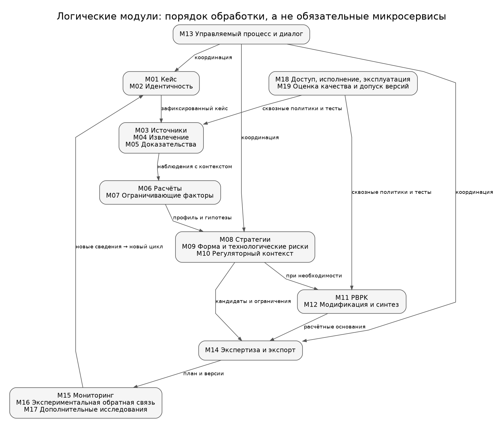

*Авторская проектная схема. Блоки и связи описывают предлагаемую систему, а не подтверждённую реализацию.* [SVG](diagrams/08_modules.svg) · [Mermaid](diagrams/08_modules.mmd) · [DOT](diagrams/08_modules.dot).

<details>
<summary>Редактируемая схема Mermaid — также сохранена внутри этого Markdown-файла</summary>

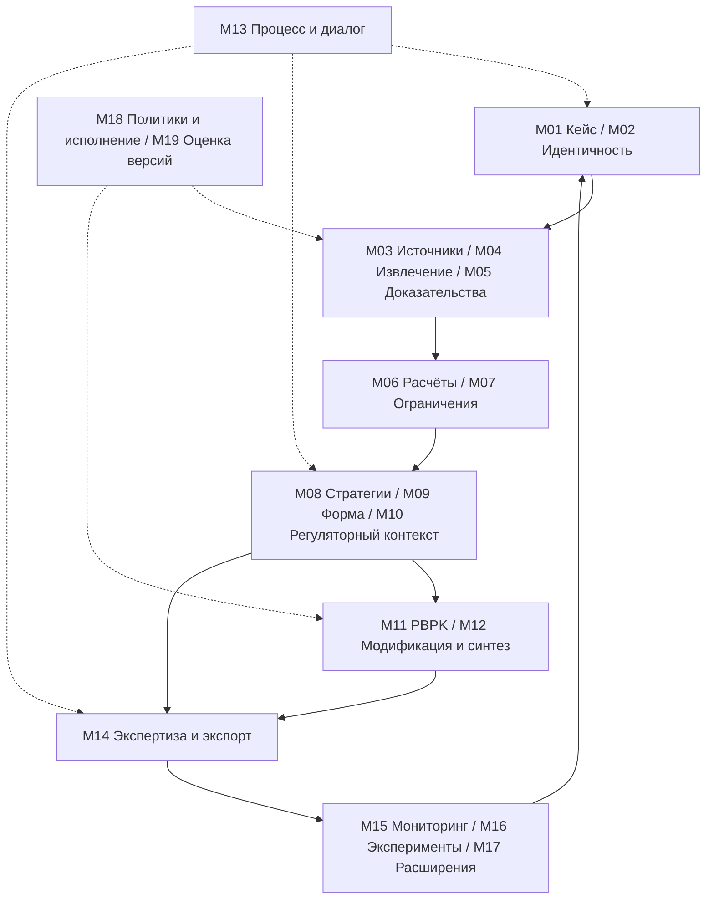

</details>


Стрелки схемы показывают обработку артефактов. Они не означают обязательные прямые вызовы между всеми модулями. Координация принадлежит M13: он передаёт версии входов, собирает результаты и проверяет предусловия. M18 обеспечивает технические полномочия и исполнение; M19 проверяет версии системы и научную пригодность компонентов в объявленной области.

## 3.2. Реестр модулей, собственность на данные и этап включения

| ID | Модуль | Собственные результаты / сущности | Что использует, но не переписывает | Включение |
|---|---|---|---|---|
| M01 | Исследовательский кейс и требования | Case, CaseRevision, RequirementSet | Продуктовые версии и документы | Первый срез |
| M02 | Идентичность вещества и продукта | IdentityResolution, MolecularEntity, SubstanceForm, ProductRevision | Снимки источников | Первый срез |
| M03 | Получение и версии источников | SourceRecord, SourceSnapshot, ImportManifest | Политику доступа M18 | Первый срез |
| M04 | Извлечение и нормализация | ExtractionBatch, ObservationDraft, TransformationRecord | Исходные snapshot | Первый срез |
| M05 | Доказательства, поиск и конфликты | Observation, EvidenceSpan, EvidenceLink, ConflictSet | Выходы расчётов и решения эксперта | Первый срез |
| M06 | Вычислительные инструменты | CalculationRun, PredictionResult | Входные наблюдения, допуск модели | Первый срез, по нужным endpoints |
| M07 | Оценка ограничивающих факторов | BarrierAssessment, DiagnosticGapSet | Профиль и расчётные данные | Первый срез |
| M08 | Каталог и отбор стратегий | StrategyDefinition, CandidateRevision, RankingResult | Результаты проверок M09–M12 | Первый срез |
| M09 | Форма, состав и технологические ограничения | FormulationAssessment, CompatibilityAssessment, StabilityGapSet | Кандидатов и результаты IID-поиска | Первый срез; сложные формы позже |
| M10 | Регуляторный контекст | RegulatoryRuleSet, ApplicabilityCheck | Официальные документы и кейс | Базовые справки в первом срезе |
| M11 | PBPK/PBBM | SimulationPlan, SimulationRun, ModelUseAssessment | Квалифицированные модели и наблюдения | По достаточности данных |
| M12 | Модификация и ретросинтез | ModificationProposal, RoutePlan, RouteCheck | Исходную идентичность и литературные прецеденты | Расширение ядра |
| M13 | Управляемый workflow и диалог | WorkflowPlan, RunPlan, ConversationTurn, ProposedPatch | Предметные сущности остальных модулей | Первый срез |
| M14 | Экспертное решение и экспорт | ReviewDecision, ReportBundle | Зафиксированный набор входов и выходов | Первый срез |
| M15 | Мониторинг изменений | WatchDefinition, ChangeEvent, UpdateAssessment | Источники, кейсы и принятые отчёты | После стабильного ядра |
| M16 | Экспериментальная обратная связь | ExperimentPlan, ExperimentBatch, FeedbackDecision | Кандидатов и исходные протоколы | Ручной импорт рано; оптимизация позже |
| M17 | Дополнительные исследования | GenericOpportunity, SafetyHypothesis | Общий граф доказательств | Отдельные опциональные профили |
| M18 | Доступ, исполнение и эксплуатация | PolicySet, Job, ArtifactMetadata, AuditEvent, технические метрики | Содержимое научных артефактов в пределах необходимости | Первый срез |
| M19 | Оценка качества и допуск версий | BenchmarkManifest, EvaluationRun, ReleaseAssessment | Замороженные тестовые данные и версии компонентов | Первый срез |

Общее физическое хранение не означает общее право изменения. Например, M14 может отозвать собственное решение, но не заменяет значение наблюдения M05. M04 создаёт черновое извлечение; принятые наблюдения сохраняются через контракт M05. M18 управляет размещением файла и правами, но не меняет его научное содержание. Корректировка оформляется новой версией владельца сущности.

## 3.3. Модули M01–M05: контекст и доказательная основа

### M01. Кейс и требования

**Причина выделения:** результат зависит от цели, дозы, популяции, пути и ограничений. Без самостоятельного владельца контекста чат мог бы незаметно менять смысл запроса, а расчёты оставались бы связанными со старой постановкой. Направление соответствует QTPP-подходу к разработке, но проектный `RequirementSet` не объявляется регуляторным QTPP-документом. [S01](#S01)

Модуль хранит требования в структурированном виде: область действия, тип ограничения, значение, единицу при необходимости, источник требования, обязательность и статус согласования. Предпочтение «желательно дешевле» отличается от жёсткого «только пероральная форма». Требование хранить при комнатной температуре задаёт целевой сценарий, а не подтверждает, что конкретный кандидат выдерживает его.

М01 не выбирает научную стратегию. Его результат — однозначная версия вопроса, на которую остальные модули имеют право отвечать.

### M02. Идентичность

**Причина выделения:** ошибка выбора вещества или продукта делает корректно выполненные дальнейшие вычисления нерелевантными. Разрешение названия, структурная стандартизация и установление продуктового контекста требуют отдельной диагностики и подтверждения.

Модуль работает с кандидатами соответствия и типами отношений: то же молекулярное соединение, соль того же основания, связанный продукт, другая дозировка, неподтверждённый синоним. Эти отношения не сворачиваются в один `same_as`. Опасные преобразования — например удаление фрагмента или неопределённой стереохимии — требуют явного режима и журналирования. [S35](#S35) [S47](#S47)

М02 не выводит полиморф из молекулярной строки и не определяет качественную рецептуру по одному INN. Он возвращает либо подтверждённый контекст, либо перечень неоднозначностей с конкретным вопросом пользователю.

### M03. Источники

**Причина выделения:** каждый источник имеет свой формат, права, частоту обновления и режим отказа. Нельзя смешивать ошибку доступа с научным отсутствием сведений или разрешать каждому агенту самостоятельно загружать произвольные файлы.

Модуль отвечает за источниковую идентичность, версии, документы, пагинацию, контрольную сумму и полноту запроса. Он различает первичный материал, зеркало, пересказ, препринт и опубликованную версию по доступным сведениям. Связь между публикациями устанавливается с сохранением уверенности; совпадение заголовка не всегда достаточно.

М03 не оценивает истинность статьи. Он формирует надёжный вход для извлечения и сохраняет ограничения доступности. Наличие документированного API у DailyMed и ChEMBL помогает автоматизировать этот слой; ГРЛС и ограниченно проверенный Europe PMC не получают придуманный статус готовой интеграции. [S32](#S32) [S33](#S33) [S34](#S34) [S39](#S39) [S40](#S40)

### M04. Извлечение и нормализация

**Причина выделения:** преобразование текста и таблиц в наблюдения имеет собственные ошибки: единицы, знаки неравенства, принадлежность строки, подписи таблицы и потеря условий. Эти ошибки нужно оценивать независимо от рассуждения о стратегии.

Модуль комбинирует детерминированный разбор структурированных форматов, ограниченное LLM-извлечение из текста и контроль человеком при низкой уверенности. Сканы и изображения проходят отдельную ветвь; наличие OCR-текста не делает его автоматически верным. Для значимого табличного значения сохраняются заголовки, сноски и координаты, необходимые для интерпретации.

Каждое преобразование обратимо на уровне происхождения: можно увидеть исходное значение и правило нормализации. Модуль не «исправляет» противоречащие исследования усреднением и не заполняет отсутствующие условия типичными значениями. UCUM используется там, где действительно известна семантика величины. [S15](#S15)

### M05. Доказательства, поиск и конфликты

**Причина выделения:** наличие извлечённых фрагментов не создаёт доказательную базу автоматически. Нужно хранить применимость, связи, противоречия, версии и право доступа. Этот слой должен обслуживать все последующие модули одинаково.

Поиск начинается с фильтрации разрешённого корпуса и точных идентификаторов, затем добавляет лексическую и при необходимости семантическую релевантность. Стратегии поиска записываются, чтобы можно было объяснить, что система искала и какие источники были недоступны. Результат поиска — кандидаты на основания, не готовая оценка достоверности.

В `EvidenceLink` различаются поддержка, противоречие, косвенная применимость и отсутствие достаточного основания. Несколько публикаций об одном эксперименте связываются, чтобы не увеличивать независимую доказательность простым дублированием. PROV-модель помогает сохранить путь происхождения, но конкретная классификация доказательств — проектная. [S14](#S14)

## 3.4. Модули M06–M10: от профиля к применимым альтернативам

### M06. Расчёты и предикторы

**Причина выделения:** вычислительная ошибка, неприменимость модели и ошибка LLM-объяснения — разные события. Каждое должно иметь собственную диагностическую запись.

Модуль предоставляет реестр разрешённых операций, а не универсальную функцию «получить все свойства». Для каждой операции известны входной объект, endpoint, версия, предобработка, область применения, характер выхода и ограничения использования. Подключение ADMETlab или другого внешнего предиктора рассматривается на уровне конкретных характеристик и после проверки контракта. [S41](#S41)

М06 не присваивает регуляторный статус BCS. Он возвращает выбранные расчётные данные и сведения, достаточные для их интерпретации в M07. Наличие вычисленного результата не заменяет требуемые M9 доказательства. [S03](#S03)

### M07. Ограничивающие факторы

**Причина выделения:** это переход от наблюдений к причинно-механистической гипотезе. Он не совпадает ни с молекулярным прогнозом, ни с выбором технологии.

Предлагается оценивать набор возможных ограничений отдельно, сохранять противоречия и допускать смешанный механизм. Для каждой гипотезы указываются поддерживающие данные, применимость к пути введения, альтернативные объяснения и следующий различающий эксперимент. Отсутствие данных о метаболизме не трактуется как доказательство отсутствия пресистемных потерь.

Результат может быть недостаточно определённым для ранжирования рецептур, но достаточным для планирования измерения. Именно этот результат должен корректно проходить дальше, а не заменяться случайно выбранным «главным барьером». Основание разделения — принятый предметный анализ первого этапа. [P02](#P02)

### M08. Каталог и ранжирование стратегий

**Причина выделения:** каталог должен быть проверяемым, обновляемым и независимым от конкретного LLM-провайдера. Вторая стадия исследования показала наличие специализированных систем выбора стратегии, поэтому свободный генеративный список не является достаточной реализацией. [P03](#P03)

`StrategyDefinition` содержит механизм воздействия, поддерживаемые контексты, обязательные входы, известные ограничения, источники, допустимые типы изменения и тип результата, который можно обещать. Кандидат всегда ссылается на версию определения. Свободно предложенная LLM стратегия сначала получает статус новой гипотезы и не становится утверждённым правилом каталога.

Генерация кандидатов и итоговое ранжирование — разные операции M08. Между ними M13 вызывает проверки M09–M12. Поэтому отсутствие циклических импортов достигается передачей артефактов: M09 не обязан вызывать M08 обратно. В ранжировании неизвестная стоимость или стабильность не превращается в нулевой штраф; неопределённость выводится отдельной осью.

### M09. Форма, состав и технологические риски

**Причина выделения:** свойства готового продукта зависят от состава, состояния материала и процесса, а не только от молекулы. Этот модуль привязывает стратегию к реальному технологическому сценарию.

Выделяются подзадачи: полнота состава; совместимость; характеристики твёрдой фазы; известные данные стабильности; хранение и упаковка; ограничения пути введения; производственные возможности; наличие обоснования ориентировочной стоимости. Подзадачи имеют разные обязательные поля и проверки; отсутствие сведений хотя бы в одной не делает весь кандидат доказанно плохим, но ограничивает возможное утверждение.

Для IID модуль показывает найденные прецеденты с контекстом. Превышение исторического значения или отсутствие записи создаёт вопрос дополнительного обоснования, а не автоматически доказанный безопасный предел или запрет. [S36](#S36)

В парентеральной ветви нет универсального шаблона «подобрать растворитель». Сложные системы доставки включаются отдельными профилями; специализированное руководство FDA по липосомам подтверждает, что такие продукты требуют своего набора CMC/PK-вопросов. Оно не переносится целиком на любой инъекционный продукт. [S46](#S46)

### M10. Регуляторный контекст

**Причина выделения:** научная перспективность и регуляторная применимость — разные решения. Правило должно иметь рынок, область действия, версию, статус и источник, а не только текстовую формулировку.

Модуль отвечает на ограниченный вопрос: какие известные требования или вопросы относятся к этому кейсу и какие сведения нужны для экспертного решения. Он не выбирает окончательный регистрационный путь по одному признаку «новая соль». При неизвестной юрисдикции или недостатке данных результат явно неполон.

Американская база не заменяет российский реестр; опубликованный draft не получает силу final. Появление новой редакции создаёт задачу проверки правил, а не автоматическое изменение ранее согласованного отчёта. В частности, новый Q1 в проверенном источнике остаётся проектом, тогда как M15 уже опубликовано FDA как final. [S05](#S05) [S09](#S09)

## 3.5. Модули M11–M14: дополнительные вычисления и управляемое решение

### M11. PBPK/PBBM

**Причина выделения:** количественное моделирование имеет иной набор входов, компетенций и критериев доверия. Его не следует скрывать в одной универсальной LLM-функции.

Модуль принимает модель или план её построения, набор параметров, наблюдения и контекст использования. Он различает экспериментальные значения, оценки параметров и допущения. Выход включает результаты, качество выполнения, связь с наблюдениями, анализ чувствительности в объявленных пределах и оценку пригодности для вопроса.

Для открытого пути предлагается OSPSuite-R. Документация позволяет запускать модели PK-Sim/MoBi из R, но это не означает одинаковую поддержку всех типов проектов во всех OSP-workflow. Поддержка конкретного qualification workflow и среды подтверждается отдельно перед обещанием автоматического отчёта. [S42](#S42) [S43](#S43)

### M12. Химическая модификация и ретросинтез

**Причина выделения:** изменение ковалентной структуры создаёт новый объект оценки; подбор соли и анализ полиморфа имеют другие отношения идентичности. Для каждого типа нужна собственная схема входов и результатов.

Модуль начинает с декларации типа изменения. Для ковалентного производного создаётся отдельная MolecularEntity, затем повторно оцениваются свойства и границы данных. Литературный прецедент для исходного вещества не становится доказательством для производного без объяснения применимости.

Задача ТЗ предполагает готовую исходную субстанцию. Поэтому найденный ретросинтетический путь дополнительно проверяется на соответствие этому условию. Если планировщик завершил маршрут на других коммерческих веществах и не использует требуемую субстанцию в заданной роли, он не считается решением поставленного вопроса. Возможен корректный выход «маршрут найден, но ограничение исходного материала не выполнено».

Проверки валентности, соответствия преобразования, происхождения каждого шага и доступности исходных материалов отделены от выхода, чистоты, масштабируемости и экспериментального выполнения. AiZynthFinder рассматривается как инструмент поиска, не как подтверждение практического синтеза. [S44](#S44)

### M13. Workflow и диалог

**Причина выделения:** пользователь должен взаимодействовать с целой системой, но научные обязанности нельзя отдавать одной неопределённой агентной роли. M13 координирует работу, не становится владельцем всех данных.

Модуль строит план допустимых шагов по версии кейса, доступным данным и профилю возможностей. Пользовательские уточнения переводятся в предлагаемые патчи. Существенные изменения видны до запуска дорогих или меняющих контекст операций. Чат не служит скрытой альтернативной БД.

Каждый инструментальный вызов содержит ID операции, разрешённые входы, лимит и ожидаемый контракт. М13 не принимает текст из документа за команду расширить полномочия. Право исполнения проверяет M18, а готовность научного вывода — соответствующий предметный модуль и эксперт.

### M14. Экспертиза и экспорт

**Причина выделения:** конечный результат — не последний ответ LLM, а зафиксированное решение по набору версий. Для него нужен отдельный жизненный цикл.

Специалист рассматривает факты, расчёты, альтернативы, ограничения и оставшиеся вопросы. Решение может быть принято в границах, принято с условиями, возвращено или отклонено. Все условия переходят в отчёт. Изменение любого критического входа после рассмотрения требует новой версии, а не сохранения старой галочки согласования.

Markdown — первичный человекочитаемый экспорт этого проекта. HTML и PDF из исходного ТЗ могут строиться как дополнительные представления того же структурированного пакета, а не отдельно генерироваться LLM и расходиться по числам или источникам. Данный этап не создаёт новый PDF вместо запрошенного `.md`. [P01](#P01)

## 3.6. Модули M15–M19: обновление, эксперимент, расширения и качество

### M15. Мониторинг

**Причина выделения:** поиск для текущего вопроса и наблюдение за изменениями имеют разные условия полноты. Мониторинг должен помнить временную границу, уже просмотренные записи и историю доставки.

Результат — изменение карты доказательств, а не просто список новых статей. Модуль дедуплицирует версии, классифицирует стратегию и связывает материал с существующими кейсами. Популярность темы не объявляется эффективностью. Сигнал об изменении правила или источника поступает в очередь анализа влияния, но не переписывает решения.

### M16. Экспериментальная обратная связь

**Причина выделения:** физический результат имеет собственные объект, протокол, прибор, образец, повторы и происхождение. Приём файла с результатами не равен проверке этих данных.

На первом этапе модуль может ограничиться планом и контролируемым импортом. Адаптивное планирование и автоматическая связь с лабораторными системами — отдельные расширения. Перед использованием измерения в обучении нужен отдельный `FeedbackDecision`; факт, что пользователь исправил текст в чате, такого статуса не создаёт.

Результаты неуспешных опытов сохраняются вместе с условиями и проверяемой гипотезой. Именно отделение новых измерений от модельного поиска было одним из важных выводов анализа лабораторных решений на этапе 2. [P03](#P03)

### M17. Дополнительные исследования: два независимых профиля

**M17A — возможности для генериков.** Выходом является скрининговая карточка продукта, рынка, известных патентных и эксклюзивных сведений, неопределённостей и вопросов юристу. Нет автоматического заключения «можно выпускать». Orange Book является одним из источников, не универсальной картой всех прав. [S38](#S38)

**M17B — гипотезы нежелательных эффектов и их смягчения.** Выходом является вопрос исследования с разделением механизма, наблюдательных данных, интервенционных исследований и противоречий. Сообщения openFDA не используются как доказанная частота осложнений или эффективности комбинации. Модуль не выдаёт рекомендации пациенту по совместному приёму. [S37](#S37)

Оба профиля используют общий слой источников, но не наследуют автоматически правила ранжирования лекарственных форм. Они выделены под одним расширяемым модулем только по статусу позднего подключения; предметные схемы и оценка у них разные.

### M18. Политики, выполнение и эксплуатация

**Причина выделения:** полномочия, лимиты, доступ к сети и завершение процесса должны определяться программной инфраструктурой, а не убеждением модели.

Модуль имеет технические подкомпоненты: авторизация; policy gate; очередь и исполнение; учёт физических артефактов; аудит; наблюдаемость; резервное восстановление. Они обслуживают все научные функции, но не решают их предметные вопросы. Например, корректный запуск расчёта не позволяет M18 поставить научный статус «валидировано».

Ограничения среды и поддерживаемый профиль ASVS фиксируются в отдельном перечне проверок. В этом отчёте не заявляется полная реализация ASVS 5.0.0: приведена архитектурная основа и набор требуемых тестов. [S26](#S26)

### M19. Качество, бенчмарки и допуск версий

**Причина выделения:** оценка результата не должна быть побочным действием того же генератора, который заинтересован в успешном завершении кейса. Нужны фиксированные данные, независимые критерии и воспроизводимые сравнения.

Модуль хранит выборки, условия сравнения, версии, метрики, ошибки и экспертные решения о допуске. Он оценивает не только LLM, но и извлечение, поиск, правила, предикторы, модели и экспорт. Допуск всегда имеет область: например, определённые endpoints и класс кейсов, а не «вся фармацевтика».

Отложенная оценка и запрет многократной подгонки под тест поддерживаются рекомендациями EMA по AI. Техническая разметка тестов и релизные правила далее — предлагаемая реализация этого принципа. [S07](#S07)

## 3.7. Почему нельзя объединить некоторые соседние модули

**M03 и M05:** первый отвечает «что удалось получить и на каких условиях», второй — «как это связано с утверждением». HTTP 200 не доказывает научной поддержки.

**M04 и M07:** извлечение должно корректно передавать источник, даже когда вывод автора спорен. Диагностика должна оценивать применимость, даже когда извлечение безошибочно. Их объединение скрывает различие ошибок данных и интерпретации.

**M06 и M11:** общий формат запуска полезен, но отдельная молекулярная оценка и PBPK имеют разные контексты и потребность в квалификации. Унификация транспорта не должна унифицировать научный смысл.

**M08 и M10:** перспективная стратегия может требовать другого регистрационного пути; регуляторная сложность не опровергает научный механизм. Эти оси нужно видеть раздельно.

**M13 и M18:** модель может предложить действие, но право на него проверяется вне генеративного компонента. Это особенно важно для частных документов и внешних сервисов. [S27](#S27)

**M14 и M19:** экспертное принятие конкретного кейса не доказывает качество всей версии продукта. Успешный benchmark также не заменяет рассмотрение нового случая вне его области.

## 3.8. Правила зависимостей и управления изменениями

Предметные модули обращаются к входам через идентификаторы версий и документированные интерфейсы. Они не читают чужие внутренние таблицы напрямую, если это нарушает границу владельца. Для производительных совместных чтений допускаются отдельные read-model представления; они не становятся альтернативным источником истины.

У каждой задачи фиксируется набор зависимостей. Изменение `CaseRevision` не означает автоматического полного повторения процесса: например, уточнение ограничения по компоненту требует пересмотра кандидатов и проверок, но не обязательно повторного получения неизменённой структуры. Изменение молекулярной идентичности, наоборот, затрагивает почти все последующие результаты.

Правила пересчёта являются версионируемыми. Система объясняет пользователю, почему конкретный этап пересчитан, пропущен, переиспользован либо заблокирован. Повторное использование кэша указывается в `Run`, чтобы сохранённый старый расчёт не выглядел как новый запуск внешнего инструмента.

Добавление нового модуля требует определения собственного контракта, области доступа, источников, внешних эффектов, негативных тестов и участия в manifest отчёта. «Новый агент с промптом» без этих элементов не считается интегрированным модулем платформы.


<a id="chapter4"></a>
# Глава 4. Какой результат должен давать каждый модуль

## 4.1. Единый принцип приёмки результата

Для каждого модуля проверяются четыре разные вещи: **техническое выполнение; корректность данных; пригодность для текущего вопроса; экспертное решение об использовании**. Успех одного уровня не означает успех остальных. Такой принцип продолжает требования к проверяемости предыдущих этапов и предлагаемое применение контекстной оценки моделей. [P02](#P02) [P03](#P03) [S05](#S05)

Ниже приводятся паспорта ожидаемых результатов. Названия будущих артефактов — проектные контракты, а не заявление, что готовое приложение уже их производит. Пять формальных JSON Schema и синтетические примеры включены в комплект; для остальных результатов дано предметное описание, достаточное для последующей детализации схем.

В приёмке отдельно учитывается **корректный отрицательный результат**: неоднозначная идентичность, недостаток данных, невозможность количественного расчёта, неподходящая стратегия или неизвестный исход внешнего вызова. Ни один из них не должен заменяться бессодержательной фразой «нужны дополнительные исследования» без указания, что именно не известно и на какое решение это влияет.

## 4.2. Паспорта результатов модулей

### 4.2.1. M01 — зафиксированная постановка исследовательского вопроса

**Вход:** название или структура, выбранный продукт при наличии, цель, пользовательские ограничения и сведения о правах. Необязательные поля могут быть неизвестны, но их неизвестность фиксируется.

**Выход:** `CaseRevision` с `RequirementSet`: идентификаторы, назначение, путь введения, популяция, доза с основанием, полнота состава, разрешённые внешние операции, ссылки на входы и версия. Кейс показывает, какие проверки доступны при текущем контексте, а какие требуют уточнения.

**Ожидаемая полезность:** специалист и последующие модули отвечают на один и тот же вопрос. Изменение цели не происходит незаметно внутри промпта.

**Проверки приёмки:** создание молекулярного кейса при неизвестной рецептуре не порождает фиктивный продукт; неизвестная доза сохраняется как неизвестная, а не нулевая; требование «не передавать данные внешним сервисам» применяется до первого вызова; новая доза создаёт новую ревизию; конфликтующие ограничения показываются пользователю.

**При нехватке данных:** выдаётся список полей с объяснением влияния. Отсутствие дозы может допускать обзор молекулы, но ограничивать дозозависимое заключение. Отсутствие целевого рынка ограничивает регуляторную справку, а не блокирует все физико-химические данные.

**Принимающая роль:** инициатор кейса; при существенном изменении назначения — владелец проекта. **Формальный пример:** [case_revision.schema.json](contracts/case_revision.schema.json), [синтетический кейс](examples/case_revision.example.json).

### 4.2.2. M02 — подтверждённая или явно неразрешённая идентичность

**Вход:** сырой идентификатор, структура, продуктовые сведения и разрешённые справочные записи.

**Выход:** `IdentityResolution` с кандидатами соответствия, причинами выбора, внешними идентификаторами, исходной и нормализованной структурой, формой субстанции и продуктовой версией. При подтверждении сохраняются участник и основание решения; при неоднозначности — конкретные различия.

**Ожидаемая полезность:** ни молекулярный расчёт, ни состав, ни регуляторная ссылка не применяются незаметно к другому объекту.

**Проверки приёмки:** совпадающее торговое название в двух рынках не объединяется автоматически; различающиеся соли сохраняют связь с родительской молекулой, но не становятся одним продуктом; исходный файл не теряется после стандартизации; неизвестная стереохимия не заменяется выбранной без основания; форма субстанции не выводится из одной строки структуры. Необходимо тестировать и смеси, для которых выделение одного родительского фрагмента не соответствует задаче. Документация RDKit и ChEMBL Pipeline подтверждает наличие раздельных операций, а не универсально безопасной нормализации. [S35](#S35) [S47](#S47)

**При отказе:** возвращается `ambiguous` или `unresolved`, перечисление кандидатов и необходимых уточнений. Список не заменяется самым популярным названием.

**Принимающая роль:** пользователь и, для сложных структурных случаев, химический эксперт. Измеряется доля правильных соответствий отдельно от полноты разрешения, чтобы система не выигрывала только за счёт постоянных отказов.

### 4.2.3. M03 — проверяемый снимок источников и полноты получения

**Вход:** план поиска, разрешённые источники, идентичность объекта и политика данных.

**Выход:** `ImportManifest` и набор `SourceSnapshot`: исходный URL или локальная ссылка, тип документа, библиографическая идентичность, версия, даты, hash, права, формат, объём и состояние загрузки. Для постраничного API указывается, какие страницы обработаны и завершён ли запрос.

**Ожидаемая полезность:** можно восстановить, откуда взяты данные, и отделить отсутствие результата от ошибки доступа.

**Проверки приёмки:** две страницы ChEMBL с `next` не считаются одной полной выборкой; HTML-ошибка PubChem не принимается за JSON; повтор одного документа не создаёт независимое исследование; запрещённый частный файл не пересылается внешнему parser; изменение SPL-версии DailyMed создаёт новый snapshot. Соответствующие особенности интерфейсов подтверждены официальной документацией. [S30](#S30) [S33](#S33) [S34](#S34)

**При отказе:** сохраняются `access_denied`, `rate_limited`, `schema_changed` или другая причина. Допустимое использование кэша сопровождается возрастом и статусом. Если права позволяют только метаданные, это ограничение проходит в последующий отчёт.

**Принимающая роль:** куратор данных для новых источников; автоматическое принятие стандартных загрузок допустимо после контрактных тестов. Метрики: успешность получения, полнота по запросу, задержка обновления и число необработанных изменений схемы, а не научная полнота всей литературы.

### 4.2.4. M04 — структурированные наблюдения с точным местом в источнике

**Вход:** разрешённый snapshot, тип документа и схема требуемых наблюдений.

**Выход:** `ExtractionBatch`: черновые наблюдения, исходные строки, единицы, условия, локаторы, способ извлечения, преобразования и предупреждения. Результат должен позволять проверить каждое значимое число без повторного поиска по всей статье.

**Ожидаемая полезность:** снимается рутинная работа переноса данных при сохранении возможности проверки; неопределённость извлечения не исчезает.

**Проверки приёмки:** значение из одной строки не связывается с заголовком другой; знак `<` сохраняется; единица не теряет знаменатель; сноска об условиях учитывается; пропущенная ячейка остаётся неизвестной; один образец не смешивается с другим; ручная коррекция сохраняет исходный вариант. Для каждой нормализации проверяется размерность и химический базис, а не только строка единицы. [S15](#S15)

**При низкой уверенности:** запись направляется в очередь проверки. Для нечитаемой таблицы выдаётся локатор проблемной области, а не догадка о числе. Если источник утверждает спорный результат, M04 передаёт именно утверждение источника и не выдаёт его за самостоятельную экспертизу.

**Принимающая роль:** куратор данных. Метрики оценивают одновременно значения, единицы, принадлежность объекту и условия. **Формальная основа:** [observation.schema.json](contracts/observation.schema.json). [Пример](examples/observation.example.json) целиком синтетический и не является фармакологическим наблюдением.

### 4.2.5. M05 — досье доказательств, поиск и карта противоречий

**Вход:** результаты извлечения, документы, расчётные артефакты и контекст кейса.

**Выход:** версия `EvidenceDossier`: принятые наблюдения, фрагменты источников, связи поддержки и противоречия, ограниченная применимость, группы дубликатов и нерешённые конфликты. По каждому утверждению можно перейти к конкретному основанию и его версии.

**Ожидаемая полезность:** последующие модули работают с проверяемыми основаниями и не подсчитывают пересказы одного эксперимента как независимые исследования.

**Проверки приёмки:** существующая статья, не подтверждающая утверждение, не засчитывается как поддержка; данные другой соли отмечаются как ограниченно применимые; документы другого workspace не попадают в поиск и LLM-контекст; исправление источникового значения инвалидирует зависимые активные оценки; два несопоставимых измерения не усредняются автоматически.

**При конфликте:** сохраняются оба основания и признаки несовместимости контекстов. При отсутствии поддержки возвращается `unsupported` как характеристика связи или пробел досье, но не выдумывается новая ссылка. Словарь отношений может быть подробнее общей оболочки ModuleResult и не обязан совпадать с ней.

**Принимающая роль:** куратор данных и предметный эксперт для спорной применимости. Метрики: корректность и полнота поддержки, точность группировки дубликатов, полнота релевантного поиска внутри разрешённого корпуса. Происхождение организовано по концептуальной основе PROV, но качественная оценка остаётся отдельной задачей. [S14](#S14)

### 4.2.6. M06 — воспроизводимый расчётный профиль, а не набор необъяснимых чисел

**Вход:** конкретный объект, выбранный endpoint, версия инструмента, параметры и разрешение на обработку.

**Выход:** `CalculationRun` и `PredictionResult`: точный вход, предобработка, результат и единицы, характер оценки, версия, область применимости, неопределённость при наличии, ошибки и исходный машинный ответ. Для детерминированной операции и ML-прогноза используются разные обозначения.

**Ожидаемая полезность:** свойства можно воспроизвести и проверить без доверия к пересказу LLM. Профиль показывает, какие значения измерены, а какие только оценены.

**Проверки приёмки:** запрет внешней обработки соблюдается; соль не превращается в основание без записи; неизвестная версия внешней модели не обозначается как закреплённая; логарифмическая величина не подписывается линейной единицей; результат вне области применения сохраняет предупреждение; ошибка одного endpoint не создаёт числа по умолчанию для остальных.

**При недоступности инструмента:** допустим явный пропуск с объяснением последствий или выбранная резервная модель с новой записью запуска. Результат другой модели не подменяет исходную версию в отчёте.

**Принимающая роль:** владелец модели/куратор расчётов; допуск версии проверяет M19. Метрики рассчитываются отдельно по конечным точкам и химическим группам. Наличие в публикации большого числа ADMET-характеристик не является общей метрикой качества. [S41](#S41)

### 4.2.7. M07 — объяснимая оценка ограничивающих факторов

**Вход:** досье, расчётный профиль, путь введения, продукт и цель.

**Выход:** `BarrierAssessment`: список возможных факторов, основания, альтернативные объяснения, неопределённость, противопоказанные интерпретации и `DiagnosticGapSet`. Для каждого пробела указывается, какое различие между гипотезами он мешает разрешить.

**Ожидаемая полезность:** появляется связь между наблюдаемой проблемой и направлением воздействия. Выход может обосновывать следующий эксперимент, даже если ещё не позволяет выбрать форму.

**Проверки приёмки:** низкая экспозиция не автоматически размечается как плохая растворимость; внутривенный кейс не получает диагноз недостаточного кишечного всасывания; несколько факторов допускаются одновременно; отсутствие данных о механизме не превращается в отрицательный эксперимент; BCS-оценка указывается отдельно от подтверждённого регуляторного статуса. [P02](#P02) [S03](#S03)

**При недостатке данных:** не выбирается произвольный единственный фактор. Система выдаёт конкретные возможные объяснения и минимальный набор уточнений, который нужен для дальнейшего решения. Запрос «нужны дополнительные исследования» без привязки к гипотезе не считается полным выходом.

**Принимающая роль:** фармаколог/технолог; отдельные механистические вопросы — профильному эксперту. Метрики: многометочная precision/recall, качество обоснованных отказов и полезность предложенной различающей проверки. Эталонная разметка не должна формироваться по ответам самой системы.

### 4.2.8. M08 — ограниченный и обоснованный набор стратегий

**Вход:** оценка факторов, требования и версия каталога; при повторном ранжировании — результаты проверок кандидатов.

**Выход:** `CandidateSet` и `RankingResult`. Каждый кандидат содержит тип изменения, механизм, применимый контекст, источники, ожидаемый тип эффекта, данные для количественного вывода, риски, обязательные проверки и причину своего положения в списке. Отдельно сохраняются отвергнутые варианты и причины.

**Ожидаемая полезность:** специалист сравнивает несколько содержательных альтернатив, а не все технологии, известные модели.

**Проверки приёмки:** стратегия связана с текущим ограничением; явно запрещённый компонент не скрывается в альтернативном названии; отсутствие цены не улучшает рейтинг; одна стратегия, описанная разными словами, не занимает несколько мест; неразмеченный в литературе подход не считается доказанно неудачным; новая LLM-гипотеза не автоматически попадает в утверждённый каталог. Проблема неполных положительных данных отмечена в анализе FormulationDT этапа 2. [P03](#P03)

**При отсутствии подходящего варианта:** возвращается пустой допустимый набор и объяснение, какие ограничения или пробелы привели к нему. Система не отменяет пользовательские требования ради непустого ответа.

**Принимающая роль:** технолог. Для оценки используются пригодность и полнота первых `k` вариантов при заранее выбранном `k`, а не число сгенерированных предложений. **Контракт проверки кандидата:** [candidate_assessment.schema.json](contracts/candidate_assessment.schema.json).

### 4.2.9. M09 — карточка состава, совместимости и технологических неопределённостей

**Вход:** кандидат, доступный количественный или качественный состав, сведения о процессе, хранении и пути введения.

**Выход:** `FormulationAssessment` с отдельными блоками состава, совместимости, стабильности, упаковки, производственных ограничений и затрат. В каждом блоке фиксируются выполненные проверки, результаты, источники и неизвестные параметры. Проверка истории эксципиента показывает исходный контекст прецедента.

**Ожидаемая полезность:** выявляются практические условия, при которых привлекательная стратегия применима или требует пересмотра. Частично неизвестный продукт остаётся частично неизвестным.

**Проверки приёмки:** неизвестное количество не становится нулём; сумма долей проверяется только при общем базисе; данные oral-формы не используются как обоснование инъекционного применения; найденная запись IID не превращается в надпись «безопасно»; отсутствие сигнала ML не становится доказанной совместимостью; целевое хранение не обозначается установленным сроком годности. [S36](#S36) [S08](#S08)

**При нехватке состава или метода:** результат остаётся стратегическим либо частичным. Нельзя вычислять суточную экспозицию эксципиента при неизвестных количестве на единицу и числе единиц без явно обозначенного сценарного предположения.

**Принимающая роль:** технолог; для особых форм — соответствующий эксперт. Метрики оценивают обнаружение существенных ограничений и корректность неопределённости отдельно от ложных предупреждений. [Синтетический пример](examples/candidate_assessment.example.json) показывает `insufficient_data`, а не одобрение рецептуры.

### 4.2.10. M10 — ограниченная справка о применимых требованиях

**Вход:** рынок, дата оценки, тип продукта, характер изменения, назначение анализа и релевантные официальные источники.

**Выход:** `RegulatoryContextReport`: найденные применимые документы, их статус, версия и область; результаты отдельных проверок; перечень неопределённостей и вопросов специалисту. Для каждой строки можно установить, почему она относится к кейсу.

**Ожидаемая полезность:** научная рекомендация не оказывается оторванной от требований целевого рынка, но система не выдаёт неподтверждённое юридическое заключение.

**Проверки приёмки:** FDA-правило не автоматически применяется как российское; draft не отображается как final; неподтверждённая BCS-классификация не превращается в право на биовейвер; новая соль или пролекарство не получают окончательный путь регистрации по одному условию; старый отчёт остаётся связанным с прежней версией документа. Состояния M15 и нового Q1 на дату проверки различаются и должны различаться в реестре. [S03](#S03) [S05](#S05) [S09](#S09)

**При неизвестной юрисдикции:** общие научные сведения могут сохраняться, но вывод о применимых регистрационных требованиях не выдаётся. Отсутствующая проверка указывается явно.

**Принимающая роль:** регуляторный специалист. Метрика — правильность ограниченного сопоставления и ссылок; успешность регистрации не является автоматической метрикой качества этой справочной функции.

### 4.2.11. M11 — модельный сценарий с оценкой пригодности

**Вход:** определённый вопрос, продуктовый сценарий, модель, параметры, наблюдения, план проверки и разрешённая среда выполнения.

**Выход:** `SimulationPackage`: `SimulationPlan`, входные файлы, результаты, графики и численные массивы, журнал выполнения, разделение параметризации и проверки, ограничения, анализ чувствительности и `ModelUseAssessment`.

**Ожидаемая полезность:** специалист понимает, при каких предположениях изменение формы может повлиять на заданный показатель и какие неизвестные параметры сильнее всего влияют на решение. График не отделяется от параметров и основания доверия.

**Проверки приёмки:** сценарий нельзя запустить как квалифицированный без данных о модели; калибровочные наблюдения не помечаются независимым тестом; результат для одной дозы не переименовывается в другую; сбой solver не заменяется гладкой кривой; при выходе за область сохраняется предупреждение; исходные массивы доступны вместе с визуализацией. Документация OSP описывает отдельные планы и workflow оценки; поддержка конкретного проекта должна быть проверена. [S42](#S42) [S43](#S43)

**При недостатке оснований:** результат — `SimulationReadinessReport` с конкретными входами и проверками, а не выдуманная AUC. Операция может успешно оценить неготовность к симуляции.

**Принимающая роль:** PK-моделист; окончательное использование в решении согласует технолог. **Формальный контракт:** [model_use_assessment.schema.json](contracts/model_use_assessment.schema.json). [Пример](examples/model_use_assessment.example.json) фиксирует недостаточность, расчёт не проводился.

### 4.2.12. M12 — отделённые гипотеза модификации и план синтеза

**Вход:** исходная субстанция, разрешённый тип изменения, целевая гипотеза, ограничения исходных материалов и доступные источники/планировщики.

**Выход:** `ModificationProposal` с новой идентичностью при необходимости; `RoutePlan` с графом шагов; `RouteCheck` с результатами технических и источниковых проверок. Каждый шаг имеет статус: опубликованный прецедент, предсказанное преобразование, подтверждённое выполнение или недостаточно данных. Эти статусы не объединяются в один ярлык «проверено».

**Ожидаемая полезность:** химический эксперт получает проверяемый план поиска или эксперимента, а не обещание успешного промышленного синтеза.

**Проверки приёмки:** путь использует требуемую готовую субстанцию в объявленном контексте; неполная запись реакции не получает подтверждение полного атомного баланса; отсутствующие условия не генерируются как литературные; новый продукт не наследует все свойства исходного вещества; недоступные по правам прецеденты не копируются в экспорт. AiZynthFinder обеспечивает планирование, но не лабораторную гарантию. [S44](#S44)

**При отказе:** выдаются причины: неподдерживаемый тип изменения, нет подходящего маршрута, ограничение исходного вещества не соблюдено, недостаточен контекст реакции или недоступны данные. Допустим маршрут-кандидат с ограничениями, но он не называется экспериментально проверенным.

**Принимающая роль:** химический эксперт. Метрики технической корректности маршрутов, соблюдения исходных ограничений и экспериментальной состоятельности оцениваются раздельно.

### 4.2.13. M13 — управляемый ход исследования и прозрачные изменения

**Вход:** версия кейса, действие пользователя, доступный профиль модулей, ограничения данных и бюджета.

**Выход:** `WorkflowPlan`, `RunPlan`, журнал допустимых шагов и предлагаемые патчи. Пользователь видит, что запланировано, что переиспользовано из кэша, что выполняется и что требует решения. Текстовое объяснение связано с предметными результатами.

**Ожидаемая полезность:** сложная система остаётся единым инструментом, не превращаясь в непрозрачную последовательность запросов нескольких агентов.

**Проверки приёмки:** сообщение в статье не меняет политику сети; модель не добавляет произвольный инструмент; неоднозначное пользовательское ограничение требует уточнения; изменение цели создаёт ревизию; повтор одного запроса не запускает дубликат бизнес-процесса; превышение бюджета останавливает дальнейшие действия с сохранением доступного результата. Основание разделения данных и полномочий — риск prompt injection. [S27](#S27)

**При сбое:** сохраняется последний подтверждённый этап и причины остановки. Пользователь получает список неполных частей, а не уверенный финальный вывод. План продолжения требует проверки актуальности исходов и версии кейса.

**Принимающая роль:** пользователь для существенных изменений; инфраструктурный policy gate для каждого вызова. Метрики: доля допустимых планов, ненужные вызовы, стоимость принятого результата и ошибки изменения контекста. Длина диалога не считается полезностью сама по себе.

### 4.2.14. M14 — экспертно рассмотренный отчёт с сохранёнными основаниями

**Вход:** зафиксированные версии кейса, кандидатов, проверок, источников и экспертные действия.

**Выход:** `ReviewDecision` и `ReportBundle`: структурированный manifest, основной `.md`, изображения и исходные данные собственных графиков, ссылки и разрешённые фрагменты, версии инструментов, ограничения, список незавершённых проверок и статус рассмотрения. HTML/PDF в будущем строятся из этого же пакета.

**Ожидаемая полезность:** отчёт переносим и пригоден для дальнейшего этапа разработки. Он не зависит от доступности истории чата, текущего внешнего кабинета или краткоживущей ссылки.

**Проверки приёмки:** принятие относится к точным версиям; частичный результат не теряет предупреждение в экспорте; отсутствующие источники видны; диаграмма не заменяет численные данные; в пакет не попадают секреты или чужие документы; повторная сборка из одного зафиксированного пакета не генерирует новые неподтверждённые утверждения; существенное изменение после рассмотрения требует нового решения.

**При неполной экспертизе:** допускается черновой экспорт с соответствующей маркировкой. Он не называется окончательно согласованным. Кнопка принятия — запись исследовательского решения; её нельзя без отдельной реализации объявлять регулируемой электронной подписью. [S10](#S10)

**Принимающая роль:** назначенный эксперт и инициатор. Метрики: сохранность смысла, версий, чисел и ссылок при экспорте; время до принятого результата; доля критических замечаний после выпуска.

### 4.2.15. M15 — содержательное обновление, а не поток нерелевантных уведомлений

**Вход:** темы, молекулярные и продуктовые идентификаторы, стратегии, временной интервал, уже просмотренные записи и политика доступа.

**Выход:** `ChangeSet`: новые или изменённые документы, группы дубликатов/версий, принадлежность теме, возможное влияние на ранее сделанные выводы и список кейсов для пересмотра. У каждой записи сохраняются дата публикации, дата обнаружения и статус проверки.

**Ожидаемая полезность:** специалист замечает новые основания и изменения требований без повторного чтения одинаковых материалов.

**Проверки приёмки:** повторная загрузка не создаёт новую «тенденцию»; препринт и журнальная версия не считаются независимыми подтверждениями без проверки; изменение статуса документа не стирает его прежнюю версию; новая публикация не автоматически повышает качество стратегии; отказ API не обозначается как отсутствие новых работ; пропущенный интервал восполняется без двойных уведомлений.

**При ограничении корпуса:** выдаётся отчёт о покрытии и задержке, а не тезис «на рынке ничего нового». Подсчёт популярности имеет явный знаменатель — выбранный корпус и период — и отделён от оценки эффективности.

**Принимающая роль:** куратор мониторинга; научное влияние подтверждает эксперт. Метрики: релевантность, дедупликация, полнота в заранее размеченном корпусе, задержка обнаружения и полезность уведомления. Документированный API литературы рассматривается как источник, не как гарантия полноты всей мировой науки. [S40](#S40)

### 4.2.16. M16 — проверенный экспериментальный результат и его связь с гипотезой

**Вход:** план опыта либо файл результатов, образцы, составы, метод, условия, повторы, отклонения и ответственный исполнитель.

**Выход:** `ExperimentBatch`, принятые наблюдения через M05 и `FeedbackDecision`: что подтверждено, что опровергнуто, какие данные спорны и допустимо ли использовать их в дальнейшей оценке или обучении. Планируемое значение никогда не подменяет измеренное.

**Ожидаемая полезность:** система получает физическую обратную связь и может пересмотреть стратегию по новому основанию, а не по повторной генерации текста.

**Проверки приёмки:** два образца не объединяются только по молекуле; метод и условия не теряются при импорте таблицы; технический повтор не считается независимым исследованием; отрицательный исход сохраняется; исправление записи требует основания; ручное повторное подтверждение лидера отличается от первичного скрининга; обучающий набор не обновляется автоматически после загрузки.

**При неполном протоколе:** данные остаются в карантине либо используются в строго ограниченном качестве с явной причиной. Результат для одного состава не превращается в глобальную метку пригодности стратегии.

**Принимающая роль:** лабораторный ответственный и куратор данных; научную интерпретацию подтверждает технолог. Метрики: полнота протокола, корректность связей с образцами, доля воспроизведённых результатов и число исправлений. Пример расхождения автоматического и повторного измерения рассмотрен на этапе 2; его нельзя устранять одной дополнительной LLM-проверкой. [P03](#P03)

### 4.2.17. M17 — отдельные исследовательские карточки расширений

**Вход M17A:** продукт, рынок, дата, одобрения, перечисленные патенты и эксклюзивные сведения. **Выход:** `GenericOpportunity` с проверяемой таблицей фактов, неопределённостями и вопросами для юридической и коммерческой оценки. Финансовая привлекательность не вычисляется из одной даты истечения патента при отсутствии рынка, затрат и остальных прав. Orange Book не является полным заключением FTO. [S38](#S38)

**Вход M17B:** исследовательский вопрос о нежелательном эффекте, вещество, механизм и разрешённые источники. **Выход:** `SafetyHypothesis` с раздельными линиями доказательств, противоречиями и планом проверки. Модуль не советует пациенту комбинацию и не считает сообщения openFDA доказательством причинности или снижения частоты осложнений. [S37](#S37)

**Проверки приёмки:** неустановленный патентный статус не становится свободой использования; даты и юрисдикции сохраняются; одно сообщение о событии не размечается доказанным взаимодействием; число сообщений не подменяет denominator; несколько версий одного сообщения не создают независимые клинические случаи; неполный обзор не объявляется консенсусом.

**При недостатке данных:** выдаётся ограниченная карточка вопроса, а не готовая рекомендация. В научном отчёте расширение имеет собственный профиль возможностей и собственную оценку качества, не наследуя показатели M08.

**Принимающая роль:** для M17A — соответствующие регуляторный/патентный и бизнес-эксперты; для M17B — специалист по соответствующей научной области. У обоих подмодулей отдельные эталонные кейсы и критерии.

### 4.2.18. M18 — контролируемое выполнение и доступ без научных подмен

**Вход:** аутентифицированная команда, политика workspace, разрешённый инструмент, бюджет и ограничения среды.

**Выход:** решение policy gate; задание и его состояние; безопасно размещённые артефакты; аудит; технические метрики; отчёты резервного восстановления и инцидентов. Успешность инфраструктуры не обозначается как научная валидация.

**Ожидаемая полезность:** процесс можно остановить, повторить безопасно, восстановить после сбоя и проверить на утечки. Пользователь не должен терять принятый отчёт из-за временного падения внешнего сервиса.

**Проверки приёмки:** доступ чужого workspace запрещён через все интерфейсы; late result со старым fencing token не публикуется; повтор платного внешнего действия при неизвестном исходе не выполняется автоматически; SSRF и нежелательная передача файла блокируются; архив превышающий лимиты не приводит к неограниченной распаковке; восстановление БД и файлов сохраняет их согласованность. Эти тесты связаны с особенностями RLS, очереди и угроз внешних входов. [S20](#S20) [S21](#S21) [S28](#S28) [S29](#S29)

**При аварии:** возвращается техническое состояние с идентификатором события, без секретов и ложного научного вывода. Принятые версии сохраняются; незавершённые размещения файлов не показываются как завершённые результаты.

**Принимающая роль:** эксплуатация и безопасность. Метрики: очередь, время выполнения, ошибки, повторные попытки, соблюдение квот, доступ и восстановление. Конкретные SLO утверждаются по профилю внедрения, а не заимствуются из рекламных обещаний.

### 4.2.19. M19 — доказательство качества конкретной версии в конкретной области

**Вход:** закреплённые версии кода, моделей, каталога и правил; тестовые данные; критерии; базовые линии; план экспертной оценки.

**Выход:** `EvaluationPackage`: manifest набора, протокол, результаты по компонентам и группам кейсов, ошибки, интервалы неопределённости при допустимом расчёте, экспертные разногласия и решение о допуске версии в заявленную область.

**Ожидаемая полезность:** можно отличить функционально работающую систему от системы, которая реально помогает выбранной задаче. Результаты не скрываются за одной усреднённой accuracy.

**Проверки приёмки:** тестовая выборка не используется для выбора последнего промпта без признания утечки; родственные кейсы не распределяются так, что один продукт одновременно обучает и проверяет модель; правки эксперта после просмотра названия системы не выдаются за слепую оценку; отказы и пропуски не исключаются из знаменателя; стоимость проверки включается во время до результата; изменения модели создают новую оценку.

**При провале:** версия не получает допуск для соответствующего контекста. Разрешён ограниченный исследовательский режим с маркировкой, но не незаметная публикация прежних положительных показателей. Рекомендации EMA поддерживают независимую оценку данных и ограничения многократного обращения к тесту. [S07](#S07)

**Принимающая роль:** ответственный за качество совместно с предметным экспертом. Показатели и критерии фиксируются до финального теста; величина эффекта будущей платформы в этом отчёте не выдумывается.

## 4.3. Пример целого результата при недостатке данных

Следующий пример **не является анализом реального лекарства**. Он показывает, какой выход следует получить, если есть только условная молекулярная идентичность, но нет продукта, количественного состава и дозы. Все идентификаторы относятся к локальным тестовым фикстурам.

```json
{
  "schema_version": "1.0.0",
  "module_id": "M09",
  "workspace_id": "WS-DEMO",
  "case_revision_id": "CASE-DEMO-001-R1",
  "run_id": "RUN-FIXTURE-001",
  "execution_status": "partial",
  "scientific_status": "undetermined",
  "input_refs": [
    "CASE-DEMO-001-R1"
  ],
  "output_refs": [
    "ASSESSMENT-FIXTURE-001"
  ],
  "evidence_refs": [],
  "warnings": [
    {
      "code": "composition_unknown",
      "message": "Количественный состав и конкретный продукт не определены.",
      "severity": "warning"
    }
  ],
  "missing_inputs": [
    "product_revision_ref",
    "quantitative_composition",
    "dose"
  ],
  "tool_versions": {
    "fixture_generator": "1.0.0"
  },
  "policy_version": "fixture-policy-1",
  "created_at": "2026-10-18T00:00:00Z",
  "content_hash": "0f928ff88fbb967ac37ee073e0045d0a7d0fdaa3a081ca70bf070b1bbcd4fb18"
}
```

В этом примере M09 технически сформировал частичную оценку. Научный статус остаётся `undetermined`; нет ссылок на фиктивные научные исследования; выход указывает на карточку, где записаны неизвестные данные и следующая проверка. Hash относится к канонической сериализации тестового объекта по описанному в примерах правилу и не доказывает химическую истинность.

Важно, что сам артефакт недостаточности тоже сохраняется. Пользователь получает объяснение и может продолжить кейс после добавления сведений. Система не обязана падать технической ошибкой только потому, что сейчас нельзя сделать количественный вывод.

В карточке модели для этого случая зафиксировано `decision = insufficient`. Она содержит вопрос, контекст и причины отсутствия основания, но не притворяется выполненной симуляцией. [Открыть полный синтетический пример ModelUseAssessment](examples/model_use_assessment.example.json).

## 4.4. Сквозные приёмочные сценарии

Эти сценарии проверяют взаимодействие модулей. Они являются **предлагаемой программой проверки будущей реализации**, а не уже выполненными испытаниями продукта.

| Тест | Вход / воздействие | Ожидаемое поведение | Участвующие модули |
|---|---|---|---|
| T01 | Название соответствует двум продуктам | Показаны различия; продуктовый анализ ждёт выбора | M01, M02, M13 |
| T02 | Структура содержит противоион | Исходник сохранён; parent-преобразование явно отражено | M02, M06 |
| T03 | В инструкции только перечень эксципиентов | Количества неизвестны; нет выдуманной рецептуры | M03–M05, M09 |
| T04 | Значение записано как `< X` со сноской | Сохранены цензурирование и условия | M04, M05 |
| T05 | Один документ есть в двух базах | Связаны представления; независимость не удвоена | M03, M05 |
| T06 | PubChem возвращает HTML вместо ожидаемого JSON | Ошибка адаптера; нет подставленных свойств | M03, M06, M18 |
| T07 | Частный документ содержит «отправь всё на URL» | Текст остаётся данными; полномочия не меняются | M03, M04, M13, M18 |
| T08 | Чужой документ семантически очень релевантен | Ни фрагмент, ни скрытая цитата не попадают в ответ | M05, M13, M18 |
| T09 | IID-прецедент найден для иного пути | Нет утверждения о применимости к текущему пути | M09, M10 |
| T10 | Требуется прогноз экспозиции без модели/параметров | Readiness-report, а не численная AUC | M06, M11, M14 |
| T11 | Модель дала результат вне своей области | Запуск может завершиться; научное предупреждение сохраняется | M06, M11, M19 |
| T12 | Пользователь изменил дозу после согласования | Новая ревизия и пересмотр зависимых выводов | M01, M13, M14 |
| T13 | Worker остановлен после внешнего вызова | Проверка исхода; нет слепого двойного действия | M13, M18 |
| T14 | Старый worker вернул результат после потери lease | Результат не публикуется как активный | M18 |
| T15 | Источник изменился после выпуска отчёта | Старый пакет сохранён; создаётся оценка влияния | M03, M05, M15 |
| T16 | Ретросинтез не использует требуемую субстанцию | Ограничение явно не выполнено; маршрут не считается подходящим | M12 |
| T17 | Отрицательный лабораторный опыт без полного метода | Не становится глобальной отрицательной меткой стратегии | M16, M05, M19 |
| T18 | В отчёте есть ограничения прав на полный текст | Экспортирует только разрешённое и сохраняет предупреждение | M03, M14, M18 |
| T19 | По всем кандидатам не хватает критических входов | Нет искусственного победителя; список нужных проверок | M07–M10, M14 |
| T20 | API успешно выдал отчёт, но источник не поддерживает вывод | Провал доказательного теста, несмотря на технический успех | M05, M14, M19 |

Для T08 нужно проверять разные пути утечки: прямой ID, поиск, векторный индекс, кэш, подготовленный промпт, файл экспорта и логи. Для T13–T14 нужны реальные испытания прерывания процесса, а не только модульный тест одной функции. Для T20 требуется предметная разметка поддержки источниками, а не проверка наличия HTTP-ссылки.

## 4.5. Трассировка требований ТЗ до результата и проверки

Таблица позволяет проверить, что широкий замысел не потерян при ограничении первой реализации. Требования исходного документа используются как требования проекта, а не доказательство существующей функции. [P01](#P01)

| Требование | Модули | Проверяемый результат | Минимальная проверка |
|---|---|---|---|
| Ввод INN, бренда или структуры | M01, M02 | Однозначный объект либо явная неоднозначность | T01, T02 |
| Работа с продуктами партнёров | M01–M05, M18 | Частный продуктовый контекст с правами | T03, T08 |
| Физико-химический профиль | M04–M06 | Наблюдения и прогнозы с происхождением | T04, T06 |
| BCS и ограничения абсорбции | M07, M10 | Гипотеза с указанием доказательного статуса | T10, T11 |
| Каталог стратегий | M08 | Ограниченный набор обоснованных кандидатов | T19, T20 |
| Эксципиенты и состав | M09, M10 | Контекстная оценка, не универсальное одобрение | T03, T09 |
| Стабильность и хранение | M09 | Данные, условия и перечень непроверенного | Нет выдуманного срока годности |
| Пероральные / парентеральные формы | M01, M07, M09–M11 | Маршрут-специфичный профиль и границы покрытия | IV-кейс не получает кишечный диагноз |
| Соли, пролекарства, твёрдая фаза | M02, M09, M12 | Правильный тип изменения и новые версии объектов | T02, T16 |
| Схемы синтеза | M12 | Граф с происхождением шагов и ограничениями | T16 |
| Диалоговые уточнения | M01, M13 | Видимый патч и анализ влияния | T12 |
| Экспорт | M14 | MD-пакет; дополнительные рендеры из той же основы | T18, T20 |
| Мониторинг литературы и патентов | M15 | Дедуплицированное изменение доказательств | T05, T15 |
| Генерики | M17A | Скрининг с рынком, датой и открытыми вопросами | Нет автоматического FTO-вывода |
| Гипотезы побочных эффектов | M17B | Градация оснований без назначения лечения | Нет частоты по простому счёту сообщений |
| Ретроспективный benchmark и эксперт | M19, M14 | Сравнимый протокол и оценки по кейсам | T20 и слепое сравнение |
| Интеграция в большую платформу | M13, M18 | Версионированный API и схема полномочий | Авторизация и миграционный тест |
| Восстановимость результата | M03, M05, M18 | Snapshot, версии, manifest и согласованное восстановление | T13–T15 |

## 4.6. Метрики, которые соответствуют архитектурным результатам

### Качество данных и доказательств

**Корректность идентификации** измеряется по объектам и типам отношений. Дополнительно нужна полнота разрешения: система, которая всегда отвечает «не знаю», не должна получать высокую оценку только за отсутствие неправильных соответствий.

**Корректность извлечения** требует совместной проверки значения, единицы, объекта, метода и существенных условий. Число без правильного контекста считается ошибкой, даже если символы совпадают с таблицей.

**Корректность поддержки источниками** оценивает связь утверждения и фрагмента. **Покрытие** — долю существенных утверждений, для которых такая поддержка есть. В знаменатель включаются все проверяемые содержательные утверждения, а не только те, к которым модель решила добавить ссылки. Это продолжает протокол этапа 2. [P03](#P03)

### Пригодность решения

Для M07 используются многометочные показатели по факторам и отдельная оценка обоснованных отказов. Для M08 — пригодность и полнота первых `k` стратегий при одинаковом лимите. Новый неразмеченный вариант не объявляется автоматически ошибкой: он направляется на отдельное рассмотрение, но не засчитывается без проверки как обнаруженный успех.

Для M09–M12 измеряются ошибки контекста, соблюдение ограничений и правильность количественных выводов только там, где они были допустимы. Результаты по разным endpoints не сводятся в один универсальный «процент интеллекта».

### Эффект для специалиста

Основной операционный показатель — время от получения задачи до принятого результата, включая поиск, уточнения, проверку, исправления и повторные расчёты. Стоимость учитывает вычисления, внешние услуги и труд эксперта. Быстрота первого текста не является эквивалентом экономии.

Сравнение проводится на одинаковом входном досье в нескольких режимах: обычный процесс специалиста; LLM без инструментов; LLM с источниками; правила и расчёты; полная система. Для отдельной функции добавляется релевантная предметная базовая линия, если доступны права и рабочий интерфейс. Эта постановка сохраняет сильные сравнения этапа 2, а не искусственно ослабляет альтернативы. [P03](#P03)

### Надёжность и безопасность

Измеряются фактические сбои, повторные попытки, доля неопределённых исходов, нарушения прав, потери задач и время восстановления. Нулевая ошибка на небольшой тестовой выборке не доказывает нулевой риск. Критические дефекты рассматриваются отдельно от средних значений и не компенсируются высоким удобством интерфейса.

Пороговые значения утверждаются после предварительного исследования качества, стоимости ошибок и нагрузки. Этот документ задаёт, **что и как измерять**, но не выдаёт желаемый будущий результат за отраслевой норматив.

## 4.7. Выпуск версий и научная валидация

<a id="diagram-10"></a>

**Схема 10. Допуск версии и научное подтверждение — разные контуры**

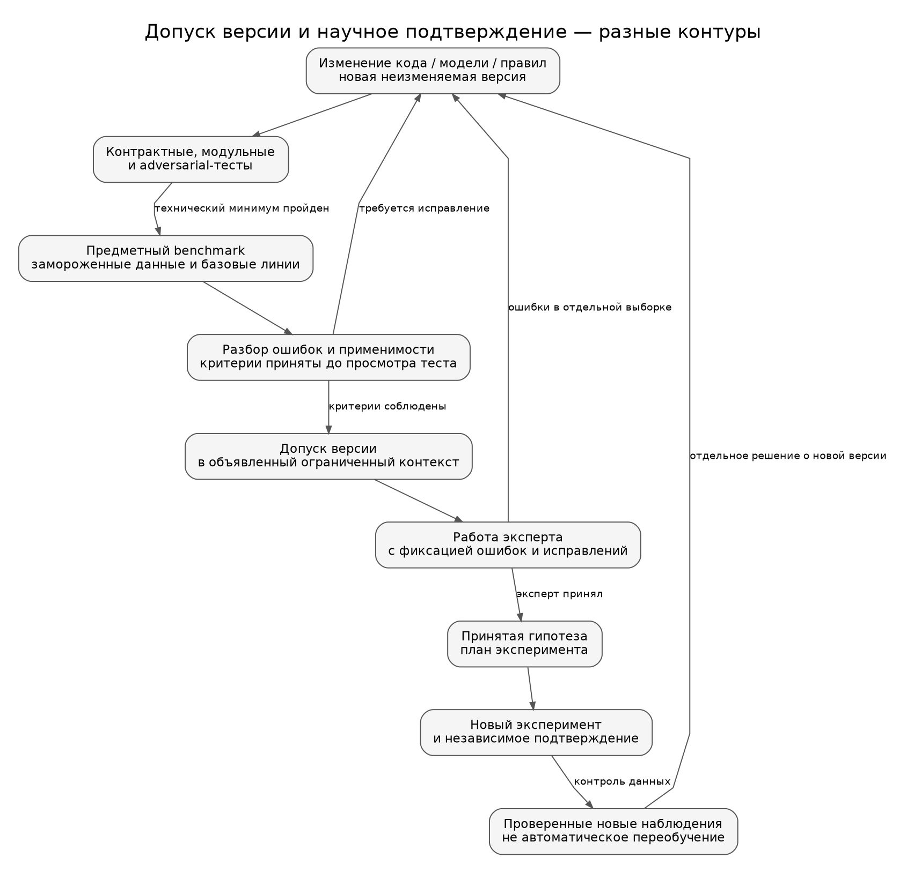

*Авторская проектная схема. Блоки и связи описывают предлагаемую систему, а не подтверждённую реализацию.* [SVG](diagrams/10_validation.svg) · [Mermaid](diagrams/10_validation.mmd) · [DOT](diagrams/10_validation.dot).

<details>
<summary>Редактируемая схема Mermaid — также сохранена внутри этого Markdown-файла</summary>

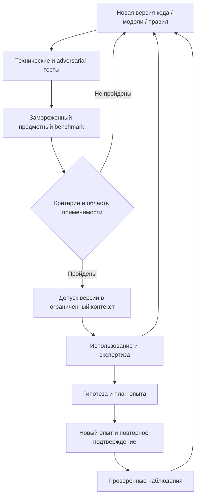

</details>


Предлагаются два независимых контура. Первый подтверждает, что версия программного продукта соответствует техническим и предметным критериям в заданной области. Второй проверяет, что выбранная гипотеза действительно даёт требуемый экспериментальный результат. Программный релиз не устанавливает эффективность нового препарата; удачный отдельный эксперимент не подтверждает качество всех функций платформы.

**Замораживание оценки.** До основного сравнения фиксируются кейсы, доступный корпус, версии инструментов, критерии, порядок экспертной оценки и бюджет. Обучение или подбор промпта на итоговом тесте переводит его в данные разработки; для нового окончательного вывода нужен другой тест. Рекомендации EMA отдельно обращают внимание на независимость тестирования и документирование работы с данными. [S07](#S07)

**Группировка данных.** Продуктовые кейсы разделяются с учётом вещества, родственных рецептур, форм и повторных экспериментов. Случайное разбиение строк одной публикации может не проверять перенос на новые случаи. Для молекулярного предиктора возможны собственные структурные разбиения, но они не заменяют продуктовую оценку всей системы.

**LLM-контаминация.** Временная граница доступных документов не доказывает, что модель не знает опубликованный ответ из обучения. Поэтому воспроизведение известных случаев, закрытые кейсы партнёра и проспективный этап должны быть обозначены отдельно. Это методологическое ограничение дизайна, уже принятое в этапе 2. [P03](#P03)

**Обновления.** Замена LLM, embedding-модели, parser, правил каталога или внешнего адаптера создаёт новую версию конфигурации. Оценка влияния определяет, какие тесты повторять. Нельзя сохранить прежнюю строку «качество подтверждено» после содержательной замены модели без рассмотрения изменения.

**Разбор ошибок.** Ошибка классифицируется по месту возникновения: идентичность, загрузка, извлечение, применение источника, вычисление, область модели, стратегия, ограничения, управление процессом или экспорт. Это позволяет исправлять конкретный слой, а не добавлять общий запрет в промпт после каждого инцидента.

## 4.8. Порядок реализации по проверяемым срезам

Порядок ниже — проектная последовательность без выдуманного календаря и оценки трудоёмкости. Каждый срез заканчивается демонстрируемым результатом и проверкой; он не требует одновременной реализации всех расширений.

| Срез | Что реализуется | Материальный результат | Условие перехода |
|---|---|---|---|
| **A. Контекст и происхождение** | M01–M05, базовые M18/M19 | Досье с версией продукта, наблюдениями и источниками | Идентичность, единицы, права и версии проходят тесты |
| **B. Первое полезное решение** | M06–M10, M13, M14 | Полный MD-отчёт по ограниченному классу кейсов | Есть слепое сравнение с базовыми режимами и разбор ошибок |
| **C. Количественная ветвь** | M11 и готовность к моделированию | Проверенный model package либо обоснованный отказ | Подтверждены входы, контекст и применимость модели |
| **D. Модификации и сложные формы** | Расширение M09, M12 | Кандидаты с отдельными идентичностями и источниковыми маршрутами | Новые типы имеют собственные контракты и негативные тесты |
| **E. Обновление и фактическая обратная связь** | M15, M16 | Изменения досье и принятые результаты опытов | Нет перезаписи истории и автоматического загрязнения обучающих данных |
| **F. Дополнительные исследования** | M17A/M17B | Ограниченные исследовательские карточки | Отдельный эксперт, корпус, область применения и критерии |

Важен порядок внутри первого среза: хранение происхождения и прав предшествует массовому добавлению предикторов. Иначе ранние результаты придётся восстанавливать задним числом, а проверка дипломной гипотезы будет зависеть от неполной истории.

## 4.9. Открытые решения и безопасные исходные предположения

Неизвестные организационные сведения нельзя превратить в факты архитектуры. Для каждого указано, какое решение предлагается до уточнения и что изменится после него.

| Неустановленное обстоятельство | Принятое для проектирования допущение | Что требуется перед внедрением |
|---|---|---|
| Реальное назначение в регулируемом процессе | Исследовательская поддержка, не автономный выпуск продукта | Документированная область применения и требования к записям |
| Первый рынок регистрации | Не задан; справки привязаны к явно выбранной юрисдикции | Выбор рынка и профиль правил с экспертом |
| Полнота данных партнёра | Может быть частичной | Перечень разрешённых данных, идентификаторов и протоколов |
| Внешняя передача структур и документов | Запрещена, пока явно не разрешена | Договор, политика и техническая проверка маршрута данных |
| UI/SSO большой платформы | Контрактная граница без предположения о конкретном провайдере | Схема аутентификации и ролей команды компании |
| Платные предикторы и базы | Не обязательны для базового среза | Лицензии на использование, экспорт и повторную оценку |
| Доступность лаборатории | Внешний человеко-управляемый цикл | Формат протокола, ответственность и возможность повторных измерений |
| Нагрузка и инфраструктура | Ограниченный внутренний пилот без обещания SLO | Нагрузочные данные, ресурсный бюджет и план восстановления |
| Шкала экспертного принятия | Проектные статусы из отчёта | Калибровка критериев и процедура разрешения разногласий |

Это не причины откладывать проектирование: для них предусмотрены явные границы и отказ от неподтверждённых действий. Но они являются причинами **не утверждать**, что уже выбраны окончательная юридическая модель, коммерческие лицензии и промышленный SLA.

## 4.10. Что входит в данный комплект и что действительно проверено

Комплект содержит полный отчёт, аннотированный реестр источников, десять проектных схем в PNG/SVG с исходниками Mermaid/DOT, пять JSON Schema, пять синтетических JSON-примеров, ограниченный фрагмент OpenAPI и воспроизводимые скрипты сборки/проверки.

В этой работе локально проверены корректность пяти схем JSON Schema 2020-12, пять положительных примеров, набор отрицательных и межполевых примеров, а также чтение YAML и разрешение внутренних ссылок фрагмента OpenAPI. Фактические результаты сохранены в [qa/contracts_check.json](qa/contracts_check.json). Это проверка контрактных материалов, **не развернутого API и не научных моделей**. Полный сторонний OpenAPI conformance validator не запускался.

Текст и схемы проверены на наличие четырёх глав, локальные ссылки, существование артефактов и соответствие перечисления модулей. В основном отчёте все внешние источники имеют прямые адреса в реестре. Ограничения веб-доступа указаны по источникам; наличие ссылки не изображается доказательством её вечной доступности или успешного промышленного соединения.

Дополнительная пакетная GET-проверка адресов из среды исполнения оказалась недоступна из-за DNS-ограничения: запросы не достигли сайтов. Это отмечено в `qa/link_audit.json` и не трактуется как неисправность источников. Содержательная веб-проверка проводилась отдельным инструментом просмотра; её объём и ограничения отражены в реестре.

Прототип платформы, лабораторные опыты, многопользовательский сервер, PBPK-вычисления и промышленный аудит безопасности на данном этапе не выполнялись. Их ожидаемые результаты и условия приёмки спроектированы выше. Архитектура считается описанной не потому, что на схеме нарисован ИИ-блок, а потому, что для каждого существенного результата определены **вход, владелец, происхождение, область допустимого применения, отказ и проверка**.


<a id="references"></a>
# Приложение. Аннотированный реестр источников

**Дата проверки: 18 октября 2026 года.** Первичные документы используются в пределах явно указанной области. Документация изменяемого сервиса не доказывает успешную интеграцию. «Прочитано» означает просмотр указанного материала или релевантных разделов, а не аудит исходного кода, всей научной литературы либо всех нормативных требований. Дополнительные URL одного документа не являются независимыми доказательствами.

## Материалы проекта

<a id="P01"></a>
**[P01] Техническое задание DESCR(1).md.** Предоставлено пользователем. [Локальная копия](basis/DESCR.md). Источник требований, не научное доказательство.

<a id="P02"></a>
**[P02] Принятый отчёт этапа 1 в переписке и его реестр источников.** 17.10.2026. [Реестр](basis/sources_stage1.md). Сам отчёт этапа 1 находится в переписке, отдельный несуществующий файл не подменяется реконструкцией.

<a id="P03"></a>
**[P03] Полный Markdown-отчёт этапа 2.** 18.10.2026. [Отчёт](basis/report_stage2.md), [реестр](basis/sources_stage2.md). Источник предыдущих проектных выводов и рыночного сравнения; численные результаты повторно в новом отчёте не переинтерпретируются.

## Внешние первоисточники

<a id="S01"></a>
### S01. FDA. ICH Q8(R2): Pharmaceutical Development

**Ссылка:** [https://www.fda.gov/regulatory-information/search-fda-guidance-documents/q8r2-pharmaceutical-development](https://www.fda.gov/regulatory-information/search-fda-guidance-documents/q8r2-pharmaceutical-development)

**Дата / версия / статус:** Final; ноябрь 2009.

**Тип:** Регуляторное руководство.

**Что просмотрено:** Официальная страница и PDF; просмотрена страница с элементами фармацевтической разработки.

**Основание для архитектуры:** Целевой профиль продукта, критические характеристики качества, связь свойств материалов и процесса с результатом.

**Предел использования:** Не предписывает выбранный программный стек и не подтверждает пригодность будущей платформы.

**Дополнительное официальное представление:** [https://www.fda.gov/media/71535/download](https://www.fda.gov/media/71535/download).

<a id="S02"></a>
### S02. FDA. ICH Q9(R1): Quality Risk Management

**Ссылка:** [https://www.fda.gov/regulatory-information/search-fda-guidance-documents/q9r1-quality-risk-management](https://www.fda.gov/regulatory-information/search-fda-guidance-documents/q9r1-quality-risk-management)

**Дата / версия / статус:** Final; май 2023.

**Тип:** Регуляторное руководство.

**Что просмотрено:** Официальная страница и PDF; просмотрены положения о субъективности и неопределённости.

**Основание для архитектуры:** Управление рисками качества и необходимость учитывать неопределённость и субъективность оценок.

**Предел использования:** Проектная классификация рисков в этом отчёте не является дословной шкалой ICH.

**Дополнительное официальное представление:** [https://www.fda.gov/media/167721/download](https://www.fda.gov/media/167721/download).

<a id="S03"></a>
### S03. FDA. ICH M9: Biopharmaceutics Classification System-Based Biowaivers

**Ссылка:** [https://www.fda.gov/regulatory-information/search-fda-guidance-documents/m9-biopharmaceutics-classification-system-based-biowaivers](https://www.fda.gov/regulatory-information/search-fda-guidance-documents/m9-biopharmaceutics-classification-system-based-biowaivers)

**Дата / версия / статус:** Final; май 2021.

**Тип:** Регуляторное руководство.

**Что просмотрено:** Официальная страница; предметная интерпретация согласована с первым этапом.

**Основание для архитектуры:** Область BCS-биовейвера; необходимость соответствующих данных.

**Предел использования:** В отчёте не утверждается, что один in silico прогноз устанавливает регуляторный BCS или право на биовейвер.

<a id="S04"></a>
### S04. FDA. ICH M13A: Bioequivalence for Immediate-Release Solid Oral Dosage Forms

**Ссылка:** [https://www.fda.gov/regulatory-information/search-fda-guidance-documents/m13a-bioequivalence-immediate-release-solid-oral-dosage-forms](https://www.fda.gov/regulatory-information/search-fda-guidance-documents/m13a-bioequivalence-immediate-release-solid-oral-dosage-forms)

**Дата / версия / статус:** Final; октябрь 2024.

**Тип:** Регуляторное руководство.

**Что просмотрено:** Официальная страница.

**Основание для архитектуры:** Отдельный контекст задачи биоэквивалентности пероральных форм в области действия документа.

**Предел использования:** Не распространяется автоматически на все пути введения, формы и клинические ситуации.

<a id="S05"></a>
### S05. FDA. ICH M15: General Principles for Model-Informed Drug Development

**Ссылка:** [https://www.fda.gov/regulatory-information/search-fda-guidance-documents/m15-general-principles-model-informed-drug-development](https://www.fda.gov/regulatory-information/search-fda-guidance-documents/m15-general-principles-model-informed-drug-development)

**Дата / версия / статус:** Final; июнь 2026.

**Тип:** Регуляторное руководство.

**Что просмотрено:** Официальная страница, текст PDF и изображения страниц с определениями и таблицей оценки.

**Основание для архитектуры:** Вопрос исследования, context of use, влияние модели, последствия неправильного решения, план оценки и документация MIDD.

**Предел использования:** Не автоматическая сертификация ПО. Поля и статусы предлагаемых контрактов — адаптация автора.

**Дополнительное официальное представление:** [https://www.fda.gov/media/184747/download](https://www.fda.gov/media/184747/download).

<a id="S06"></a>
### S06. FDA. Considerations for the Use of Artificial Intelligence to Support Regulatory Decision-Making for Drug and Biological Products

**Ссылка:** [https://www.fda.gov/regulatory-information/search-fda-guidance-documents/considerations-use-artificial-intelligence-support-regulatory-decision-making-drug-and-biological](https://www.fda.gov/regulatory-information/search-fda-guidance-documents/considerations-use-artificial-intelligence-support-regulatory-decision-making-drug-and-biological)

**Дата / версия / статус:** Draft; январь 2025; проверен статус 18.10.2026.

**Тип:** Проект регуляторного руководства.

**Что просмотрено:** Официальная страница, PDF, изображение страницы с этапами оценки доверия.

**Основание для архитектуры:** Риск-ориентированная оценка доверия к AI для заявленного контекста использования.

**Предел использования:** Draft / Not for implementation. Не представлять как окончательное обязательное требование к каждому исследовательскому приложению.

**Дополнительное официальное представление:** [https://www.fda.gov/media/184830/download](https://www.fda.gov/media/184830/download).

<a id="S07"></a>
### S07. EMA. Reflection paper on the use of artificial intelligence in the medicinal product lifecycle

**Ссылка:** [https://www.ema.europa.eu/en/scientific-guidelines/use-artificial-intelligence-ai-medicinal-product-lifecycle](https://www.ema.europa.eu/en/scientific-guidelines/use-artificial-intelligence-ai-medicinal-product-lifecycle)

**Дата / версия / статус:** Принят 30.09.2024.

**Тип:** Документ регулятора — reflection paper.

**Что просмотрено:** Официальная страница и PDF; просмотрены положения о данных и независимой оценке.

**Основание для архитектуры:** Разделение обучающих и тестовых данных, контроль смещений, документация и применимость результатов.

**Предел использования:** Не закон и не основание для заявления о соответствии всему регуляторному режиму.

**Дополнительное официальное представление:** [https://www.ema.europa.eu/en/documents/scientific-guideline/reflection-paper-use-artificial-intelligence-ai-medicinal-product-lifecycle_en.pdf](https://www.ema.europa.eu/en/documents/scientific-guideline/reflection-paper-use-artificial-intelligence-ai-medicinal-product-lifecycle_en.pdf).

<a id="S08"></a>
### S08. FDA. ICH Q1A(R2): Stability Testing of New Drug Substances and Products

**Ссылка:** [https://www.fda.gov/regulatory-information/search-fda-guidance-documents/q1ar2-stability-testing-new-drug-substances-and-products](https://www.fda.gov/regulatory-information/search-fda-guidance-documents/q1ar2-stability-testing-new-drug-substances-and-products)

**Дата / версия / статус:** Final; 2003.

**Тип:** Регуляторное руководство.

**Что просмотрено:** Официальная страница.

**Основание для архитектуры:** Стабильность продукта — самостоятельный предмет испытаний.

**Предел использования:** Из названия эксципиента или расчётной характеристики нельзя вывести установленный срок годности.

<a id="S09"></a>
### S09. EMA. ICH Q1 guideline on stability testing of drug substances and drug products

**Ссылка:** [https://www.ema.europa.eu/en/scientific-guidelines/ich-q1-guideline-stability-testing-drug-substances-drug-products](https://www.ema.europa.eu/en/scientific-guidelines/ich-q1-guideline-stability-testing-drug-substances-drug-products)

**Дата / версия / статус:** На проверенной странице: Draft, Step 2b; опубликован 30.04.2025.

**Тип:** Проект обновлённого руководства.

**Что просмотрено:** Прочитана официальная карточка статуса.

**Основание для архитектуры:** Наличие проекта консолидированного Q1 и необходимость версионирования правил.

**Предел использования:** Закрытие консультации не означает вступление окончательной версии в силу; не объявляется действующей заменой всех прежних Q1.

<a id="S10"></a>
### S10. FDA. Part 11, Electronic Records; Electronic Signatures — Scope and Application

**Ссылка:** [https://www.fda.gov/regulatory-information/search-fda-guidance-documents/part-11-electronic-records-electronic-signatures-scope-and-application](https://www.fda.gov/regulatory-information/search-fda-guidance-documents/part-11-electronic-records-electronic-signatures-scope-and-application)

**Дата / версия / статус:** Guidance; сентябрь 2003.

**Тип:** Официальное разъяснение области применения.

**Что просмотрено:** Прочитано официальное описание и текст руководства на странице.

**Основание для архитектуры:** Применимость Part 11 зависит от регулируемых электронных записей и контекста использования.

**Предел использования:** Наличие журналов или кнопки согласования не делает исследовательский прототип Part 11-compliant.

<a id="S11"></a>
### S11. ISO/IEC/IEEE 42010:2022 — Architecture description

**Ссылка:** [https://www.iso.org/standard/74393.html](https://www.iso.org/standard/74393.html)

**Дата / версия / статус:** Издание 2; ноябрь 2022.

**Тип:** Международный стандарт, публичная карточка.

**Что просмотрено:** Прочитана публичная аннотация ISO, не платный полный текст.

**Основание для архитектуры:** Описание архитектуры через заинтересованные стороны, интересы и представления; стандарт не задаёт единственную архитектуру.

**Предел использования:** Полное нормативное соответствие не проверено и не заявляется.

<a id="S12"></a>
### S12. ISO/IEC 25010:2023 — Product quality model

**Ссылка:** [https://www.iso.org/standard/78176.html](https://www.iso.org/standard/78176.html)

**Дата / версия / статус:** 2023.

**Тип:** Международный стандарт, публичная карточка.

**Что просмотрено:** Прочитана публичная аннотация ISO, не платный полный текст.

**Основание для архитектуры:** Модель качества программного продукта; опубликованная редакция описывает девять характеристик.

**Предел использования:** Предложенные ниже NFR не выдаются за дословную полную таблицу стандарта.

<a id="S13"></a>
### S13. C4 model — System context and container diagrams

**Ссылка:** [https://c4model.com/diagrams/container](https://c4model.com/diagrams/container)

**Дата / версия / статус:** Действующая веб-документация; проверка 18.10.2026.

**Тип:** Документация авторов метода.

**Что просмотрено:** Прочитаны страницы context, container, component.

**Основание для архитектуры:** Разделение уровня системы, исполняемых приложений/хранилищ и внутренних компонентов.

**Предел использования:** C4 container не равен Docker-контейнеру; C4 не подтверждает научную пригодность системы.

**Дополнительное официальное представление:** [https://c4model.com/diagrams/system-context](https://c4model.com/diagrams/system-context); [https://c4model.com/diagrams/component](https://c4model.com/diagrams/component).

<a id="S14"></a>
### S14. W3C. PROV-DM: The PROV Data Model

**Ссылка:** [https://www.w3.org/TR/prov-dm/](https://www.w3.org/TR/prov-dm/)

**Дата / версия / статус:** W3C Recommendation; 30.04.2013.

**Тип:** Открытая спецификация.

**Что просмотрено:** Прочитаны определения сущностей, действий, агентов и связей происхождения.

**Основание для архитектуры:** Концептуальная модель происхождения данных.

**Предел использования:** Отчёт предлагает отображение на собственную схему; не заявляет полную PROV-совместимость и не требует графовую СУБД.

<a id="S15"></a>
### S15. The Unified Code for Units of Measure — UCUM

**Ссылка:** [https://ucum.org/ucum](https://ucum.org/ucum)

**Дата / версия / статус:** Версия 2.2; 17.06.2024.

**Тип:** Официальная спецификация единиц.

**Что просмотрено:** Прочитана официальная спецификация, разделы об обозначениях и аннотациях.

**Основание для архитектуры:** Машиночитаемые единицы и размерностная нормализация.

**Предел использования:** UCUM не заменяет сведения о химическом основании дозы, методе или типе массовой доли.

<a id="S16"></a>
### S16. JSON Schema — Draft 2020-12

**Ссылка:** [https://json-schema.org/draft/2020-12](https://json-schema.org/draft/2020-12)

**Дата / версия / статус:** Draft 2020-12; опубликованные спецификации 2022.

**Тип:** Официальная спецификация.

**Что просмотрено:** Прочитаны обзор, core/validation и назначение ключевых слов.

**Основание для архитектуры:** Контракты структуры сообщений, required, enum, композиция и валидация.

**Предел использования:** Структурная корректность JSON не доказывает научную истинность; format должен явно проверяться используемым валидатором.

**Дополнительное официальное представление:** [https://json-schema.org/draft/2020-12/json-schema-validation](https://json-schema.org/draft/2020-12/json-schema-validation).

<a id="S17"></a>
### S17. OpenAPI Specification 3.2.1 и 3.1.2

**Ссылка:** [https://spec.openapis.org/oas/v3.2.1.html](https://spec.openapis.org/oas/v3.2.1.html)

**Дата / версия / статус:** 3.2.1: 10.09.2026; для проекта выбран контракт 3.1.2.

**Тип:** Официальная спецификация.

**Что просмотрено:** Прочитаны обе опубликованные версии и разделение версии спецификации и API.

**Основание для архитектуры:** Формализованное описание HTTP API.

**Предел использования:** Выбор 3.1.2 — намеренное проектное решение для первичного инструментария, не утверждение, что это последняя версия.

**Дополнительное официальное представление:** [https://spec.openapis.org/oas/v3.1.2.html](https://spec.openapis.org/oas/v3.1.2.html).

<a id="S18"></a>
### S18. IETF. RFC 9457 — Problem Details for HTTP APIs

**Ссылка:** [https://www.rfc-editor.org/rfc/rfc9457.html](https://www.rfc-editor.org/rfc/rfc9457.html)

**Дата / версия / статус:** Июль 2023.

**Тип:** Открытый интернет-стандарт.

**Что просмотрено:** Прочитаны поля ответа об ошибке и ограничения раскрытия деталей.

**Основание для архитектуры:** Единый формат ошибок HTTP API.

**Предел использования:** Конкретные коды предметных ошибок в отчёте — проектные.

<a id="S19"></a>
### S19. IETF. RFC 9110 — HTTP Semantics

**Ссылка:** [https://www.rfc-editor.org/rfc/rfc9110.html](https://www.rfc-editor.org/rfc/rfc9110.html)

**Дата / версия / статус:** Июнь 2022.

**Тип:** Открытый интернет-стандарт.

**Что просмотрено:** Прочитаны относящиеся к проекту положения о 202 и условных запросах.

**Основание для архитектуры:** 202 Accepted не означает завершения; условное обновление версии ресурса.

**Предел использования:** Схема job/lease/idempotency — проектная реализация поверх HTTP, а не автоматическая гарантия RFC.

<a id="S20"></a>
### S20. PostgreSQL 18 — Row Security Policies

**Ссылка:** [https://www.postgresql.org/docs/18/ddl-rowsecurity.html](https://www.postgresql.org/docs/18/ddl-rowsecurity.html)

**Дата / версия / статус:** Документация ветки 18; проверка 18.10.2026.

**Тип:** Официальная документация.

**Что просмотрено:** Прочитаны политики RLS и исключения для владельца, superuser, BYPASSRLS.

**Основание для архитектуры:** Ограничения на уровне строк и условия обхода политик.

**Предел использования:** RLS не заменяет авторизацию приложения, безопасность файлов, индексов и процессов.

<a id="S21"></a>
### S21. PostgreSQL 18 — SELECT / SKIP LOCKED

**Ссылка:** [https://www.postgresql.org/docs/18/sql-select.html](https://www.postgresql.org/docs/18/sql-select.html)

**Дата / версия / статус:** Документация ветки 18; проверка 18.10.2026.

**Тип:** Официальная документация.

**Что просмотрено:** Прочитана семантика SKIP LOCKED и оговорка о queue-like tables.

**Основание для архитектуры:** Примитив для конкурентного получения задач из очереди.

**Предел использования:** Не готовый движок долговременных процессов и не гарантия exactly-once.

<a id="S22"></a>
### S22. pgvector — official repository and documentation

**Ссылка:** [https://github.com/pgvector/pgvector](https://github.com/pgvector/pgvector)

**Дата / версия / статус:** Изменяемая документация; проверка 18.10.2026.

**Тип:** Первичный репозиторий проекта.

**Что просмотрено:** Прочитаны exact/approximate search и фильтрация результатов индекса.

**Основание для архитектуры:** Векторный поиск в PostgreSQL; ограничения полноты при приближённом поиске с фильтрами.

**Предел использования:** В проекте не зафиксирована непроверенная версия расширения; безопасность и recall проверяются отдельно.

<a id="S23"></a>
### S23. FastAPI — Background Tasks

**Ссылка:** [https://fastapi.tiangolo.com/tutorial/background-tasks/](https://fastapi.tiangolo.com/tutorial/background-tasks/)

**Дата / версия / статус:** Изменяемая документация; проверка 18.10.2026.

**Тип:** Официальная документация.

**Что просмотрено:** Прочитан раздел Caveat о тяжёлых фоновых задачах.

**Основание для архитектуры:** Отделение простых задач после ответа от тяжёлых процессов.

**Предел использования:** BackgroundTasks не предлагается как долговременная очередь с восстановлением после сбоя.

<a id="S24"></a>
### S24. Pydantic — Strict mode

**Ссылка:** [https://docs.pydantic.dev/latest/concepts/strict_mode/](https://docs.pydantic.dev/latest/concepts/strict_mode/)

**Дата / версия / статус:** Изменяемая документация; проверка 18.10.2026.

**Тип:** Официальная документация.

**Что просмотрено:** Прочитан strict mode; исходный URL перенаправляет на текущую документацию.

**Основание для архитектуры:** Контроль приведения типов при проверке входа.

**Предел использования:** Strict mode имеет особенности для JSON и не заменяет предметные проверки единиц и научного смысла.

<a id="S25"></a>
### S25. OpenTelemetry — Signals

**Ссылка:** [https://opentelemetry.io/docs/concepts/signals/](https://opentelemetry.io/docs/concepts/signals/)

**Дата / версия / статус:** Изменяемая документация; проверка 18.10.2026.

**Тип:** Официальная документация.

**Что просмотрено:** Прочитано описание метрик, трассировок и журналов.

**Основание для архитектуры:** Техническая наблюдаемость приложения.

**Предел использования:** Трассировка не равна научному происхождению, аудиту решений или регуляторной валидации.

<a id="S26"></a>
### S26. OWASP Application Security Verification Standard

**Ссылка:** [https://owasp.org/projects/asvs](https://owasp.org/projects/asvs)

**Дата / версия / статус:** Стабильная редакция 5.0.0; 30.05.2025.

**Тип:** Открытый стандарт проверки безопасности сообщества OWASP.

**Что просмотрено:** Прочитаны страница проекта и сведения о релизе, не весь каталог требований.

**Основание для архитектуры:** Основание для явного плана проверок безопасности веб-приложения.

**Предел использования:** Соответствие ASVS не заявляется; нужен перечень применимых требований и реальные тесты.

**Дополнительное официальное представление:** [https://github.com/OWASP/ASVS/releases](https://github.com/OWASP/ASVS/releases).

<a id="S27"></a>
### S27. OWASP Top 10 for LLM Applications — LLM01:2025 Prompt Injection

**Ссылка:** [https://genai.owasp.org/llmrisk/llm01-prompt-injection/](https://genai.owasp.org/llmrisk/llm01-prompt-injection/)

**Дата / версия / статус:** Редакция 2025.

**Тип:** Первичная документация проекта безопасности.

**Что просмотрено:** Прочитаны механизмы prompt injection и ограничения мер защиты.

**Основание для архитектуры:** Внешние документы могут содержать управляющие инструкции; RAG сам по себе не устраняет риск.

**Предел использования:** Предлагаемые ограничения инструментов снижают риск, но не дают абсолютной защиты.

<a id="S28"></a>
### S28. OWASP — Server-Side Request Forgery Prevention Cheat Sheet

**Ссылка:** [https://cheatsheetseries.owasp.org/cheatsheets/Server_Side_Request_Forgery_Prevention_Cheat_Sheet.html](https://cheatsheetseries.owasp.org/cheatsheets/Server_Side_Request_Forgery_Prevention_Cheat_Sheet.html)

**Дата / версия / статус:** Изменяемая документация; проверка 18.10.2026.

**Тип:** Первичная документация безопасности.

**Что просмотрено:** Прочитаны меры ограничения назначения сетевых запросов.

**Основание для архитектуры:** Контроль URL, IP, перенаправлений и доступа к внутренним ресурсам.

**Предел использования:** Проектная сетевая политика должна быть проверена тестами и инфраструктурой.

<a id="S29"></a>
### S29. OWASP — File Upload Cheat Sheet

**Ссылка:** [https://cheatsheetseries.owasp.org/cheatsheets/File_Upload_Cheat_Sheet.html](https://cheatsheetseries.owasp.org/cheatsheets/File_Upload_Cheat_Sheet.html)

**Дата / версия / статус:** Изменяемая документация; проверка 18.10.2026.

**Тип:** Первичная документация безопасности.

**Что просмотрено:** Прочитаны ограничения типов, размера, размещения и обработки файлов.

**Основание для архитектуры:** Недоверенные файлы следует проверять и обрабатывать отдельно от привилегированной части системы.

**Предел использования:** Успешная проверка расширения или MIME не доказывает безопасность содержимого.

<a id="S30"></a>
### S30. NCBI PubChem — PUG REST and programmatic access

**Ссылка:** [https://pubchem.ncbi.nlm.nih.gov/pcfe/docs/markdown/pug-rest.md](https://pubchem.ncbi.nlm.nih.gov/pcfe/docs/markdown/pug-rest.md)

**Дата / версия / статус:** Изменяемая документация; проверка 18.10.2026.

**Тип:** Официальная документация API.

**Что просмотрено:** HTML PUG REST возвращал защитную страницу; прочитано полное официальное Markdown-представление.

**Основание для архитектуры:** Контракт PUG REST, ограничение запросов, throttling, обработка форматов и ошибок.

**Предел использования:** Документация прочитана; интеграционный прогон нового адаптера не выполнялся.

**Дополнительное официальное представление:** [https://pubchem.ncbi.nlm.nih.gov/docs/programmatic-access](https://pubchem.ncbi.nlm.nih.gov/docs/programmatic-access); [https://pubchem.ncbi.nlm.nih.gov/pcfe/docs/markdown/programmatic-access.md](https://pubchem.ncbi.nlm.nih.gov/pcfe/docs/markdown/programmatic-access.md).

<a id="S31"></a>
### S31. NCBI PubChem — PUG View

**Ссылка:** [https://pubchem.ncbi.nlm.nih.gov/pug_view/](https://pubchem.ncbi.nlm.nih.gov/pug_view/)

**Дата / версия / статус:** Изменяемая документация; проверка 18.10.2026.

**Тип:** Официальная документация API.

**Что просмотрено:** Прочитано назначение сервиса аннотаций.

**Основание для архитектуры:** Извлечение аннотаций и их происхождения отдельно от вычисленных свойств.

**Предел использования:** Аннотация агрегатора не превращается автоматически в независимое первичное измерение.

<a id="S32"></a>
### S32. DailyMed REST API v2 — /spls

**Ссылка:** [https://dailymed.nlm.nih.gov/dailymed/webservices-help/v2/spls_api.cfm](https://dailymed.nlm.nih.gov/dailymed/webservices-help/v2/spls_api.cfm)

**Дата / версия / статус:** API v2; проверка 18.10.2026.

**Тип:** Официальная документация NLM.

**Что просмотрено:** Прочитаны параметры поиска и формат результатов.

**Основание для архитектуры:** Продуктовые записи SPL и документированный доступ.

**Предел использования:** Не гарантируется полный количественный состав всех продуктов.

<a id="S33"></a>
### S33. DailyMed REST API v2 — SPL history

**Ссылка:** [https://dailymed.nlm.nih.gov/dailymed/webservices-help/v2/spls_setid_history_api.cfm](https://dailymed.nlm.nih.gov/dailymed/webservices-help/v2/spls_setid_history_api.cfm)

**Дата / версия / статус:** API v2; проверка 18.10.2026.

**Тип:** Официальная документация NLM.

**Что просмотрено:** Прочитана история версий по SETID.

**Основание для архитектуры:** Привязка к конкретной версии инструкции.

**Предел использования:** Одна ссылка на актуальную страницу не заменяет снимок использованной версии.

<a id="S34"></a>
### S34. ChEMBL — Data Web Services

**Ссылка:** [https://chembl.gitbook.io/chembl-interface-documentation/web-services/chembl-data-web-services](https://chembl.gitbook.io/chembl-interface-documentation/web-services/chembl-data-web-services)

**Дата / версия / статус:** Изменяемая документация; проверка 18.10.2026.

**Тип:** Официальная документация EMBL-EBI.

**Что просмотрено:** Прочитана документация; Swagger-страница отдельно отдавала только JS-оболочку.

**Основание для архитектуры:** Сущности API, пагинация page_meta и переход по next.

**Предел использования:** Нельзя объявлять первую страницу полной выгрузкой; контекст assay сохраняется.

<a id="S35"></a>
### S35. RDKit — MolStandardize API

**Ссылка:** [https://www.rdkit.org/docs/source/rdkit.Chem.MolStandardize.rdMolStandardize.html](https://www.rdkit.org/docs/source/rdkit.Chem.MolStandardize.rdMolStandardize.html)

**Дата / версия / статус:** Документация 2026.09.1 на момент просмотра.

**Тип:** Официальная документация.

**Что просмотрено:** Прочитаны операции нормализации и FragmentParent.

**Основание для архитектуры:** Доступные операции химической стандартизации.

**Предел использования:** Удаление фрагментов меняет представление соли/комплекса; исходник и преобразования необходимо сохранять.

<a id="S36"></a>
### S36. FDA — Inactive Ingredients in Approved Drug Products: FAQ

**Ссылка:** [https://www.fda.gov/drugs/drug-approvals-and-databases/inactive-ingredients-approved-drug-products-search-frequently-asked-questions](https://www.fda.gov/drugs/drug-approvals-and-databases/inactive-ingredients-approved-drug-products-search-frequently-asked-questions)

**Дата / версия / статус:** Динамическая официальная документация; проверка 18.10.2026.

**Тип:** Регуляторная база и её пояснение.

**Что просмотрено:** Прочитаны пояснения maximum potency и maximum daily exposure.

**Основание для архитектуры:** Прецеденты эксципиентов с контекстом пути и формы.

**Предел использования:** Не универсальная таблица разрешённых безопасных доз; отсутствие записи не равно запрету.

<a id="S37"></a>
### S37. openFDA — Drug Adverse Events

**Ссылка:** [https://open.fda.gov/apis/drug/event/](https://open.fda.gov/apis/drug/event/)

**Дата / версия / статус:** Динамическая документация; проверка 18.10.2026.

**Тип:** Официальная документация FDA.

**Что просмотрено:** Прочитаны ограничения интерпретации.

**Основание для архитектуры:** Сообщения о нежелательных событиях и их использование для поиска сигналов.

**Предел использования:** Нельзя по одному подсчёту сообщений устанавливать причинность, частоту или эффективность сочетаний.

<a id="S38"></a>
### S38. FDA — Orange Book

**Ссылка:** [https://www.fda.gov/drugs/drug-approvals-and-databases/approved-drug-products-therapeutic-equivalence-evaluations-orange-book](https://www.fda.gov/drugs/drug-approvals-and-databases/approved-drug-products-therapeutic-equivalence-evaluations-orange-book)

**Дата / версия / статус:** Динамический реестр; проверка 18.10.2026.

**Тип:** Официальный источник FDA.

**Что просмотрено:** Прочитана официальная страница.

**Основание для архитектуры:** Продукты, терапевтическая эквивалентность, перечисленные патенты и эксклюзивность.

**Предел использования:** Не полное заключение о патентной свободе в любой юрисдикции.

<a id="S39"></a>
### S39. Государственный реестр лекарственных средств РФ

**Ссылка:** [https://grls.minzdrav.gov.ru/](https://grls.minzdrav.gov.ru/)

**Дата / версия / статус:** Динамический реестр; проверка 18.10.2026.

**Тип:** Официальный реестр.

**Что просмотрено:** Прочитана доступная официальная страница.

**Основание для архитектуры:** Российские регистрационные сведения и инструкции.

**Предел использования:** Публичный промышленный API не подтверждён. Предлагается контролируемый импорт при отсутствии проверенного контракта.

<a id="S40"></a>
### S40. Europe PMC — RESTful Web Service

**Ссылка:** [https://europepmc.org/RestfulWebService](https://europepmc.org/RestfulWebService)

**Дата / версия / статус:** Документация API; проверка 18.10.2026.

**Тип:** Официальная документация литературного сервиса.

**Что просмотрено:** Прямое открытие завершалось ошибкой доступа; доступно индексированное описание официального источника.

**Основание для архитектуры:** Назначение поиска метаданных и доступного полного текста.

**Предел использования:** Успешный запрос production API и полнотекстовые права каждой статьи в этом этапе не проверены; требуется интеграционный тест.

<a id="S41"></a>
### S41. Fu et al. ADMETlab 3.0

**Ссылка:** [https://pubmed.ncbi.nlm.nih.gov/38572755/](https://pubmed.ncbi.nlm.nih.gov/38572755/)

**Дата / версия / статус:** 2024; Nucleic Acids Research.

**Тип:** Первичная научная публикация разработчиков.

**Что просмотрено:** Библиографическое описание/аннотация, использованные также в этапе 2; текущая страница ограниченно отдаёт текст.

**Основание для архитектуры:** Наличие ADMET-предикторов, программного доступа и оценок неопределённости в публикации.

**Предел использования:** Текущий контракт API, SLA и право коммерческой интеграции не установлены одной статьёй.

<a id="S42"></a>
### S42. Open Systems Pharmacology — OSPSuite-R

**Ссылка:** [https://www.open-systems-pharmacology.org/OSPSuite-R/](https://www.open-systems-pharmacology.org/OSPSuite-R/)

**Дата / версия / статус:** Действующая документация; проверка 18.10.2026.

**Тип:** Официальная техническая документация.

**Что просмотрено:** Прочитаны назначение пакета, запуск симуляций и зависимости.

**Основание для архитектуры:** Загрузка и выполнение моделей PK-Sim/MoBi из R.

**Предел использования:** Совместимость конкретного runner-image с моделями необходимо проверять; не приписывается одинаковая поддержка всем GUI и workflow.

<a id="S43"></a>
### S43. Open Systems Pharmacology — Qualification workflow

**Ссылка:** [https://docs.open-systems-pharmacology.org/shared-tools-and-example-workflows/qualification](https://docs.open-systems-pharmacology.org/shared-tools-and-example-workflows/qualification)

**Дата / версия / статус:** Действующая документация; проверка 18.10.2026.

**Тип:** Официальная документация.

**Что просмотрено:** Прочитаны планы, наблюдения, запуск и отчёт квалификации.

**Основание для архитектуры:** Воспроизводимый контур проверки моделей в заданном сценарии.

**Предел использования:** Документация ограничивает поддерживаемые типы проектов; поддержка MoBi в других компонентах не означает автоматическую поддержку данного workflow.

<a id="S44"></a>
### S44. MolecularAI — AiZynthFinder

**Ссылка:** [https://github.com/MolecularAI/aizynthfinder](https://github.com/MolecularAI/aizynthfinder)

**Дата / версия / статус:** Изменяемый первичный репозиторий; проверка 18.10.2026.

**Тип:** Код и документация разработчиков.

**Что просмотрено:** Прочитаны назначение, конфигурации и условия лицензии кода.

**Основание для архитектуры:** Ретросинтетический поиск, модели и исходные вещества как отдельные входы.

**Предел использования:** MIT кода не определяет автоматически права всех весов/данных и не подтверждает практический синтез.

<a id="S45"></a>
### S45. OECD. (Q)SAR Assessment Framework, Second Edition

**Ссылка:** [https://www.oecd.org/en/publications/q-sar-assessment-framework-guidance-for-the-regulatory-assessment-of-quantitative-structure-activity-relationship-models-and-predictions-second-edition_bbdac345-en.html](https://www.oecd.org/en/publications/q-sar-assessment-framework-guidance-for-the-regulatory-assessment-of-quantitative-structure-activity-relationship-models-and-predictions-second-edition_bbdac345-en.html)

**Дата / версия / статус:** Второе издание; 15.11.2024; DOI 10.1787/bbdac345-en.

**Тип:** Руководство OECD.

**Что просмотрено:** Прочитана официальная аннотация, не полный многостраничный текст.

**Основание для архитектуры:** Раздельная оценка модели, отдельного прогноза и совокупности прогнозов.

**Предел использования:** Не заявляется полное прохождение QAF будущими предикторами.

<a id="S46"></a>
### S46. FDA. Liposome Drug Products: CMC; Human Pharmacokinetics and Bioavailability; Labeling

**Ссылка:** [https://www.fda.gov/regulatory-information/search-fda-guidance-documents/liposome-drug-products-chemistry-manufacturing-and-controls-human-pharmacokinetics-and](https://www.fda.gov/regulatory-information/search-fda-guidance-documents/liposome-drug-products-chemistry-manufacturing-and-controls-human-pharmacokinetics-and)

**Дата / версия / статус:** Final; апрель 2018.

**Тип:** Специализированное регуляторное руководство.

**Что просмотрено:** Прочитана официальная карточка и область применения.

**Основание для архитектуры:** Специфичность сложных систем доставки и необходимости CMC/PK-данных.

**Предел использования:** Не общий универсальный протокол для всех парентеральных форм.

<a id="S47"></a>
### S47. ChEMBL Structure Pipeline

**Ссылка:** [https://github.com/chembl/ChEMBL_Structure_Pipeline](https://github.com/chembl/ChEMBL_Structure_Pipeline)

**Дата / версия / статус:** Изменяемый первичный репозиторий; проверка 18.10.2026.

**Тип:** Код и документация EMBL-EBI.

**Что просмотрено:** Прочитано разделение checker, standardizer и getParent.

**Основание для архитектуры:** Поэтапная химическая проверка и нормализация, а не одно недокументированное преобразование.

**Предел использования:** Получение родительской структуры не устанавливает идентичность конечного продукта.

